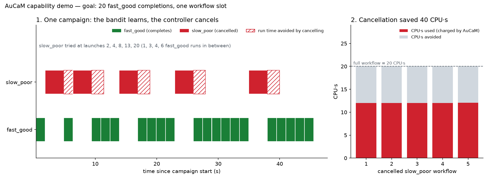

# AuCaM — Autonomous Campaign Manager

AuCaM runs a scientific campaign on HPC within its budget. A **campaign**
pursues one scientific goal through many **workflows** (simulation runs,
analyses, …). You describe the workflows, the decision logic and the
limits; AuCaM launches the workflows, watches their results while they run, and
acts on them.

What AuCaM does:

- **Steers the campaign from live results** — a controller (built-in rules,
  an ADR policy, or your own code) decides which workflows to launch and which
  to cancel, every policy cycle and whenever a workflow finishes.
- **Learns what to run** — the scheduler (a UCB1 bandit) favours
  workflow types that complete and explores less as the budget runs down.
- **Learns how much each workflow gets** — every workflow starts with its own
  spending limit and CPUs / GPUs, sized from what earlier workflows of its type
  used, within the campaign's capacity; a campaign can plug in its own sizing.
- **Keeps spending within limits** — every workflow is charged (CPU-hours,
  GPU-hours or any other dimension) in one ledger, a workflow that passes its
  own limit is cancelled, and the campaign stops launching at its limit.
- **Runs any workflow** — Python functions or command-line programs in any
  language, on AsyncFlow and RHAPSODY backends, from a laptop to an HPC
  allocation.
- **Returns the outcome** — when the campaign ends, `run()` returns its
  outcome (exit reason, counts, spending, the controller's summary), so a
  script or an agent can plan the next campaign.



*The campaign cancels poor workflows and learns to avoid them (see
[the capability demo](docs/cm-advantages.md)).*

---

## Install

```bash
pip install -e .                          # core (Python ≥ 3.11)
pip install -e ".[telemetry]"             # + OpenTelemetry + GPU metrics
pip install -e ".[dragon]"                # + Dragon/RADICAL HPC backend
pip install -e ".[dragon,telemetry]"      # HPC + telemetry
pip install -e ".[dev]"                   # + pytest, ruff, coverage
```

## Hello world

```python
import asyncio
import random

from src.aucam import (
    CampaignBudget,
    CampaignController,
    CampaignManager,
    CampaignSpec,
    WorkflowConfig,
    WorkflowReporter,
)


async def my_sim(reporter: WorkflowReporter) -> None:
    for step in range(5):
        await asyncio.sleep(0.05)
        await reporter.emit(score=random.random(), iteration=step)


spec = CampaignSpec(
    name="hello",
    budget=CampaignBudget(
        max_concurrent_workflows=4, max_concurrency_per_workflow=4, capacity={"cpus": 8}
    ),
    controller=CampaignController(launch=["sim"], goal_type="sim", goal_n=10),
    workflows=[WorkflowConfig(name="sim", block=my_sim)],
    policy_interval_s=0.5,
)


async def main() -> None:
    outcome = await CampaignManager().run(spec)  # returns when the campaign ends
    print(outcome.exit_reason, outcome.completed, outcome.elapsed_s)


asyncio.run(main())
```

---

## Documentation

| Doc | For | What it covers |
|---|---|---|
| [Architecture overview](docs/architecture-overview.md) | Everyone | Concepts, components and design decisions, without code |
| [Demo campaign guide](docs/demo-campaign-guide.md) | New users | Run a demo campaign in a few minutes |
| [Capability demo](docs/cm-advantages.md) | Everyone | What AuCaM adds, shown on one campaign |
| [Campaign developer guide](docs/campaign-developer-guide.md) | Campaign authors | Workflows, controllers, scheduling, budgets, running campaigns |
| [Budgets and spending](docs/budget.md) | Campaign authors | How spending is measured, limited and reported |
| [Code walkthrough](docs/code-walkthrough.md) | Contributors | Module map and main code paths |
| [Known gaps](docs/known-gaps.md) | Contributors | What is planned or not implemented yet |

---

## Running tests

```bash
pytest                   # full suite
pytest -m "not slow"     # skip slow integration tests
pytest --cov=src         # with coverage

ruff check --no-fix .    # lint (pyproject sets fix = true; plain `ruff check .` edits files)
ruff format --check .    # formatting
```

---

## License

MIT — see [LICENSE](LICENSE).
