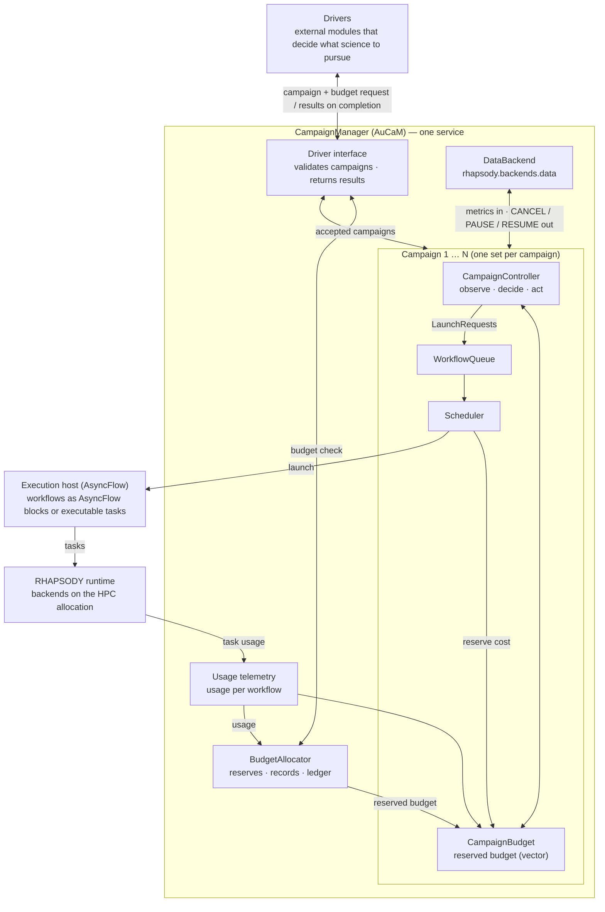

<!-- Source: "AuCaM Design v2-6" (Word), converted to Markdown for agents. Diagram: aucam-architecture.png (Mermaid version inline). -->

# Autonomous Campaign Manager

## Overview

A campaign pursues one scientific hypothesis or direction and consists of multiple scientific workflows, which may run concurrently across one or more execution environments. Campaigns are defined and submitted by drivers, external modules that decide what science to pursue. The Autonomous Campaign Manager (AuCaM; CM in this document) runs many campaigns concurrently under a shared, multi-dimensional budget and operates at two levels. Across campaigns, CM checks each campaign's budget request against the shared budget, reserves it when the campaign is accepted, and returns any budget a campaign releases or leaves unused to the shared pool for future campaigns. Within each campaign, a CampaignController uses pluggable logic to choose which workflows to launch, continue or cancel, and in what order; it cancels workflows whose scientific results do not improve, leaving the campaign's remaining budget to more productive workflows or releasing it to the shared pool.

CM treats each workflow as an opaque black box and exchanges data with it through a DataBackend (rhapsody.backends.data) that CM starts and owns: workflows report progress and scientific scores, and receive lifecycle signals (CANCEL, PAUSE, RESUME). For each campaign, the CampaignController runs a periodic observe–decide–act cycle: the campaign's observe() turns the latest metrics, telemetry, queue and budget state into an observation, its decide() returns a PolicyResult, and the controller applies it: it sends lifecycle signals to running workflows through the DataBackend and adds launch requests to the campaign's WorkflowQueue, from which the Scheduler starts them. When a campaign ends, the driver interface returns its results, final state and budget used to the driver that submitted it.

## Architecture




**Service level (one per CM)**

- **CampaignManager** — top-level orchestrator. Owns the driver interface, BudgetAllocator, DataBackend and resource monitor, and runs one CampaignController per accepted campaign. Runs as one service for all concurrent campaigns.
- **Driver interface** — the bidirectional interface between CM and drivers. Validates each submitted campaign's specification and checks that its budget request fits within the budget still available; accepts every campaign that passes and returns the errors otherwise. On completion, returns the campaign's results, final state and budget used to its driver.
- **BudgetAllocator** — bookkeeper of the shared budget: reserves each accepted campaign's requested budget, records each workflow's usage, and returns released or unused budget to the shared pool.
- **DataBackend** (rhapsody.backends.data) — the communication bus between CM and workflows. Workflows push WorkflowMetrics (progress, throughput, scientific scores); CM pushes lifecycle signals (CANCEL, PAUSE, RESUME). CM starts and owns the data backend and injects its endpoint into every workflow's environment (CM_DATA_ENDPOINT).

**Campaign level (one per campaign)**

- **CampaignController** — runs the campaign's periodic policy cycle and manages the lifecycle of its workflows. Each cycle it gathers live metrics, telemetry, queue and budget state, calls the campaign's observe() and decide() methods, sends the returned decisions (CANCEL / PAUSE / RESUME / NOOP) to running workflows, and adds any launch requests to the WorkflowQueue.
- **CampaignBudget** — declares the campaign's resource limits, which the Scheduler enforces: the reserved budget (a vector of resource dimensions), the maximum number of concurrent workflow instances, and the maximum per workflow type. It is part of the campaign specification submitted by the driver.
- **WorkflowQueue** — a priority queue (CRITICAL > HIGH > NORMAL > LOW) of dependency-cleared launch requests, one per workflow instance; within the same priority, earlier requests come first.
- **Scheduler** — decides when queued workflows start, independently of the policy cycle. Whenever a concurrency slot opens, it takes the first request, checks that the campaign's remaining budget covers its estimated cost, and applies a SchedulingPolicy to LAUNCH, HOLD or DROP it; launched workflows run through AsyncFlow.

**Execution and workflows**

- **Execution host** — a separate process holding an AsyncFlow engine on a RHAPSODY backend, in which workflows run as AsyncFlow blocks. A workflow may instead run with its own AsyncFlow instance; a command-line workflow runs as an AsyncFlow executable task. RHAPSODY telemetry reports resource usage to CM.
- **WorkflowReporter** — a client library embedded in workflows that report to CM. It pushes WorkflowMetrics to the DataBackend and polls for lifecycle signals. Workflows without it (Tier 2) run as AsyncFlow tasks with no metrics.

## Detailed Design

### Workflow Contract

Workflows integrate with CM at one of two depths. **Tier 1 (Full Contract)** workflows push live metrics and scientific scores, giving the CampaignController full visibility to steer them in real time. **Tier 2 (Minimal Contract)** workflows do not report to CM: CM tracks their lifecycle but receives no metrics and cannot make science-based decisions about them. The tier is set in WorkflowConfig: provide metrics_cls for Tier 1, omit it for Tier 2.

#### Tier 1 — Full Contract

The workflow participates fully in the campaign's policy cycle. The CampaignController receives live metrics and scientific scores and can make data-driven decisions per instance.

The workflow must:

1. Read CM_DATA_ENDPOINT, CM_CAMPAIGN_ID and CM_WORKFLOW_ID from its environment at startup (injected by CM).
1. Instantiate a WorkflowReporter and push WorkflowMetrics — including populated scores — at a regular cadence.
1. Poll for CM signals via WorkflowReporter.poll() and handle **CANCEL** by exiting cleanly. This is the only mandatory signal.
1. Report a final snapshot with status=COMPLETED or status=FAILED before exiting.

**Optional — PAUSE:** workflows that implement cooperative pause are registered with supports_pause=True. When CM sends PAUSE, the workflow finishes in-flight work, reports status=PAUSED, and blocks in WorkflowReporter.wait_for_resume(). CM enforces this by monitoring for acknowledgment within a configurable timeout; if it does not arrive, CM cancels the instance. Workflows registered with supports_pause=False (the default) are never sent PAUSE.

#### Stale Reporter Policy

CM checks time.time() - metrics.timestamp each policy cycle. If the gap exceeds WorkflowConfig.stale_timeout_s (default 300 s), CM treats the instance as unresponsive and auto-cancels it — identical to a policy-driven CANCEL. The concurrency slot is released and the scheduler is notified. On the same cycle, the CampaignController can enqueue a replacement LaunchRequest at priority CRITICAL — the scheduler bypasses the scheduling policy and picks it up immediately.

The timeout is declared per workflow type because different workflow types report at different cadences. Set it to at least 3× the workflow's expected report interval.

#### Tier 2 — Minimal Contract (Legacy Workflows)

For workflows that cannot be modified to use WorkflowReporter, the CampaignController manages the workflow's lifecycle through AsyncFlow without any metrics channel. Declare a Tier 2 workflow by omitting metrics_cls in WorkflowConfig. Because there is no reporter, CANCEL cancels the AsyncFlow task immediately (no cooperative exit), and PAUSE and stale-reporter detection do not apply.

What CM provides:

- Runs launch_cmd through a generated wrapper script as an AsyncFlow executable task, and detects natural exit when the task completes.
- Cancels the task through AsyncFlow when the CampaignController cancels it, when the campaign's budget is exhausted, or when it exceeds max_wall_time_s.
- On exit, records the task's return code in the workflow's WorkflowResult, so dependency conditions and on-completion hooks can decide what to launch next.

### Communication Layer

All CM ↔ workflow communication flows through a DataBackend from rhapsody.backends.data. CM starts the data backend at launch, serializes its endpoint via Endpoint.serialize(), and injects it as CM_DATA_ENDPOINT into every workflow's environment. Workflows open their own DataBackend client connections on startup.

#### Key Schema

| Key | Direction | Purpose |
|---|---|---|
| cm:metrics:{wf_id} | ← workflow | JSON-encoded WorkflowMetrics; CM reads on each policy cycle |
| cm:signals:{wf_id} | ← CM | CampaignDecision + optional payload written by CM; workflow polls via WorkflowReporter.poll() |
| cm:pause:{wf_id} | ← CM set/clear | Key presence = paused; cleared by CM on RESUME. Only used when supports_pause=True. |

#### Checkpointing and Recovery

CM writes a checkpoint to the disk after each campaign's policy cycle. On restart, CM reads the checkpoint file and re-joins all active workflows (AsyncFlow blocks and tasks) — they continue running uninterrupted. The WorkflowQueue and scheduling policy state are serialized in the checkpoint. The checkpoint also holds the campaign registry and the budget ledger (allocations, reservations and charges per campaign and workflow).

If CM restarts while a workflow is paused, it re-issues the PAUSE signal on reconnect so the workflow does not accidentally resume.

#### WorkflowReporter API

```python
class WorkflowReporter:
    def __init__(
        self,
        data_endpoint: str,       # from CM_DATA_ENDPOINT
        workflow_id: str,         # from CM_WORKFLOW_ID
        report_interval_s: float = 30.0,
    ): ...

    async def report(self, metrics: WorkflowMetrics) -> None:
        """Push metrics snapshot to cm:metrics:{workflow_id}."""

    async def poll(self, timeout: float = 0.0) -> CampaignDecision | None:
        """Non-blocking read of cm:signals:{workflow_id}. Returns None if no signal."""

    async def wait_for_resume(self) -> None:
        """Block until cm:pause:{workflow_id} is cleared. Call after handling PAUSE."""
```

#### Usage Pattern Inside a Workflow

```python
async def run_workflow():
    reporter = WorkflowReporter(
        data_endpoint=os.environ["CM_DATA_ENDPOINT"],
        workflow_id=os.environ["CM_WORKFLOW_ID"],
    )
    while not done:
        # ... science work ...

        await reporter.report(MyWorkflowMetrics(
            workflow_id=os.environ["CM_WORKFLOW_ID"],
            workflow_type="rome-stage-1",
            status=WorkflowStatus.RUNNING,
            elapsed_s=elapsed,
            progress=completed / total,
            throughput=tasks_per_min,
            is_improving=is_improving,
            error_count=errors,
            scores={
                "binding_affinity": best_energy,
                "plddt":            best_plddt,
            },
        ))

        signal = await reporter.poll()
        if signal == CampaignDecision.CANCEL:
            break
        elif signal == CampaignDecision.PAUSE:
            await reporter.wait_for_resume()   # only if supported
```

### WorkflowMetrics

Every workflow reports via a subclass of WorkflowMetrics. The base class defines the fields the CM's CampaignController can always rely on, regardless of workflow type. The subclass is declared in WorkflowConfig(metrics_cls=MyMetrics) so CM deserializes incoming JSON correctly.

#### Base Class

```python
from dataclasses import dataclass, field
from enum import Enum

class ScoreDirection(str, Enum):
    HIGHER = "higher"   # higher value = better (e.g. pLDDT, reward, diversity)
    LOWER  = "lower"    # lower value  = better (e.g. binding energy, RMSD)

class WorkflowStatus(str, Enum):
    PENDING   = "PENDING"
    RUNNING   = "RUNNING"
    PAUSED    = "PAUSED"
    COMPLETED = "COMPLETED"
    FAILED    = "FAILED"
    CANCELLED = "CANCELLED"

@dataclass
class WorkflowMetrics:
    workflow_id:   str
    workflow_type: str
    timestamp:     float           # Unix epoch; CM uses this to 
                                   # detect stale reporters
    status:        WorkflowStatus
    elapsed_s:     float
    progress:      float           # 0.0-1.0, workflow-defined meaning
    throughput:    float           # tasks/min or domain-equivalent   
                                   # unit
    is_improving:  bool            # workflow's own rolling-window 
                                   # trend assessment
    error_count:   int
    scores:        dict[str, float] = field(default_factory=dict)
```

| Field | Type | Notes |
|---|---|---|
| workflow_id | str | CM-assigned instance ID; used as DataBackend key suffix |
| workflow_type | str | Registered workflow name; lets the CampaignController group and compare instances by type |
| timestamp | float | Unix epoch; CM uses this to detect stale reporters — auto-CANCEL if gap exceeds stale_timeout_s |
| status | WorkflowStatus | State machine value; COMPLETED/FAILED trigger on_completion hooks |
| elapsed_s | float | Wall-clock since this instance started |
| progress | float 0-1 | Workflow-defined; interpretation is left to the workflow author (e.g. fraction of tasks completed across all pipelines) |
| throughput | float | tasks/min or sequences/hr; CampaignController uses for performance comparisons |
| is_improving | bool | Workflow's rolling-window assessment of its own scientific trend |
| error_count | int | Cumulative failed tasks; CampaignController may cancel on threshold |
| scores | dict[str, float] | Scientific metrics. Direction declared in WorkflowConfig(score_directions=...) |

#### Domain Subclasses

```python
@dataclass
class DDSimWorkflowMetrics(WorkflowMetrics):
    n_completed_episodes: int = 0
```

#### WorkflowResult

```python
@dataclass
class WorkflowResult:
    final_metrics: WorkflowMetrics
    output_dir:    str | None
    wall_time_s:   float
    returncode:    int
```

### Campaign Controller

CampaignController manages one campaign. It follows the ADR (radical.adr) operator structure: an observe–decide–act cycle that runs once per policy cycle (default 60 s) and works toward the campaign's goals. Each campaign supplies its goals and the observe and decide steps; the controller carries out the act step and checks the goals:

**goals()** defines what the campaign is trying to achieve, as one or more goals. Each goal names a metric from the campaign's observation, a threshold and a direction. The campaign is complete when all its goals are satisfied.

**Goals can change while the campaign runs.** As results come in, decide() may add a goal (e.g. a new target metric the results suggest, or a tighter threshold for one already reached), update an existing goal by name, or remove a goal that is no longer relevant, through PolicyResult.goals and PolicyResult.remove_goals. The controller applies these changes in the same cycle and records them in the checkpoint; the goals in force when the campaign ends are returned to the driver with its results.

**observe()** turns what CM gathered since the last cycle (WorkflowMetrics, telemetry, queue snapshot, budget state) into the campaign's observation, including the metrics its goals refer to, such as best scores, trends or convergence. The default passes the inputs through unchanged.

**decide()** takes the observation and returns a PolicyResult that moves the campaign toward its goals, including any goal changes. It is pure application logic: rules, heuristics, threshold checks, an LLM call, or ADR.

**Act** — the controller applies the PolicyResult: it sends lifecycle signals through the DataBackend, enqueues launch requests, releases the budget of cancelled workflows and applies goal changes. It then checks the current goals against the observation and ends the campaign when all are satisfied, or when decide() sets terminate.

The controller also owns the lifecycle of the campaign's workflows (launch, CANCEL, PAUSE/RESUME, stale detection, checkpointing). CM runs one CampaignController per campaign; controllers of different campaigns do not see each other, and results from other campaigns reach a campaign only through its driver.

#### Decision Types

| Decision | Effect |
|---|---|
| CANCEL | CM terminates the targeted instance. Concurrency slot released; the scheduler picks up the next queued request. |
| PAUSE | Only for supports_pause=True instances. Instance blocks until RESUME. CM cancels if acknowledgment times out. |
| RESUME | Clears the pause lock; instance unblocks and continues. |
| NOOP | No action this cycle. Default. |
| LAUNCH (via LaunchRequest list) | Enqueues requests into the WorkflowQueue. The scheduler drains them asynchronously with scheduling agent re-evaluation. |
| TERMINATE (all goals satisfied, or PolicyResult.terminate) | Ends the campaign. The CampaignController ends it when all current goals are satisfied by the observation, which it checks every cycle, or when decide() sets PolicyResult.terminate, e.g. because the goals are judged unreachable or no workflow is making progress. The controller first applies the rest of this cycle's PolicyResult, then shuts the campaign down gracefully (see Graceful Shutdown). |
| GOALS (via PolicyResult.goals / remove_goals) | Adds or updates goals (by name) and removes goals; takes effect in the same cycle. |

#### PolicyResult

```python
@dataclass
class PolicyResult:
    decisions:       dict[str, CampaignDecision]  # workflow_id → decision
    launch_requests: list[LaunchRequest]           # new requests to enqueue
    terminate:       bool = False
    cancel_queued:   dict[str, int] | None = None
    goals:           list[Goal] = []              # goals to add or update (by name)
    remove_goals:    list[str]  = []              # names of goals to drop
    # cancel_queued: evict pending requests from the WorkflowQueue before they launch.
    # e.g. {"rome-stage-1": 2} removes up to 2 queued requests of that type (lowest
    # priority first). Use together with CANCEL decisions when scaling down — otherwise
    # freed slots are immediately refilled by whatever is already queued.
    # When terminate=True, the controller cancels active instances (graceful shutdown),
    # then ends the campaign. Use it to stop for reasons other than the goals.
    # goals / remove_goals: change the campaign's goals at run time; applied in the
    # same cycle, before the goal check.
```

#### TelemetrySnapshot

```python
@dataclass
class TelemetrySnapshot:
    gpu_util_pct:   float  # mean GPU utilization across the job
    cpu_util_pct:   float
    mem_used_gb:    float
    gpu_hours_used: float  # cumulative since campaign start

@dataclass
class BudgetState:
    reserved:          dict[str, float]             # e.g. {"gpu_h": 800.0}
    used:              dict[str, float]             # usage so far
    usage_by_workflow: dict[str, dict[str, float]]  # workflow_id → usage
```

Collected by CM from AsyncFlow/RHAPSODY telemetry each policy cycle and passed to the campaign's observe(); workflows do not report these fields. The campaign's budget state (BudgetState: reserved budget and usage per dimension, in total and per workflow) is passed to observe() as well, so the decision logic can weigh each workflow's progress against its cost and cancel workflows that consume resources without producing results.

#### Base Class

```python
from abc import ABC, abstractmethod
from radical.adr.goals import Goal   # Goal(name, metric, threshold, direction)

ScoreDirections = dict[str, dict[str, ScoreDirection]]

class CampaignController(ABC):
    # ── Observe ─────────────────────────────────────────────
    def observe(
        self,
        metrics:          list[WorkflowMetrics],
        score_directions: ScoreDirections,
        queue_snapshot:   QueueSnapshot,
        telemetry:        TelemetrySnapshot,
        budget:           BudgetState,
    ) -> dict:
        """
        Called once per policy cycle, before decide().
        Turns what CM gathered into the campaign's observation
        (derived metrics such as best scores, trends, convergence).

        metrics:          one WorkflowMetrics per active workflow instance.
        score_directions: {workflow_type: {score_key: ScoreDirection}}
        queue_snapshot:   total_queued / by_type, to throttle inserts.
        telemetry:        CM-collected hardware snapshot (GPU/CPU/memory util).
        budget:           reserved budget and usage per dimension,
                          in total and per workflow.

        Default: returns the inputs unchanged.
        """
        return dict(metrics=metrics, score_directions=score_directions,
                    queue_snapshot=queue_snapshot, telemetry=telemetry,
                    budget=budget)

    # ── Decide ──────────────────────────────────────────────
    @abstractmethod
    def decide(self, obs: dict) -> PolicyResult:
        """
        Called once per policy cycle with the output of observe().
        Returns PolicyResult with decisions, launch_requests,
        cancel_queued, goal changes (goals, remove_goals) and terminate.
        """

    # ── Goals ───────────────────────────────────────────────
    def goals(self) -> list[Goal]:
        """
        Initial goals: what the campaign is trying to achieve. decide()
        may add or remove goals at run time (PolicyResult.goals).
        """
        return []
```

#### Example Controller

```python
class ProjectCampaignController(CampaignController):
    CANCEL_ERROR_THRESHOLD = 10
    STALL_SECONDS          = 7200
    MAX_INSTANCES          = {"rome-stage-1": 4, "ddsim-parallel": 2}

    def goals(self) -> list[Goal]:
        # Campaign succeeds when the best binding affinity drops below -9.0
        return [Goal(name="binding", metric="best_affinity",
                     threshold=-9.0, direction="minimize")]

    def observe(self, metrics, score_directions, queue_snapshot,
                telemetry, budget) -> dict:
        def norm(m: WorkflowMetrics) -> float:
            dirs = score_directions.get(m.workflow_type, {})
            total = 0.0
            for k, v in m.scores.items():
                d = dirs.get(k, ScoreDirection.HIGHER)
                total += v if d == ScoreDirection.HIGHER else -v
            return total

        by_type: dict[str, list[WorkflowMetrics]] = {}
        for m in sorted(metrics, key=norm, reverse=True):
            by_type.setdefault(m.workflow_type, []).append(m)

        return {
            "best_affinity": min(
                (m.scores.get("binding_affinity", 0.0) for m in metrics),
                default=0.0,
            ),
            "by_type": by_type,                          # best-first per type
            "score":   {m.workflow_id: norm(m) for m in metrics},
            "queued":  queue_snapshot.by_type,
        }

    def decide(self, obs: dict) -> PolicyResult:
        decisions: dict[str, CampaignDecision] = {}
        requests:  list[LaunchRequest] = []

        for wf_type, instances in obs["by_type"].items():
            best = obs["score"][instances[0].workflow_id]
            cancelled = 0

            for m in instances:
                score = obs["score"][m.workflow_id]
                if m.error_count > self.CANCEL_ERROR_THRESHOLD:
                    decisions[m.workflow_id] = CampaignDecision.CANCEL; cancelled += 1
                elif not m.is_improving and m.elapsed_s > self.STALL_SECONDS:
                    decisions[m.workflow_id] = CampaignDecision.CANCEL; cancelled += 1
                elif best > 0 and score < 0.5 * best:
                    decisions[m.workflow_id] = CampaignDecision.CANCEL; cancelled += 1
                else:
                    decisions[m.workflow_id] = CampaignDecision.NOOP

            cap = self.MAX_INSTANCES.get(wf_type, 1)
            running = len(instances) - cancelled
            already_queued = obs["queued"].get(wf_type, 0)
            replacements = max(0, min(cancelled, cap - running) - already_queued)

            for _ in range(replacements):
                requests.append(LaunchRequest(
                    workflow_type=wf_type,
                    priority=LaunchPriority.NORMAL,
                    enqueued_at=time.time(),
                    context={"reason": "replacement"},
                    requester="policy_agent",
                ))

        return PolicyResult(decisions=decisions, launch_requests=requests)
```

### Workflow Dependencies

Three mechanisms compose the campaign execution graph. They may be used simultaneously. The primary mechanism is the **CampaignController** — it has full visibility into all running instances and scores, and is the right place for any logic that requires science judgment. The **static DAG** and **on-completion hooks** are convenience mechanisms for simple, unconditional sequencing that does not require policy logic: the DAG declares upfront ordering between workflow types, while hooks fire at runtime when a specific instance completes.

**Dependency routing** applies uniformly to all three mechanisms. When any request is enqueued — by the DAG, a hook, or the CampaignController — CM checks whether the target workflow type's DAG dependencies are already satisfied. If yes, the request enters the WorkflowQueue immediately. If not, it is held in a **pending set** outside the queue. When a source workflow completes and its dependency condition fires, CM promotes all matching pending requests into the live queue. The scheduler only ever sees dependency-cleared requests.

#### A. Static DAG

Dependencies are declared as WorkflowDependency objects in the campaign specification (dependencies=[...]) before the campaign is submitted. CM evaluates each condition when a source instance reaches a terminal state. When the condition passes, the target type becomes eligible to launch. Once satisfied, the dependency stays satisfied for the rest of the campaign.

```python
@dataclass
class WorkflowDependency:
    source: str
    target: str
    condition: Callable[[WorkflowResult], bool] = field(
        default=lambda r: r.returncode == 0
    )

WorkflowDependency(
    source="rome-stage-1",
    target="analysis-pipeline",
    condition=lambda r: (
        r.returncode == 0
        and r.final_metrics.scores.get("binding_affinity", float("inf")) < -8.0
    ),
)
```

Workflows that must wait for a dependency are registered with launch_on_start=False. Multi-source logic (AND/OR across multiple sources, waiting for all instances of a type) belongs in the CampaignController, not in the static DAG.

#### B. On-Completion Hooks

A callable in WorkflowConfig(on_completion=...). Fires in the campaign's CampaignController immediately when an instance reaches a terminal state. Hooks call campaign.enqueue(LaunchRequest(...)) to insert a follow-on request directly into that campaign's queue.

```python
def on_rome_done(result: WorkflowResult) -> None:
    if result.status == WorkflowStatus.COMPLETED:
        campaign.enqueue(LaunchRequest(
            workflow_type="analysis-pipeline",
            priority=LaunchPriority.HIGH,
            enqueued_at=time.time(),
            context={"input_dir": result.output_dir},
            requester="hook:on_rome_done",
        ))
```

#### C. Dynamic Launch (Policy Agent)

decide() returns launch requests in PolicyResult.launch_requests. Each request is handed to CM's dependency router before entering the queue (see Dependency Routing above).

### Workflow Scheduling

Launch requests do not execute immediately — they enter the campaign's priority queue. The scheduler drains the queue asynchronously whenever a concurrency slot is free, applying a pluggable SchedulingPolicy to make a LAUNCH / HOLD / DROP decision for each dequeued request. CM ships with a default policy; campaign authors can replace it with a bandit, an LLM call, or any custom logic.

#### Priority

```python
class LaunchPriority(str, Enum):
    CRITICAL = "CRITICAL"  # bypass scheduling policy; launch as soon as slot opens
    HIGH     = "HIGH"
    NORMAL   = "NORMAL"    # default for policy-agent launch requests
    LOW      = "LOW"
```

LaunchPriority is always set by whoever constructs the LaunchRequest. CampaignController.decide() sets it on each request it returns; on-completion hooks set it as a hardcoded or WorkflowResult-derived value chosen by the hook author (e.g. LaunchPriority.HIGH on success, NORMAL on partial success). Priority is set at request creation and unchanged when CM promotes the request from the pending set into the live queue.

#### LaunchRequest

```python
@dataclass
class LaunchRequest:
    workflow_type: str
    priority:      LaunchPriority
    enqueued_at:   float   # Unix timestamp; used for aging and scheduling context
    context:       dict    # seed config, parent instance id, reason, etc.
    requester:     str     # "policy_agent" | "hook:{name}" | "dag"
```

#### WorkflowQueue

One queue per campaign, ordered by priority tier, then by arrival time within the same tier. All inserts go through the same queue regardless of source. The queue is serialized in the CM checkpoint.

```python
@dataclass
class QueueSnapshot:
    total_queued:  int
    by_priority:   dict[str, int]  # LaunchPriority.value -> count
    by_type:       dict[str, int]  # workflow_type -> count
    oldest_wait_s: float
```

#### SchedulingPolicy

A pluggable interface called by the scheduler on every dequeued request. CM ships with DefaultSchedulingPolicy; campaign authors can replace it by supplying a custom implementation in the campaign specification.

```python
from abc import ABC, abstractmethod
class SchedulingPolicy(ABC):
    @abstractmethod
    def schedule(
        self,
        request:          LaunchRequest,
        active_instances: list[WorkflowMetrics],
        budget_headroom:  float,              # free_slots / max_slots
    ) -> SchedulingDecision:                  # LAUNCH | HOLD | DROP
        ...

    def on_outcome(self, request: LaunchRequest, outcome: InstanceOutcome) -> None:
        """Optional feedback called after the launched instance completes."""
```

| Decision | Meaning |
|---|---|
| LAUNCH | Start the workflow now |
| HOLD | Requeue with original timestamp (preserves wait time for aging) |
| DROP | Discard the request |

**Default implementation** (DefaultSchedulingPolicy): deterministic rules, no learned state — LAUNCH if the workflow type's running count is below its concurrency cap; HOLD otherwise, requeuing with the original timestamp. Campaign authors who need adaptive behavior — a bandit, an LLM, or a hybrid — supply their own SchedulingPolicy.

#### Scheduler Loop

Runs as a separate async task, independent of the policy cycle. Wakes on slot-open events (CANCEL, natural exit, or budget released). Every request in the queue has already passed DAG dependency checks — no re-validation needed here.

1. Pop the highest-priority, oldest-enqueued request.
1. **CRITICAL** — skip scheduling policy; go straight to budget check.
1. **HIGH / NORMAL / LOW** — invoke scheduling policy, which returns:
   - **LAUNCH** — proceed to budget check.
   - **HOLD** — requeue with original timestamp (preserves wait time for aging).
   - **DROP** — discard the request.
1. Budget check — if the request's estimated cost does not fit the campaign's remaining budget in every dimension, skip it and continue scanning the queue for a lower-cost request that fits within the remaining budget. A launch reserves the estimated cost; usage measured by telemetry replaces the reservation.
1. Launch — through AsyncFlow (see Workflow Launch).

#### Backpressure and Aging

- **max_queue_depth**: a soft warning threshold, not a hard eviction limit. All requests — regardless of priority — are accepted into the queue and wait there until a concurrency slot is free and the campaign's remaining budget covers their estimated cost. CM logs a WARNING when total_queued exceeds this threshold so the user can observe backpressure. The CampaignController sees queue_snapshot.total_queued on every cycle and can throttle its own insert rate if the queue is growing.
- **Aging**: NORMAL → HIGH after age_threshold_s waiting in queue. Prevents starvation.

### Resource Management

CM holds one shared budget: a vector of resource dimensions (e.g. GPU-hours, CPU-hours, LLM tokens), compared through fixed per-dimension prices. The BudgetAllocator reserves each campaign's requested budget when the campaign is accepted and records each workflow's usage (see Usage Accounting). Within a campaign, the scheduler skips requests that would exceed the campaign's remaining budget, and the CampaignController cancels workflows that consume resources without producing results, leaving their remaining budget to other workflows in the campaign or releasing it to the shared pool. Budget limits of one campaign never affect other campaigns.

#### Campaign Budget

```python
@dataclass
class CampaignBudget:
    max_concurrent_workflows:    int
    max_concurrency_per_workflow: int
    # campaign's budget request, reserved on acceptance,
    # e.g. {"gpu_h": 800.0, "cpu_h": 2000.0}
    budget:                      dict[str, float]
```

Settings that are not resource limits live elsewhere: policy_interval_s, max_queue_depth and age_threshold_s are fields of CampaignSpec; slurm_account, qos and telemetry_interval_s are CM service settings passed to CampaignManager(...); stale_timeout_s is set per workflow type in WorkflowConfig.

#### Usage Accounting

CM records usage measured by the runtime: each RHAPSODY task event (read through AsyncFlow telemetry) carries the task's workflow ID, duration and resources, so usage is charged per workflow and per campaign. When no measurement is available (until RHAPSODY reports per-task resources), CM charges the workflow's declared resources multiplied by elapsed wall time.

#### Instance Scaling

Scaling means adjusting how many instances run concurrently within the campaign's limits. CANCEL releases a slot and wakes the scheduler; new LaunchRequests fill the slot once the scheduling policy approves.

When scaling down, cancelling running instances alone is not enough — freed slots would immediately be refilled by requests already waiting in the queue. The controller must also set PolicyResult.cancel_queued to evict pending requests of that type before they launch.

#### Telemetry

CM collects resource telemetry via the asyncflow telemetry layer at telemetry_interval_s. The resulting TelemetrySnapshot is merged into the per-instance metrics view before each policy cycle. Task events are tagged with the workflow ID (the AsyncFlow workflow_id or block ID), so CM attributes usage to each workflow and campaign. LLM token usage is charged when the runtime or the workflow reports it; its source is still to be defined. Usage without a workflow ID, and allocation time that is held but idle, is recorded at the CM level and not charged to any campaign.

### Campaign Lifecycle

#### Policy Cycle

Runs for each campaign every policy_interval_s, and earlier when an event arrives (workflow finished, budget overrun, stalled progress):

1. Read latest cm:metrics:{id} for all active instances. Auto-cancel any with a timestamp gap exceeding stale_timeout_s.
1. Merge latest TelemetrySnapshot into the metrics view.
1. Build QueueSnapshot from the current WorkflowQueue.
1. Call controller.observe(metrics, score_directions, queue_snapshot, telemetry, budget) → obs, then controller.decide(obs) → PolicyResult. If either does not return within its timeout, a rule-based fallback decides this cycle. The controller receives each workflow's metrics together with its spending, so it can cancel workflows that consume resources without producing results and release their remaining budget.
1. Apply goal changes (result.goals, result.remove_goals). If result.terminate is True, or all current goals are satisfied by obs → enter graceful shutdown (see below).
1. Apply instance decisions: CANCEL → PAUSE/RESUME → NOOP.
1. Enqueue each LaunchRequest from result.launch_requests (subject to max_queue_depth).
1. Write checkpoint to DataBackend and a fallback file on disk.
1. Sleep policy_interval_s; repeat.

Separately, the BudgetAllocator updates the budget ledger every policy_interval_s with the usage reported for each workflow, and returns budget released by CampaignControllers to the shared pool.

#### Campaign Exit Criteria

A campaign ends when any of the following occurs:

- **Goals met:** all of the campaign's current goals are satisfied by its observation. The CampaignController shuts the campaign down gracefully.
- **Stopped by decision logic:** decide() sets PolicyResult.terminate, e.g. because the goals are judged unreachable or no workflow is making progress. The CampaignController shuts the campaign down gracefully.
- **Budget exhausted:** the campaign's reserved budget is consumed. The CampaignController shuts the campaign down immediately — active instances are cancelled, not waited on.
- **Budget too low**: no queued request fits the campaign's remaining budget. The campaign ends once its running instances finish.
- **All workflows complete:** all registered workflow types have reached terminal state and the queue is empty.
- **SIGTERM received:** SLURM walltime fires or the user kills the job. CM shuts down all campaigns gracefully.

Ending one campaign does not stop CM: the campaign's unused budget returns to the shared pool, and the driver interface returns the campaign's results, final state and budget used to its driver.

#### Graceful Shutdown

Applied to one campaign (goals met, stopped by decision logic, budget too low, all workflows complete) or to all campaigns (SIGTERM). On budget exhaustion, active instances are cancelled immediately instead of waiting for shutdown_timeout_s. Steps:

1. Stop the scheduler (no new launches).
1. Send CANCEL to all active instances. Wait up to shutdown_timeout_s (default 120 s) for each to exit cleanly.
1. Cancel through AsyncFlow any instance that has not exited within the timeout.
1. Write the final checkpoint.
1. Log a campaign summary and return the campaign's results, final state and budget used to its driver.
1. Exit (only when shutting down all campaigns)

CM registers the SIGTERM handler at startup so that SLURM's pre-kill signal (typically sent 30–60 s before hard termination) triggers this sequence. shutdown_timeout_s should be set conservatively below the SLURM grace period for the QOS in use.

#### Workflow Launch

Every workflow is launched through AsyncFlow: a Python workflow (WorkflowConfig.block) as an AsyncFlow block in the execution host, and a command-line workflow (WorkflowConfig.launch_cmd) as an AsyncFlow executable task. CM passes each workflow its CM variables (CM_DATA_ENDPOINT, CM_WORKFLOW_ID, CM_CAMPAIGN_ID) and any extra variables from WorkflowConfig.env. A block receives them directly. For a command-line workflow, CM generates a shell script that exports them and then runs launch_cmd:

```bash
#!/bin/bash
export CM_DATA_ENDPOINT="<endpoint>"
export CM_WORKFLOW_ID="<wf_id>"
export CM_CAMPAIGN_ID="<campaign_id>"
exec <launch_cmd>
```

Cancelling the block or task cancels everything the workflow submitted.

### Observability

CM emits structured log lines to stdout (captured by SLURM in the job log). Each line carries a bracketed component prefix so grep and log aggregators can filter by subsystem.

#### Log Prefixes

| Prefix | Source | Example events |
|---|---|---|
| [CM] | CampaignManager main loop | campaign start/end, checkpoint write, SIGTERM received |
| [SCHEDULER-{campaign}] | Scheduler loop | request dequeued, scheduling policy decision, launch |
| [POLICY-{campaign}] | Policy cycle | cycle start, decisions summary, terminate flag |
| [WORKFLOW-{id}] | Per-instance events | instance start, stale detection, CANCEL sent, exit code |
| [BUDGET] | BudgetAllocator / telemetry | usage recorded per workflow, budget reserved or released, remaining budget per campaign |
| [DRIVER] | Driver interface | campaign submitted, validation errors returned, results returned |

#### Log Levels

- **INFO** — normal operation: instance launched, policy cycle complete, checkpoint written.
- **WARNING** — stale reporter detected, queue overflow (request dropped), DAG condition not yet met.
- **ERROR** — instance exited with non-zero returncode, checkpoint write failed, data backend unreachable.

#### Campaign Summary

```text
[CM] Campaign summary — protein-binding-campaign-v3
  wall_time:        4h 12m
  gpu_hours_used:   387.4 / 800.0
  instances_run:    23 (rome-stage-1: 18, ddsim-parallel: 5)
  instances_cancelled: 6
  stale_cancels:    1
  policy_cycles:    252
  policy_launches:  19 | holds: 3 | drops: 1
  exit_reason:      goal_achieved (binding_affinity = -9.3 < -9.0)
  best_scores:      binding_affinity=-9.3  plddt=0.91  diversity=0.74
```

### Python API

#### WorkflowConfig

```python
from pydantic import BaseModel

class WorkflowConfig(BaseModel):
    name:             str
    # Python workflow, run as an AsyncFlow block
    block:            Callable | None                         = None
    # command-line workflow, run as an AsyncFlow executable task
    launch_cmd:       list[str] | None                        = None
    # declared resources per instance, e.g. {"gpu": 4, "cpu": 32}
    resources:        dict[str, float]                        = {}
    metrics_cls:      type[WorkflowMetrics] | None            = None   # None = Tier 2
    score_directions: dict[str, ScoreDirection]               = {}
    supports_pause:   bool                                    = False
    launch_on_start:  bool                                    = True
    stale_timeout_s:  float                                   = 300.0  # Tier 1 only
    max_wall_time_s:  float | None                            = None   # Tier 2 timeout
    env:              dict[str, str]                          = {}     # extra env vars
    on_completion:    Callable[[WorkflowResult], None] | None = None

    model_config = {"arbitrary_types_allowed": True}
```

#### Campaign Definition

```python
import asyncio
import time
from rhapsody.campaign import (
    CampaignManager, CampaignSpec, CampaignBudget,
    WorkflowConfig, WorkflowDependency, WorkflowResult,
    LaunchRequest, LaunchPriority, QueueSnapshot,
    PolicyResult, ScoreDirection,
)
from my_science.metrics import ROMEWorkflowMetrics, DDSimWorkflowMetrics
from my_science.agents import ProjectCampaignController

def _on_rome_done(result: WorkflowResult) -> None:
    if result.returncode == 0:
        campaign.enqueue(LaunchRequest(
            workflow_type="analysis-pipeline",
            priority=LaunchPriority.HIGH,
            enqueued_at=time.time(),
            context={"input_dir": result.output_dir},
            requester="hook:on_rome_done",
        ))

cm = CampaignManager(  # one service for all campaigns
    slurm_account="bbmb-delta-gpu",
    qos="normal",
    telemetry_interval_s=300.0,
)

campaign = CampaignSpec(
    name="protein-binding-campaign-v3",
    budget=CampaignBudget(
        max_concurrent_workflows=6,
        max_concurrency_per_workflow=4,
        budget={"gpu_h": 800.0},
    ),
    policy_interval_s=60.0,
    max_queue_depth=50,
    age_threshold_s=300.0,
    controller=ProjectCampaignController(),
    workflows=[
        WorkflowConfig(
            name="rome-stage-1",
            launch_cmd=["python3", "run_rome.py"],
            resources={"gpu": 4},
            metrics_cls=ROMEWorkflowMetrics,
            supports_pause=True,
            stale_timeout_s=120.0,
            score_directions={
                "binding_affinity": ScoreDirection.LOWER,
                "plddt":            ScoreDirection.HIGHER,
                "diversity":        ScoreDirection.HIGHER,
            },
            env={"IMPRESS_N_PIPELINES": "16", "ROME_MAX_PASSES": "20"},
            on_completion=_on_rome_done,
        ),
        WorkflowConfig(
            name="ddsim-parallel",
            launch_cmd=["python3", "run_ddsim.py"],
            resources={"gpu": 2},
            metrics_cls=DDSimWorkflowMetrics,
            score_directions={
                "avg_reward":     ScoreDirection.HIGHER,
                "policy_entropy": ScoreDirection.HIGHER,
            },
            env={"DDSIM_N_AGENTS": "8"},
        ),
        WorkflowConfig(
            name="analysis-pipeline",
            launch_cmd=["python3", "run_analysis.py"],
            resources={"gpu": 1},
            metrics_cls=ROMEWorkflowMetrics,
            score_directions={"quality_score": ScoreDirection.HIGHER},
            launch_on_start=False,
        ),
    ],
    dependencies=[
        WorkflowDependency(
            source="rome-stage-1",
            target="analysis-pipeline",
            condition=lambda r: (
                r.returncode == 0
                and r.final_metrics.scores.get("binding_affinity", 0) < -8.0
            ),
        ),
    ],
)

if __name__ == "__main__":
    cm.submit_campaign(campaign)   # normally done by a driver
    asyncio.run(cm.run())
```

This example defines a campaign as a CampaignSpec and submits it to the running CM service with cm.submit_campaign(campaign). Normally a driver does this; calling it directly is useful for testing or for a single predefined campaign. The on-completion hook _on_rome_done adds a follow-on LaunchRequest to its own campaign's WorkflowQueue through campaign.enqueue(...); hooks cannot add work to other campaigns.
