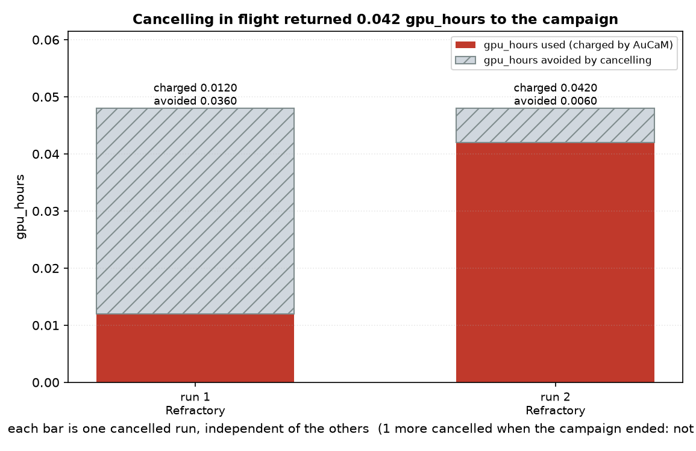

# IMPRESS AuCaM Campaign

The real use case, with mock tools: AuCaM steering IMPRESS-A protein-binding
design. Each AuCaM *workflow* is a complete IMPRESS-A design run — plan, score,
Pareto front — and AuCaM gives it a budget and resources, learns which kind of
workflow is worth launching, and decides when to stop.

## Quick start

```bash
# The specs are read from your IMPRESS checkout ($IMPRESS_DIR/agent/campaigns).
# Optional when impress_a is an editable install of that checkout.
export IMPRESS_DIR=/path/to/IMPRESS

# Three workflow types (tractable / borderline / refractory), steered by a bandit.
python run_campaign.py --multi-arm --goal-n 10

# One workflow type on its own.
python run_campaign.py --spec mock-binding-tractable.yaml

# The same three types, cancelling runs that spend without improving.
python run_campaign.py --multi-arm --goal-n 10 --cost-cancel 0.008
```

---

## What it demonstrates

**Three workflow types**, differing in how reliably a run converges on a design
that satisfies every objective. One AuCaM campaign runs many instances of them
at once, and each instance plans, submits its own tools, scores a Pareto front
and loops over its own cycles before reporting a single number back. AuCaM
learns from those numbers which type deserves the allocation.

The terms here are AuCaM's. A **workflow** (or **run**) is what AuCaM
launches, budgets and cancels; a **campaign** is the whole collection of them.
IMPRESS's own field names and log lines call what a single workflow executes a
campaign as well — `campaign_id` in the spec, `campaign … ended` in the log —
but in this README that is a workflow. `BanditSchedulingPolicy` calls a workflow
type an *arm*, so the scheduling passages use that word where the bandit's
choice is the subject.

The three rates are chosen so that **no ranking is available in advance: the
scheduler has to spend allocation to learn which type is worth it.** That is
what makes its steering worth watching:

| Workflow type | difficulty | Runs reaching the front | Its role |
|---|---|---|---|
| `binding_tractable` | 0.25 | every run | the type the bandit should converge on |
| `binding_borderline` | 0.42 | roughly 2 in 5 | the one whose mean sits strictly between 0 and 1 |
| `binding_refractory` | 0.70 | none, and it runs longest | expensive and fruitless: the type to starve, and the in-flight run that gets cancelled |

A *run* either produced a satisfying design or it did not — `progress` is
`front_satisfying / target_front`, so with `target_front: 1` it is 0.0 or 1.0 by
construction. What is fractional is a **type's mean**, and that is what the
bandit estimates. It works because each instance draws its own lineage: AuCaM
gives a Python workflow its own `context["workflow_id"]`, the adapter uses it as
IMPRESS's `seed_salt`, so two instances of one type are independent samples with
a mean worth collecting.

Measure these rates with `--multi-arm`, never with `--spec`, because the two
give a run very different budgets. Under `--multi-arm` each run gets the
0.5 gpu_hours its type declares in `campaign.yaml`. Under `--spec` the limit
comes from IMPRESS's own offer instead — 0.0075 gpu_hours, about one cycle at
the 0.006 a cycle costs. A type that needs two or more cycles to converge then
runs out of budget before it has had its chances, and its rate looks far worse
than it is. The rates measured this way are recorded in the headers of the
specs themselves, in `$IMPRESS_DIR/agent/campaigns/`.

| What this campaign uses it for | Where it comes from | How to run it |
|---|---|---|
| Nesting: one AuCaM workflow is a whole IMPRESS-A design run, cycles and all | `impress_a…aucam.workflow_config()` per type | `--multi-arm` (otherwise `--spec` runs one type) |
| Steering on a **science** score rather than on completions | `BanditSchedulingPolicy(reward_fn=…)` | the default; `--policy throughput` scores completions instead, for the contrast |
| An unsteered baseline to compare against | `EvenSplitPolicy` in `scheduler.py` | `--policy even` — what figure 1 measures the steered run against |
| A goal counted in **results**, not in finished runs | `MultiArmController.is_goal_reached()` | `--goal-n N` |
| Cancelling a run that spends without improving | `CostCancelRule` | `--cost-cancel 0.008` |
| Sizing each run against a grant, and charging what it spends | `spending_limit` / `resources` per type, `[SPEND]` lines | any run |
| Launching fewer runs when the nodes are busy | `target_utilization` in `campaign.yaml` | on by default; watch `allowed=N/6` in the cycle line |
| The telemetry the figures are drawn from | `MultiArmController` + `RecordingPolicy` | `--telemetry-out PATH` |

`run_campaign.py --help` lists the rest: the plumbing flags, and the AuCaM
features this campaign does not lean on (`--score-floor`, `--wall-hours`,
`--on-limit`).

`CostCancelRule` cancels a run once it has spent `--cost-cancel` gpu_hours
**since its score last improved**, so a run that scores nothing is left alone
while it is cheap and stopped once it is not. The other cancel rule,
`CancelRule`, tests the latest score against a fixed bar; it is the wrong tool
here, because `progress` is `front_satisfying / target_front` and with
`target_front: 1` it reads 0.0 until a run satisfies every objective and 1.0
after, so any floor above 0 cancels every run on its first report.

What it prints when it fires:

```
[CTRL] CostCancelRule(binding_refractory):
       cancelling impress-multi-arm.binding_refractory.2fa16e04:
       gpu_hours 0.01182 spent since its best score 0.0
```

---

## Figures

`plot_results.py` answers three questions about **what AuCaM contributed**, from
a run's own telemetry:

```bash
# The steered run, and the same campaign and goal without steering.
python run_campaign.py --multi-arm --goal-n 20 --max-concurrent 2 \
    --cost-cancel 0.008 --telemetry-out runs/bandit.jsonl
python run_campaign.py --multi-arm --goal-n 20 --max-concurrent 2 \
    --policy even --telemetry-out runs/even.jsonl
python plot_results.py --telemetry runs/bandit.jsonl \
    --baseline runs/even.jsonl --out figures/
```

The three below came from exactly that command, so a run of your own should
look like them — not match them, since each instance draws its own lineage.

### 1. Did steering cost less than not steering?


The same campaign, the same goal, the same three types — only the steering differs.
Both reach 20 results; the steered run spends 0.324 gpu_hours against 0.630, and
the hatched part of each bar is what went to runs that produced nothing. The
right panel is the same claim over time: a steeper curve is more science per
unit of allocation.

### 2. Did it learn, and act on what it learned?


Both panels are on elapsed seconds, so they can be read against each other. The
refractory arm is launched at 0.75s and twice at 1.83s; its first result lands
at 1.83s and its mean pins to 0.00 — and then it is not launched again for five
and a half seconds. That gap is the figure's point, and so is the lag before it:
a choice can only use runs that had already finished. At 7.5s the bandit samples
it twice more — UCB1 revisiting a thinly-measured arm, and both of those runs
came back 0.00 as well.

### 3. What did cancelling in flight save?



One bar per cancelled run, independent of the others. The solid part is what
AuCaM was charged, the hatched part what the run would have cost had it been
left alone — measured from this campaign's own completed runs of that type, not
from the declared limit. The bars differ because `CostCancelRule` fires only
once a run has spent without improving, and some runs look promising for longer.

Only cancellations the campaign *chose* are counted. A run still in flight when
the goal is reached is cancelled too, and the figure says how many of those
there were rather than drawing them: AuCaM did not save that allocation by
judging the run, it simply ran out of reasons to continue.

`--max-concurrent 2` is what makes figure 1 mean anything. The controller tops
every type up to 2 in flight each cycle, so at the default of 6 there is a free
slot for all three at once: nothing has to be chosen, the policy only
reorders launches that all happen anyway, and the steered and unsteered runs
come out within a few percent of each other. Below 3 x 2 the queue is contended,
the policy decides who actually runs, and the bandit starves the refractory arm
(5 launches against the even split's 10, while giving the tractable arm 17
against 11). `--cost-cancel 0.008` is below one refractory run's spend, so
figure 3 has several cancellations to show.

Figure 1 compares **two steering mechanisms against neither**, and its labels
say so. AuCaM steers in two places: the scheduler chooses (the bandit stops
picking the arm that does not pay) and the controller stops (`CancelRule` /
`CostCancelRule` kill a run already going nowhere). On this campaign they are
substitutes: both are aimed at the same refractory runs, so the gap belongs to
the pair. Measured per result, over 20 results:

| | no cancel rule | `--cost-cancel 0.008` |
|---|---|---|
| `--policy bandit` | 0.0180 | 0.0177 |
| `--policy even` | 0.0330 | 0.0213 |

The bandit alone buys 1.8x, the cancel rule alone 1.5x, and together 1.9x — not
3x, because each has already removed most of what the other would have.

Figure 1 needs **two** runs, because "AuCaM helped" is a claim about a baseline.
Without `--baseline` it is skipped with a line saying why; the other two are
still written. The baseline is the same campaign with the same goal and the same
types — only the scheduling policy differs — so the gap between the bars is the
scheduler's doing and not a different experiment.

Figure 3 measures a saving against **observed** behaviour: what a run of that
type cost when nothing stopped it, taken from this run's own completed
instances, rather than against the declared spending limit, which is a ceiling
nobody reaches. A type with no completed run of its own has nothing to compare
against, so no bar is drawn for it.

---

## Files

| File | Purpose |
|---|---|
| `run_campaign.py` | Entry point — builds the AuCaM `CampaignSpec` and runs it |
| `controller.py` | `ImpressController` (one type) and `MultiArmController` — per-type scores, the cancel rules, and the `decide()` that keeps each type topped up |
| `scheduler.py` | The `--policy` menu, and the wrapper that records which type the scheduler picked |
| `config.py` | Dataclasses + YAML loaders for `GlobalConfig` / `CampaignConfig` |
| `plot_results.py` | Figures from a run's telemetry (`--telemetry-out`) |
| `campaign_configs/campaign.yaml` | Campaign defaults (goal, budget, spending limits) |
| `campaign_configs/global.yaml` | Engine / telemetry defaults |
| `delta_env_setup.sh` | Create the VE on Delta (run once) |
| `delta_sbatch.sh` | Slurm job script |

---

## Architecture

```
CampaignManager (AuCaM)
│
├── CampaignSpec
│   ├── scheduling_policy        — which QUEUED launch runs next (scheduler.py)
│   ├── MultiArmController       — tops each type up, applies the cancel rule,
│   │                              stops at the goal (controller.py)
│   └── WorkflowConfig per type  — one IMPRESS-A design run as an async block
│
└── per policy cycle:
    ├── controller.observe()     — [BUDGET] burn, [TYPES] per-type state
    ├── controller.decide()      — top-ups + the cost-cancel rule
    ├── policy.select()          — only decides anything when the queue is contended
    └── [SPEND] line             — AuCaM's own budget accounting
```

Each workflow instance wraps `impress_a.integrations.aucam.make_impress_worker()`,
which builds a fresh `CampaignManager` and runs IMPRESS-A's own inner loop.
AuCaM owns the outer lifecycle; IMPRESS-A owns the science.

---

## What a run looks like in the log

### 1. Startup and initial launch

```
[CM] Campaign impress-mock-binding-tractable: starting
[BANDIT]  budget_rem=100.0%  c_eff=1.414  arms={'impress': 'μ=nan'}
[SCHEDULER] LAUNCH impress id=impress-mock-binding-tractable.impress.b3eec390
    requester=cm:init
    spending_limit={'gpu_hours': 4.0}
    resources={'cpus': 8.0, 'gpus': 1.0}
```

Every line that names a run uses its workflow id, `<campaign>.<type>.<8 hex>` —
unique per instance, since the suffix is a fresh UUID4 each launch. It is what
the campaign's own telemetry keys on, and what a Python workflow reads from
`context["workflow_id"]` (this campaign's instances hand it to IMPRESS as a
`seed_salt`, which is what makes two runs of one type independent samples).

AuCaM fires the first workflow immediately at startup (`requester=cm:init`) without
waiting for the first policy cycle. The bandit shows `μ=nan` — no prior reward data
yet. `spending_limit` and `resources` come from `WorkflowConfig`, which
`impress_a.integrations.aucam.workflow_config()` builds from the IMPRESS offer.

### 2. IMPRESS runs the design chain

```
impress_a.aucam  fitted to the caller's grant {'cpus': 8.0, 'gpus': 1.0}:
                 concurrency=1 replicas=1
impress_a.runtime.executor  submitted r0001: {
    'l0_s0_mock_rfd3_design', 'l0_s1_mock_mpnn_design',
    'l0_s2_mock_packmin', 'l0_s3_mock_fastrelax',
    'l0_s4_mock_filter_shape', 'l0_s5_mock_boltz_predict'
} (trusted=True, estimate={'gpu_hours': 0.006, 'cpu_hours': 0.006})
impress_a.runtime.executor  reaped r0001: 6/6 tasks ok,
    cost={'gpu_hours': 0.006, 'cpu_hours': 0.006}
```

`_fit_resources()` in `impress_a.aucam` sizes IMPRESS concurrency to the GPU grant.
IMPRESS submits `r0001` (cycle 1 of its own inner loop): six staged tools —
RFdiffusion → ProteinMPNN → Rosetta pack/minimize → FastRelax → shape filter →
Boltz predict. Each `task.000NNN is in DONE state` line is one asyncflow task.
After both cycles (r0001, r0002) satisfy all Pareto objectives, IMPRESS stops:

```
impress_a.runtime.executor  stop requested: every spec objective satisfied
impress_a.aucam  campaign mock-binding-tractable ended:
    every spec objective satisfied (3 report(s) emitted)
```

### 3. Workflow completion and spend accounting

```
[WORKFLOW-impress-mock-binding-tractable.impress.b3eec390] COMPLETED wall=0.7s rc=0
[SPEND] wf_done  wf=impress-mock-binding-tractable.impress.b3eec390
    method=exact  source=wf_reported
    cpu_h=0.0000  gpu_h=0.0000  wall_s=0.7  rc=0
```

`rc` is `WorkflowResult.returncode`, how the run ended: **0** finished on its
own terms, **-1** AuCaM cancelled it, anything else is a failure (1 for a Python
workflow like this one; a command-line workflow reports its program's exit code).
Only the three types' `rc=0` runs carry a score, and `cancelled` in the summary
counts the `-1`s — in the run behind the figures, 23 completed against 4
cancelled.

`method=exact  source=wf_reported` — AuCaM used the measured figures IMPRESS
reported via `reporter.emit()`. For the mock spec the measured spend is near zero
because no real GPU work ran (the displayed `0.0000` is `4e-6 cpu_h` rounded).

### 4. Controller records the live score

```
[CTRL] impress done  progress=1.000  front_size=1
    best=[complex_plddt=0.844  ligand_iptm=0.784
          shape_complementarity=0.703  total_score=-325.524]
    total=1/30  spent={'gpu_hours': 0.006, 'cpu_hours': 0.00089}
```

`ImpressController.on_complete()` fires here. `progress=1.000` — the full Pareto
front is satisfied. `total=1/30` counts results toward `goal_n`, which
`campaign.yaml` sets to 30.

### 5. Budget monitoring and policy cycle

```
[BUDGET] cpu_hours: 0.0000/10.0000 (0.0%)  |  gpu_hours: 0.0000/10.0000 (0.0%)
[POLICY] cycle: active=0 queued=0 decisions=0
    launches=1 terminate=False decide=controller
[SPEND] campaign=impress-mock-binding-tractable  spent_cpu_h=0.0009
    spent_gpu_h=0.0060  in_flight_cpu_h=0.0000  in_flight_gpu_h=0.0000
    budget_used=0.1%
[BANDIT]  budget_rem=100.0%  arms={'impress': 'μ=nan'}
[SCHEDULER] LAUNCH impress id=impress-mock-binding-tractable.impress.5ac93467
    requester=policy_agent
    spending_limit={'gpu_hours': 4.0}
```

`[BUDGET]` is logged by `ImpressController.observe()` each cycle — it shows
per-dimension consumption against the campaign-wide `spending` limits from
`campaign.yaml`. A WARNING fires once when either dimension crosses 80%.

`decide=controller` — the controller's own `decide()` ran (rather than AuCaM
falling back to its rules), `is_goal_reached()` returned `False`, so it asked for
one more launch. The second run receives the same `spending_limit` as the first.

### 6. Cost learning is off

`build_multi_arm_spec()` passes `learn=False`, because each type runs a fixed
number of cycles and its cost is known from the start. Left on, the mock tools'
near-zero GPU spend would teach AuCaM a cost of 0, and every later launch would
be sized at 0 and dropped for falling under `budget_floor`.

### 7. Campaign exits

```
========================================================================
  CAMPAIGN SUMMARY  impress-mock-binding-tractable
========================================================================
  exit         : goals_satisfied  (goal reached: True)
  elapsed      : 13.2s
  spent        : cpu_hours=0.0290  gpu_hours=0.1800

  impress              completed=30 cancelled=0 failed=0  best=1.000 avg=1.000
========================================================================
```

`goals_satisfied` is the controller's own end condition: `is_goal_reached()`
counts runs that reached the front, not runs that finished.

---

## How a spending limit reaches IMPRESS

The number in `campaign.yaml` ends up as IMPRESS's own budget, through three
hand-offs. The last one crosses from the outside of a run to the inside:

| Step | Where | What it does |
|---|---|---|
| The whole allocation | `budget.spending` in `campaign.yaml` | What every run together may spend; AuCaM stops when it is gone |
| Each run's share | `spending_limit` per type, passed to `workflow_config()` | 0.5 gpu_hours per run here, and AuCaM cancels a run that exceeds it |
| What IMPRESS enforces from inside the run | `_narrow_budget()` in the adapter | The run's 0.5 gpu_hours becomes the budget IMPRESS works to, so its gate 5 refuses a graph it cannot afford before any task runs |

That last step is what makes the limit worth setting: enforced only from
outside, a limit can cancel a run that has already overspent; enforced inside,
IMPRESS refuses the work up front and stops itself with a reason.

---

## Score flow

```
IMPRESS tool (Boltz) → metrics dict
  → CampaignDigest.best["ligand_iptm"] / ["complex_plddt"]
  → CampaignDigest.progress  (fraction of Pareto front satisfied)
  → _ReporterSink.report()   (impress_a.integrations.aucam)
  → reporter.emit(score=progress, metrics={cpu_hours, gpu_hours, best, ...})
  → WorkflowResult.final_score / .final_metrics
  → ImpressController.on_complete()  → [CTRL] log line
  → BanditSchedulingPolicy reward    → μ updates → UCB arm selection
```

The score AuCaM's bandit sees is `progress` — a scalar in [0, 1]. The rich
per-objective bests (`ligand_iptm`, `complex_plddt`, etc.) travel in `metrics` and
are logged by the controller; the scalar is what the scheduler selects on.

---

## Configuration reference

### `campaign_configs/campaign.yaml`

The values the campaign runs with, and what each one decides:

```yaml
controller:
  goal_n: 30                       # runs that must REACH THE FRONT before stopping
  budget_warn_fraction: 0.80       # log a WARNING past this fraction of the budget

budget:
  max_concurrent: 6                # workflow instances in flight at once
  max_concurrency_per_workflow: 2  # per type; the controller tops each one up to this
  capacity: {cpus: 48, gpus: 6}    # what the campaign has to hand out
  spending:                        # campaign-wide total; it stops when exhausted
    cpu_hours: 10.0
    gpu_hours: 10.0
  # wall_hours: 4.0                # instead of spending: capacity x wall_hours,
                                   # which is how a job's allocation actually works
  on_limit: cancel                 # at the limit: cancel running work, or "finish"
  target_utilization: 0.85         # launch fewer when the nodes are already busy

workflows:
  binding_tractable:                   # one block per type; impress: for --spec mode
    spending_limit: {gpu_hours: 0.5}   # per RUN, and IMPRESS takes it as its budget
    resources: {cpus: 8, gpus: 1}      # the grant each run is sized against
    stale_timeout_s: 120.0             # cancel a run that stops reporting
```

`max_concurrent` is the one to understand before reading the figures: the
controller keeps every type topped up to `max_concurrency_per_workflow`, so at
3 types x 2 there is always a free slot, nothing has to be chosen, and the
scheduling policy has no effect on which runs. Contention is what gives a policy
something to decide.

---

## IMPRESS spec — what `--spec` points to

The spec is the IMPRESS-A YAML describing the protein design problem (its own
first field is `campaign_id`). **The specs live in IMPRESS, not here**: they are
IMPRESS's file format and IMPRESS owns what the knobs in them mean, so this
campaign reads them from the IMPRESS checkout, in `$IMPRESS_DIR/agent/campaigns/`,
rather than keeping copies that could drift.

`IMPRESS_DIR` is the root of that checkout. Left unset, the campaign uses the
checkout `impress_a` is installed from — an editable install, which is how
`delta_env_setup.sh` installs it — so a local run needs nothing set. `--spec`
takes a path or the bare name of a spec in that directory, and `--specs-dir`
points the three-type mode somewhere else.

| Spec | Use |
|---|---|
| `mock-binding-{tractable,borderline,refractory}.yaml` | The three types — mock tools, seconds, no GPU |
| `delta-small-molecule-smoke.yaml` | Quick Delta smoke test — real tools, small run |
| `delta-small-molecule.yaml` | Full Delta run — RFdiffusion + ProteinMPNN + Rosetta + Boltz |

### As a batch job on Delta

`delta_sbatch.sh` takes its settings from the environment and hands
`IMPRESS_SPEC` to `run_campaign.py` as `--spec`, so a batch job runs **one**
workflow type:

| Variable | Default | What it sets |
|---|---|---|
| `IMPRESS_SPEC` | required | The spec to run: the bare name of one in `$IMPRESS_DIR/agent/campaigns/`, or a path |
| `WORK_DIR` | required | The directory holding the `campaign_manager` and `IMPRESS` checkouts |
| `IMPRESS_DIR` | `$WORK_DIR/IMPRESS` | The IMPRESS checkout the specs are read from |
| `ENGINE` | `dragon` | `dragon` for the real tools on GPUs; `concurrent` for the mock specs |
| `SBATCH_ACCOUNT` | Slurm's default | The allocation the job is charged to |
| `CAMPAIGN_CONFIG` / `GLOBAL_CONFIG` | `campaign_configs/campaign.yaml` / `global.yaml` | The configs the run reads |

```bash
export WORK_DIR=<your_work_dir>
cd $WORK_DIR/campaign_manager/campaigns/impress_campaign
mkdir -p logs                           # Slurm writes the job's output here
export SBATCH_ACCOUNT=<project>-delta-gpu
export IMPRESS_SPEC=delta-small-molecule-smoke.yaml
sbatch delta_sbatch.sh
```

Key fields in the spec:

```yaml
objectives:
  - {name: complex_plddt,  direction: maximize, min: 0.75}
  - {name: ligand_iptm,    direction: maximize, min: 0.4}
  - {name: shape_complementarity, direction: maximize, min: 0.55}
  - {name: total_score,    direction: minimize}

budget:
  gpu_hours: 4.0
  cpu_hours: 4.0

stages: [mock_rfd3_design, mock_mpnn_design, mock_packmin,
         mock_fastrelax, mock_filter_shape, mock_boltz_predict]
```

AuCaM narrows `budget` to its own `spending_limit` before each run via
`_narrow_budget()`.
