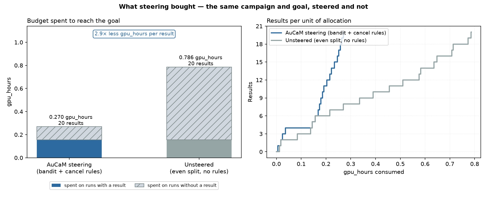

# IMPRESS AuCaM Campaign

The real use case, with mock tools: AuCaM steering IMPRESS-A protein-binding
design. Each AuCaM *workflow* is a complete IMPRESS-A design run — plan, score,
Pareto front — and AuCaM gives it a budget and resources, learns which kind of
workflow is worth launching, and decides when to stop.

## Quick start

```bash
# The specs are read from your IMPRESS checkout ($IMPRESS_DIR/agent/campaigns).
# Optional when impress_a is an editable install of that checkout.
export IMPRESS_DIR=/path/to/IMPRESS

# Three workflow types (tractable / borderline / refractory), steered by a bandit.
python run_campaign.py --multi-arm --goal-n 10

# One workflow type on its own.
python run_campaign.py --spec mock-binding-tractable.yaml

# The same three types, cancelling runs that spend without improving.
python run_campaign.py --multi-arm --goal-n 10 --cost-cancel 0.008
```

---

## What it demonstrates

**Three workflow types**, differing in how reliably a run converges on a design
that satisfies every objective. AuCaM runs many instances of them at once,
each reporting a single score back, and learns which type to launch more of.

A **workflow** (or **run**) is what AuCaM launches, budgets and cancels; a
**campaign** is the whole collection of them. IMPRESS's logs call a run a
"campaign" too, and the bandit calls a workflow type an *arm*.

A run that finds a design satisfying every objective produces a **result**
(IMPRESS reports `progress` 1.0, otherwise 0.0); the campaign counts results,
not finished runs. Each type has its own **success rate**, chosen so that
**no ranking is available in advance**:

| Workflow type | Runs that produce a result | Its role |
|---|---|---|
| `binding_tractable` | every run | the type the bandit should converge on |
| `binding_borderline` | roughly 2 in 5 | the uncertain one: only sampling can judge it |
| `binding_refractory` | none, and it runs longest | expensive and fruitless: the type to starve |

The bandit does not know these rates in advance. It learns them from results as
runs finish, launches more of the types that are paying off, and still tries a
type it has little evidence about now and then, in case its early runs were
unlucky. That only works because each run of a type is a fresh attempt: it explores
different designs, so two runs of the same type can end differently.

The measured rates, and how to re-measure them, are in the spec headers.

| What this campaign uses it for | Where it comes from | How to run it |
|---|---|---|
| Inner loop: each AuCaM workflow runs IMPRESS-A's own design loop until it finds a result | `impress_a…aucam.workflow_config()` per type | `--multi-arm` (otherwise `--spec` runs one type) |
| Steering on a **science** score rather than on completions | `BanditSchedulingPolicy(reward_fn=…)` | the default; `--policy throughput` scores completions instead |
| An unsteered baseline to compare against | `EvenSplitPolicy` in `scheduler.py` | `--policy even` — what figure 1 measures the steered run against |
| A goal counted in **results**, not in finished runs | `MultiArmController.is_goal_reached()` | `--goal-n N` |
| Cancelling a run that keeps spending with no progress | `CostCancelRule` | `--cost-cancel 0.008` |
| Giving each run a spending limit and resources, and charging what it spends | `spending_limit` / `resources` per type, `[SPEND]` lines | any run |
| The telemetry the figures are drawn from | `MultiArmController` + `RecordingPolicy` | `--telemetry-out PATH` |

`run_campaign.py --help` lists the other flags.

`CostCancelRule` cancels a run once it has spent `--cost-cancel` gpu_hours
**since its score last improved** — a cheap run that has scored nothing yet is
left alone. When it fires:

```
[CTRL] CostCancelRule(binding_refractory):
       cancelling impress-multi-arm.binding_refractory.2fa16e04:
       gpu_hours 0.01182 spent since its best score 0.0
```

---

## Figures

`plot_results.py` answers three questions about **what AuCaM contributed**, from
a run's own telemetry:

```bash
# The steered run, and the same campaign and goal without steering.
python run_campaign.py --multi-arm --goal-n 20 --max-concurrent 2 \
    --cost-cancel 0.008 --telemetry-out runs/bandit.jsonl
python run_campaign.py --multi-arm --goal-n 20 --max-concurrent 2 \
    --policy even --telemetry-out runs/even.jsonl
python plot_results.py --telemetry runs/bandit.jsonl \
    --baseline runs/even.jsonl --out figures/
```

The figures below came from that command; your own run will look similar, not
identical, since every run explores different designs.

### 1. Did steering cost less than not steering?



The same campaign, the same goal, the same three types — only the steering differs.
Both reach 20 results; the steered run spends 0.270 gpu_hours against 0.786, and
the hatched part of each bar is what went to runs without a result. The
right panel is the same claim over time: a steeper curve is more results per
gpu_hour.

### 2. Did it learn, and act on what it learned?


The bandit tries all three types early. As soon as the first refractory run
finishes without a result, the bandit stops launching that type and spends the
rest of the campaign on the other two.

### 3. What did cancelling in flight save?


One bar per cancelled run: solid is what AuCaM was charged, hatched is what the
run would have cost uncancelled (the average of this campaign's finished runs of
that type). The controller cancels a run once it has spent `--cost-cancel`
gpu_hours without its score improving, so runs are stopped at different points.

`--max-concurrent 2` is what lets the policy matter: with fewer slots than
3 types × 2, the scheduler must choose, and the bandit starves the refractory
type (3 launches against the even split's 14). The steered run combines the
bandit and `--cost-cancel`; each alone gives most of the saving (1.8× and 1.5×
per result), together 1.9×.

---

## Files

| File | Purpose |
|---|---|
| `run_campaign.py` | Entry point — builds the AuCaM `CampaignSpec` and runs it |
| `controller.py` | `ImpressController` (one type) and `MultiArmController` — per-type scores, the cancel rules, and the `decide()` that keeps each type topped up |
| `scheduler.py` | The `--policy` menu, and the wrapper that records which type the scheduler picked |
| `config.py` | Dataclasses + YAML loaders for `GlobalConfig` / `CampaignConfig` |
| `plot_results.py` | Figures from a run's telemetry (`--telemetry-out`) |
| `campaign_configs/campaign.yaml` | Campaign defaults (goal, budget, spending limits) |
| `campaign_configs/global.yaml` | Engine / telemetry defaults |

---

## Architecture

```
CampaignManager (AuCaM)
│
├── CampaignSpec
│   ├── scheduling_policy        — which QUEUED launch runs next (scheduler.py)
│   ├── MultiArmController       — tops each type up, applies the cancel rule,
│   │                              stops at the goal (controller.py)
│   └── WorkflowConfig per type  — one IMPRESS-A design run as an async block
│
└── per policy cycle:
    ├── controller.observe()     — [BUDGET] burn, [TYPES] per-type state
    ├── controller.decide()      — top-ups + the cost-cancel rule
    ├── policy.select()          — only decides anything when the queue is contended
    └── [SPEND] line             — AuCaM's own budget accounting
```

Each workflow instance wraps `impress_a.integrations.aucam.make_impress_worker()`,
which builds a fresh `CampaignManager` and runs IMPRESS-A's own inner loop.
AuCaM owns the outer lifecycle; IMPRESS-A owns the science.

---

## What a run looks like in the log

### 1. Startup and initial launch

```
[CM] Campaign impress-mock-binding-tractable: starting
[BANDIT]  budget_rem=100.0%  c_eff=1.414  arms={'impress': 'μ=nan'}
[SCHEDULER] LAUNCH impress id=impress-mock-binding-tractable.impress.b3eec390
    requester=cm:init
    spending_limit={'gpu_hours': 4.0}
    resources={'cpus': 8.0, 'gpus': 1.0}
```

Each run has a unique workflow id, `<campaign>.<type>.<8 hex>`; IMPRESS uses it
as a seed, so two runs of one type explore different designs.

The first run launches at startup (`requester=cm:init`); `μ=nan` means no
results yet. `spending_limit` and `resources` come from `workflow_config()`.

### 2. IMPRESS runs the design chain

```
impress_a.aucam  fitted to the caller's grant {'cpus': 8.0, 'gpus': 1.0}:
                 concurrency=1 replicas=1
impress_a.runtime.executor  submitted r0001: {
    'l0_s0_mock_rfd3_design', 'l0_s1_mock_mpnn_design',
    'l0_s2_mock_packmin', 'l0_s3_mock_fastrelax',
    'l0_s4_mock_filter_shape', 'l0_s5_mock_boltz_predict'
} (trusted=True, estimate={'gpu_hours': 0.006, 'cpu_hours': 0.006})
impress_a.runtime.executor  reaped r0001: 6/6 tasks ok,
    cost={'gpu_hours': 0.006, 'cpu_hours': 0.006}
```

Each IMPRESS cycle (`r0001`, …) runs the six-tool design chain. Once a design
satisfies every objective, IMPRESS stops:

```
impress_a.runtime.executor  stop requested: every spec objective satisfied
impress_a.aucam  campaign mock-binding-tractable ended:
    every spec objective satisfied (3 report(s) emitted)
```

### 3. Workflow completion and spend accounting

```
[WORKFLOW-impress-mock-binding-tractable.impress.b3eec390] COMPLETED wall=0.7s rc=0
[SPEND] wf_done  wf=impress-mock-binding-tractable.impress.b3eec390
    method=exact  source=wf_reported
    cpu_h=0.0009  gpu_h=0.0060  wall_s=0.7  rc=0
```

`rc`: **0** finished, **-1** cancelled by AuCaM, anything else failed.
`method=exact` means AuCaM charged the spend IMPRESS reported.

### 4. Controller records the live score

```
[CTRL] impress done  progress=1.000  front_size=1
    best=[complex_plddt=0.844  ligand_iptm=0.784
          shape_complementarity=0.703  total_score=-325.524]
    total=1/30  spent={'gpu_hours': 0.006, 'cpu_hours': 0.00089}
```

`progress=1.000`: the run found a satisfying design, so it is a result.
`total=1/30` counts results toward `goal_n`.

### 5. Budget monitoring and policy cycle

```
[BUDGET] cpu_hours: 0.0000/10.0000 (0.0%)  |  gpu_hours: 0.0000/10.0000 (0.0%)
[POLICY] cycle: active=0 queued=0 decisions=0
    launches=1 terminate=False decide=controller
[SPEND] campaign=impress-mock-binding-tractable  spent_cpu_h=0.0009
    spent_gpu_h=0.0060  in_flight_cpu_h=0.0000  in_flight_gpu_h=0.0000
    budget_used=0.1%
[BANDIT]  budget_rem=100.0%  arms={'impress': 'μ=nan'}
[SCHEDULER] LAUNCH impress id=impress-mock-binding-tractable.impress.5ac93467
    requester=policy_agent
    spending_limit={'gpu_hours': 4.0}
```

`[BUDGET]` shows campaign-wide spend each cycle (a WARNING past 80%).
`decide=controller`: the goal is not reached, so the controller launches another run.

### 6. Cost learning is off

`build_multi_arm_spec()` passes `learn=False`, because each type runs a fixed
number of cycles and its cost is known from the start. Left on, the mock tools'
near-zero GPU spend would teach AuCaM a cost of 0, and every later launch would
be sized at 0 and dropped for falling under `budget_floor`.

### 7. Campaign exits

```
========================================================================
  CAMPAIGN SUMMARY  impress-mock-binding-tractable
========================================================================
  exit         : goals_satisfied  (goal reached: True)
  elapsed      : 13.2s
  spent        : cpu_hours=0.0290  gpu_hours=0.1800

  impress              completed=30 cancelled=0 failed=0  best=1.000 avg=1.000
========================================================================
```

`goals_satisfied`: the results goal was reached.

---

## How a spending limit reaches IMPRESS

The budget in `campaign.yaml` is passed down in three steps, from the whole
campaign to each run, and from the run into IMPRESS itself:

| Step | Where | What it does |
|---|---|---|
| The whole allocation | `budget.spending` in `campaign.yaml` | What the entire campaign may spend; AuCaM stops when it is gone |
| Each run's share | `spending_limit` per type, passed to `workflow_config()` | 0.5 gpu_hours per run here, and AuCaM cancels a run that exceeds it |
| What IMPRESS enforces from inside the run | `_narrow_budget()` in the adapter | The run's 0.5 gpu_hours becomes IMPRESS's own budget, so it refuses work it cannot afford before running it |

Enforced from outside, a limit can only cancel a run that already overspent;
enforced inside, IMPRESS refuses the work up front.

---

## Score flow

```
IMPRESS run → progress (1.0 once it has a result, else 0.0) + per-objective bests
  → reporter.emit(score=progress, metrics={cpu_hours, gpu_hours, best, ...})
  → WorkflowResult.final_score / .final_metrics
  → ImpressController.on_complete()  → [CTRL] log line
  → BanditSchedulingPolicy reward    → μ updates → UCB arm selection
```

The bandit's reward is `progress` (1.0 or 0.0). The best value of each
objective (`ligand_iptm`, `complex_plddt`, …) is reported too, but only for the
log; it does not affect scheduling.

---

## Configuration reference

### `campaign_configs/campaign.yaml`

The values the campaign runs with, and what each one decides:

```yaml
controller:
  goal_n: 30                       # results needed before the campaign stops
  budget_warn_fraction: 0.80       # log a WARNING past this fraction of the budget

budget:
  max_concurrent: 6                # workflow instances in flight at once
  max_concurrency_per_workflow: 2  # per type; the controller tops each one up to this
  capacity: {cpus: 48, gpus: 6}    # what the campaign has to hand out
  spending:                        # campaign-wide total; it stops when exhausted
    cpu_hours: 10.0
    gpu_hours: 10.0
  on_limit: cancel                 # at the limit: cancel running work, or "finish"
  target_utilization: 0.85         # launch fewer when the nodes are already busy

workflows:
  binding_tractable:                   # one block per type; impress: for --spec mode
    spending_limit: {gpu_hours: 0.5}   # per RUN, and IMPRESS takes it as its budget
    resources: {cpus: 8, gpus: 1}      # CPUs / GPUs each run gets
    stale_timeout_s: 120.0             # cancel a run that stops reporting
```

---

## IMPRESS spec — what `--spec` points to

The spec is the IMPRESS-A YAML describing the design problem. Specs live in the
IMPRESS repo, in `$IMPRESS_DIR/agent/campaigns/` (unset, the checkout `impress_a`
is installed from). `--spec` takes a bare name from there or a path.

| Spec | Use |
|---|---|
| `mock-binding-{tractable,borderline,refractory}.yaml` | The three types — mock tools, seconds, no GPU |
| `delta-small-molecule-smoke.yaml` | Quick Delta smoke test — real tools, small run |
| `delta-small-molecule.yaml` | Full Delta run — RFdiffusion + ProteinMPNN + Rosetta + Boltz |

### As a batch job on Delta

`delta_sbatch.sh` takes its settings from the environment and hands
`IMPRESS_SPEC` to `run_campaign.py` as `--spec`, so a batch job runs **one**
workflow type:

| Variable | Default | What it sets |
|---|---|---|
| `IMPRESS_SPEC` | required | The spec to run: the bare name of one in `$IMPRESS_DIR/agent/campaigns/`, or a path |
| `WORK_DIR` | required | The directory holding the `campaign_manager` and `IMPRESS` checkouts |
| `IMPRESS_DIR` | `$WORK_DIR/IMPRESS` | The IMPRESS checkout the specs are read from |
| `ENGINE` | `dragon` | `dragon` for the real tools on GPUs; `concurrent` for the mock specs |
| `SBATCH_ACCOUNT` | Slurm's default | The allocation the job is charged to |
| `CAMPAIGN_CONFIG` | `campaign_configs/campaign.yaml` | The campaign's goal and budget, and each workflow type's spending limit and resources |
| `GLOBAL_CONFIG` | `campaign_configs/global.yaml` | Engine, scheduling policy and telemetry |

```bash
export WORK_DIR=<your_work_dir>
cd $WORK_DIR/campaign_manager/campaigns/impress_campaign
mkdir -p logs                           # Slurm writes the job's output here
export SBATCH_ACCOUNT=<project>-delta-gpu
export IMPRESS_SPEC=delta-small-molecule-smoke.yaml
sbatch delta_sbatch.sh
```

Key fields in the spec:

```yaml
objectives:
  - {name: complex_plddt,  direction: maximize, min: 0.75}
  - {name: ligand_iptm,    direction: maximize, min: 0.4}
  - {name: shape_complementarity, direction: maximize, min: 0.55}
  - {name: total_score,    direction: minimize}

budget:
  gpu_hours: 4.0
  cpu_hours: 4.0

stages: [mock_rfd3_design, mock_mpnn_design, mock_packmin,
         mock_fastrelax, mock_filter_shape, mock_boltz_predict]
```
