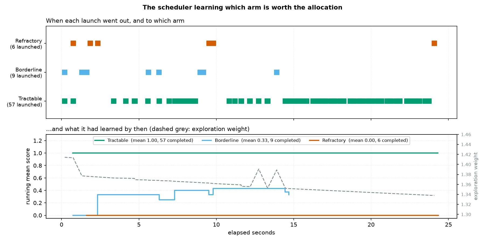
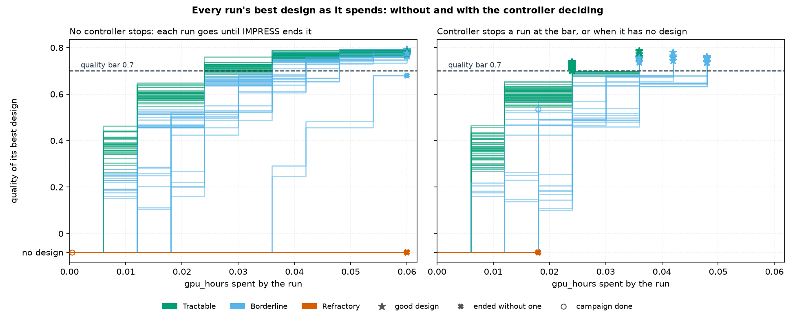
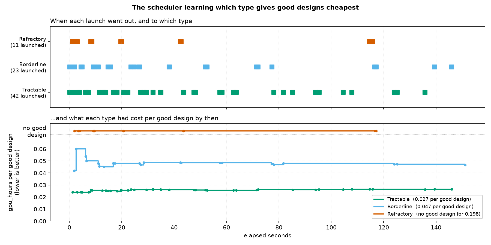
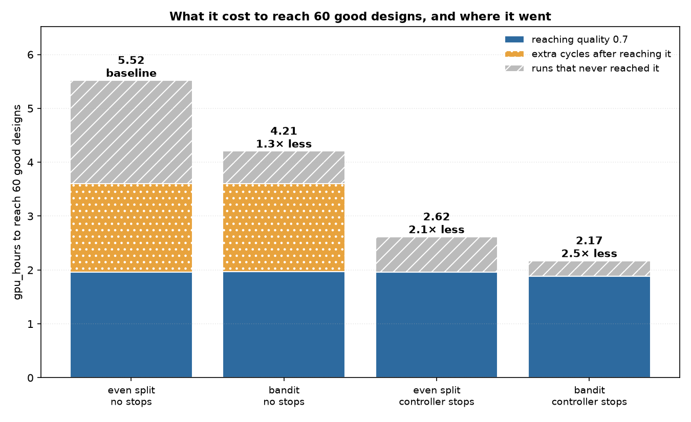

# IMPRESS AuCaM Campaign

The real use case, with mock tools: AuCaM steering IMPRESS-A protein-binding
design. Each AuCaM *workflow* is a complete IMPRESS-A design run — plan, score,
Pareto front — and AuCaM gives it a budget and resources, learns which kind of
workflow is worth launching, and decides when to stop.

Two experiments on the same three workflow types:

1. **Results.** A run produces a result or not; the scheduler learns which type
   produces results, and the controller cancels runs that spend without progress.
2. **Good designs for the fewest gpu_hours.** Runs keep improving their design;
   the controller decides how long each run lives, and the scheduler learns
   which type delivers good designs cheapest.

## Quick start

```bash
# The specs are read from your IMPRESS checkout ($IMPRESS_DIR/agent/campaigns).
# Optional when impress_a is an editable install of that checkout.
export IMPRESS_DIR=/path/to/IMPRESS

# Three workflow types (tractable / borderline / refractory), steered by a bandit.
python run_campaign.py --multi-arm --goal-n 10

# One workflow type on its own.
python run_campaign.py --spec mock-binding-tractable.yaml

# The same three types, cancelling runs that spend without improving.
python run_campaign.py --multi-arm --goal-n 10 --cost-cancel 0.008

# Experiment 2: 10 designs of quality 0.7 or better.
python run_campaign.py --multi-arm --quality-bar 0.7 --goal-n 10
```

Every run also writes AuCaM's and the campaign's own log lines, without IMPRESS's
or AsyncFlow's, to `logs/aucam.log` (`--aucam-log` to change it, `''` to turn it off).

---

## Experiment 1: results

**Three workflow types**, differing in how reliably a run converges on a design
that satisfies every objective. AuCaM runs many instances of them at once,
each reporting a single score back, and learns which type to launch more of.

A **workflow** (or **run**) is what AuCaM launches, budgets and cancels; a
**campaign** is the whole collection of them. IMPRESS's logs call a run a
"campaign" too, and the bandit calls a workflow type an *arm*.

A run that finds a design satisfying every objective produces a **result**
(IMPRESS reports `progress` 1.0, otherwise 0.0); the campaign counts results,
not finished runs. Each type has its own **success rate**, chosen so that
**no ranking is available in advance**:

| Workflow type | Runs that produce a result | Its role |
|---|---|---|
| `binding_tractable` | every run | the type the bandit should converge on |
| `binding_borderline` | roughly 2 in 5 | the uncertain one: only sampling can judge it |
| `binding_refractory` | none, and it runs longest | expensive and fruitless: the type to starve |

The bandit does not know these rates in advance. It learns them from results as
runs finish, launches more of the types that are paying off, and still tries a
type it has little evidence about now and then, in case its early runs were
unlucky. That only works because each run of a type is a fresh attempt: it explores
different designs, so two runs of the same type can end differently.

The measured rates, and how to re-measure them, are in the spec headers.

| What this campaign uses it for | Where it comes from | How to run it |
|---|---|---|
| Inner loop: each AuCaM workflow runs IMPRESS-A's own design loop until it finds a result | `impress_a…aucam.workflow_config()` per type | `--multi-arm` (otherwise `--spec` runs one type) |
| Steering on a **science** score rather than on completions | `BanditSchedulingPolicy(reward_fn=…)` | the default; `--policy throughput` scores completions instead |
| An unsteered baseline to compare against | `EvenSplitPolicy` in `scheduler.py` | `--policy even` — what figure 1 measures the steered run against |
| A goal counted in **results**, not in finished runs | `MultiArmController.is_goal_reached()` | `--goal-n N` |
| Cancelling a run that keeps spending with no progress | `CostCancelRule` | `--cost-cancel 0.008` |
| Giving each run a spending limit and resources, and charging what it spends | `spending_limit` / `resources` per type, `[SPEND]` lines | any run |
| The telemetry the figures are drawn from | `MultiArmController` + `RecordingPolicy` | `--telemetry-out PATH` |

`run_campaign.py --help` lists the other flags.

`CostCancelRule` cancels a run once it has spent `--cost-cancel` gpu_hours
**since its score last improved** — a cheap run that has scored nothing yet is
left alone. When it fires:

```
[CTRL] CostCancelRule(binding_refractory):
       cancelling impress-multi-arm.binding_refractory.2fa16e04:
       gpu_hours 0.01182 spent since its best score 0.0
```

---

## Experiment 1: figures

`plot_results.py` answers three questions about **what AuCaM contributed**, from
a run's own telemetry:

```bash
./run_results_experiment.sh     # about 3 minutes
```

It runs the steered campaign (`--multi-arm --goal-n 60 --max-concurrent 2
--cost-cancel 0.008`) and its baseline (`--policy even`, no cancel rule), plus
the bandit alone and the cancel rule alone, then draws the figures below. Your
own run will look similar, not identical, since every run explores different
designs.

### 1. Did steering cost less than not steering?


The same campaign, the same goal, the same three types — only the steering differs.
Both reach 60 results; the steered run spends 0.558 gpu_hours against 2.322, and
the hatched part of each bar is what went to runs without a result. The
right panel is the same claim over time: a steeper curve is more results per
gpu_hour.

### 2. Did it learn, and act on what it learned?



The bandit tries all three types early. Once refractory runs finish without a
result, it launches that type only rarely (6 of 72 launches) and spends most of
the campaign on tractable.

### 3. What did cancelling in flight save?


One bar per cancelled run: solid is what AuCaM was charged, hatched is what the
run would have cost uncancelled (the median finished run of that type, in this
campaign and its baseline). The controller cancels a run once it has spent
`--cost-cancel` gpu_hours without its score improving, so runs are stopped at
different points.

`--max-concurrent 2` is what lets the policy matter: with fewer slots than
3 types × 2, the scheduler must choose, and the bandit starves the refractory
type (6 launches against the even split's 39). The steered run combines the
bandit and `--cost-cancel`: the bandit alone gives 3.3× fewer gpu_hours per
result, the cancel rule alone 1.5×, and together 4.2×.

---

## Experiment 2: good designs for the fewest gpu_hours

The same three types, but a run does not stop at its first passing design:
IMPRESS keeps improving it, cycle after cycle, and the **controller decides how
long each run lives**. A design is **good** once its quality reaches a bar
(`--quality-bar`), and the campaign stops at `--goal-n` good designs.

A design's **quality** comes from the objectives that have a `min` in the spec
(`complex_plddt` ≥ 0.75, `ligand_iptm` ≥ 0.4, `shape_complementarity` ≥ 0.55;
these metrics top out at 1.0). For each one we take how far the design is above
the `min`, as a fraction of the room left above it, and the design's quality is
the weakest of these:

```
quality = min over objectives of (value − min) / (1 − min)
```

0 means just at the thresholds, 1 is perfect. For example, `complex_plddt` 0.92,
`ligand_iptm` 0.88 and `shape_complementarity` 0.82 give 0.68, 0.80 and 0.60, so
the design's quality is 0.60. Taking the weakest objective means one strong
metric can't make up for a poor one.

Each policy cycle, the controller ends a run when one of these rules holds. A
run whose design reaches the bar is ended with AuCaM's `FINISH` decision, so it
counts as completed; the others are cancelled. Either way the run's design is
kept, and the controller's reason is recorded with its result.

| Rule | Why |
|---|---|
| its design reaches the bar (`FINISH`) | it is good; more cycles add little |
| it has no design after `--no-design` gpu_hours | there is nothing to refine |
| it has not improved for `--patience` gpu_hours | it has plateaued |
| what it still needs to reach the bar is more than its share of the budget left | the campaign can't afford it (budget left ÷ good designs still needed) |

The scheduler is AuCaM's bandit in cost-aware mode, rewarded 1 for a good
design, so it ranks types by good designs per gpu_hour.

With `--quality-bar`, runs report every 0.05 s and the controller decides every
0.1 s, so a run is stopped in the cycle it reaches the bar.

```bash
./run_quality_experiment.sh     # about 15 minutes
```

It runs the steered campaign (`--multi-arm --quality-bar 0.7 --goal-n 60
--max-concurrent 2`) and three baselines, the same command with `--policy even`,
`--no-stops`, or both, then draws the figures below from their telemetry.

### 1. What did the controller decide for each run?



Each line is one run: the quality of its best design as it spends. Without
stops (left), runs keep going long after they cross the bar, and a refractory
run spends 0.06 gpu_hours with no design to show. With the controller (right),
a run stops as soon as its design is good, and a run with no design is stopped
at 0.018.

### 2. Which type did the scheduler learn to launch?



Tractable delivers a good design for about 0.027 gpu_hours, borderline for
0.047, and refractory never does. The bandit launches tractable most and
refractory least: 11 of 76 launches, against 32 of 96 for an even split.

### 3. What did the two save together?



To reach 60 good designs: 5.52 gpu_hours with neither, 4.21 with the bandit
alone, 2.62 with the controller alone, and 2.17 with both, 2.5× less than
neither. Reaching quality 0.7 (blue) takes about 2 gpu_hours in every case;
the rest is waste. The controller removes the cycles runs spend after reaching
it (orange), and the bandit and controller together cut what goes to runs that
never reach it (grey) from 1.92 to 0.29.

---

## Files

| File | Purpose |
|---|---|
| `run_campaign.py` | Entry point — builds the AuCaM `CampaignSpec` and runs it |
| `controller.py` | `ImpressController` (one type) and `MultiArmController` — per-type scores, the cancel rules, and the `decide()` that keeps each type topped up |
| `scheduler.py` | The `--policy` menu, and the wrapper that records which type the scheduler picked |
| `config.py` | Dataclasses + YAML loaders for `GlobalConfig` / `CampaignConfig` |
| `plot_results.py` | Experiment 1 figures, from a run's telemetry (`--telemetry-out`) |
| `quality.py` | Experiment 2: design quality, and the controller that decides how long each run lives |
| `plot_quality.py` | Experiment 2 figures, from four runs' telemetry |
| `run_results_experiment.sh` | Experiment 1: runs the four campaigns, then `plot_results.py` |
| `run_quality_experiment.sh` | Experiment 2: runs the four campaigns, then `plot_quality.py` |
| `campaign_configs/campaign.yaml` | Campaign defaults (goal, budget, spending limits) |
| `campaign_configs/global.yaml` | Engine / telemetry defaults |

---

## Architecture

```
CampaignManager (AuCaM)
│
├── CampaignSpec
│   ├── scheduling_policy        — which QUEUED launch runs next (scheduler.py)
│   ├── MultiArmController       — tops each type up, applies the cancel rule,
│   │                              stops at the goal (controller.py)
│   │   └── QualityController    — experiment 2: also FINISHes or cancels each
│   │                              run by its design's quality (quality.py)
│   └── WorkflowConfig per type  — one IMPRESS-A design run as an async block
│
└── per policy cycle:
    ├── controller.observe()     — [BUDGET] burn, [TYPES] per-type state
    ├── controller.decide()      — top-ups + the cost-cancel rule (experiment 2:
    │                              the quality rules)
    ├── policy.select()          — only decides anything when the queue is contended
    └── [SPEND] line             — AuCaM's own budget accounting
```

Each workflow instance wraps `impress_a.integrations.aucam.make_impress_worker()`,
which builds a fresh `CampaignManager` and runs IMPRESS-A's own inner loop.
AuCaM owns the outer lifecycle; IMPRESS-A owns the science.

---

## What a run looks like in the log

### 1. Startup and initial launch

```
[CM] Campaign impress-mock-binding-tractable: starting
[BANDIT]  budget_rem=100.0%  c_eff=1.414  arms={'impress': 'μ=nan'}
[SCHEDULER] LAUNCH impress id=impress-mock-binding-tractable.impress.b3eec390
    requester=cm:init
    spending_limit={'gpu_hours': 4.0}
    resources={'cpus': 8.0, 'gpus': 1.0}
```

Each run has a unique workflow id, `<campaign>.<type>.<8 hex>`; IMPRESS uses it
as a seed, so two runs of one type explore different designs.

The first run launches at startup (`requester=cm:init`); `μ=nan` means no
results yet. `spending_limit` and `resources` come from `workflow_config()`.

### 2. IMPRESS runs the design chain

```
impress_a.aucam  fitted to the caller's grant {'cpus': 8.0, 'gpus': 1.0}:
                 concurrency=1 replicas=1
impress_a.runtime.executor  submitted r0001: {
    'l0_s0_mock_rfd3_design', 'l0_s1_mock_mpnn_design',
    'l0_s2_mock_packmin', 'l0_s3_mock_fastrelax',
    'l0_s4_mock_filter_shape', 'l0_s5_mock_boltz_predict'
} (trusted=True, estimate={'gpu_hours': 0.006, 'cpu_hours': 0.006})
impress_a.runtime.executor  reaped r0001: 6/6 tasks ok,
    cost={'gpu_hours': 0.006, 'cpu_hours': 0.006}
```

Each IMPRESS cycle (`r0001`, …) runs the six-tool design chain. Once a design
satisfies every objective, IMPRESS stops:

```
impress_a.runtime.executor  stop requested: every spec objective satisfied
impress_a.aucam  campaign mock-binding-tractable ended:
    every spec objective satisfied (3 report(s) emitted)
```

### 3. Workflow completion and spend accounting

```
[WORKFLOW-impress-mock-binding-tractable.impress.b3eec390] COMPLETED wall=0.7s rc=0
[SPEND] wf_done  wf=impress-mock-binding-tractable.impress.b3eec390
    method=exact  source=wf_reported
    cpu_h=0.0009  gpu_h=0.0060  wall_s=0.7  rc=0
```

`rc`: **0** finished (on its own, or ended by the controller with `FINISH`),
**-1** cancelled by AuCaM, anything else failed.
`method=exact` means AuCaM charged the spend IMPRESS reported.

### 4. Controller records the live score

```
[CTRL] impress done  progress=1.000  front_size=1
    best=[complex_plddt=0.844  ligand_iptm=0.784
          shape_complementarity=0.703  total_score=-325.524]
    total=1/30  spent={'gpu_hours': 0.006, 'cpu_hours': 0.00089}
```

`progress=1.000`: the run found a satisfying design, so it is a result.
`total=1/30` counts results toward `goal_n`.

### 5. Budget monitoring and policy cycle

```
[BUDGET] cpu_hours: 0.0000/10.0000 (0.0%)  |  gpu_hours: 0.0000/10.0000 (0.0%)
[POLICY] cycle: active=0 queued=0 decisions=0
    launches=1 terminate=False decide=controller
[SPEND] campaign=impress-mock-binding-tractable  spent_cpu_h=0.0009
    spent_gpu_h=0.0060  in_flight_cpu_h=0.0000  in_flight_gpu_h=0.0000
    budget_used=0.1%
[BANDIT]  budget_rem=100.0%  arms={'impress': 'μ=nan'}
[SCHEDULER] LAUNCH impress id=impress-mock-binding-tractable.impress.5ac93467
    requester=policy_agent
    spending_limit={'gpu_hours': 4.0}
```

`[BUDGET]` shows campaign-wide spend each cycle (a WARNING past 80%).
`decide=controller`: the goal is not reached, so the controller launches another run.

### 6. Cost learning is off

`build_multi_arm_spec()` passes `learn=False`, because each type runs a fixed
number of cycles and its cost is known from the start. Left on, the mock tools'
near-zero GPU spend would teach AuCaM a cost of 0, and every later launch would
be sized at 0 and dropped for falling under `budget_floor`.

### 7. Campaign exits

```
========================================================================
  CAMPAIGN SUMMARY  impress-mock-binding-tractable
========================================================================
  exit         : goals_satisfied  (goal reached: True)
  elapsed      : 13.2s
  spent        : cpu_hours=0.0290  gpu_hours=0.1800

  impress              completed=30 cancelled=0 failed=0  best=1.000 avg=1.000
========================================================================
```

`goals_satisfied`: the results goal was reached. In experiment 2 each type's
line also says how many runs the controller ended with `FINISH`, for example
`completed=21 (finished early 21)`.

---

## How a spending limit reaches IMPRESS

The budget in `campaign.yaml` is passed down in three steps, from the whole
campaign to each run, and from the run into IMPRESS itself:

| Step | Where | What it does |
|---|---|---|
| The whole allocation | `budget.spending` in `campaign.yaml` | What the entire campaign may spend; AuCaM stops when it is gone |
| Each run's share | `spending_limit` per type, passed to `workflow_config()` | 0.5 gpu_hours per run here, and AuCaM cancels a run that exceeds it |
| What IMPRESS enforces from inside the run | `_narrow_budget()` in the adapter | The run's 0.5 gpu_hours becomes IMPRESS's own budget, so it refuses work it cannot afford before running it |

Enforced from outside, a limit can only cancel a run that already overspent;
enforced inside, IMPRESS refuses the work up front.

---

## Score flow

```
IMPRESS run → progress (1.0 once it has a result, else 0.0) + per-objective bests
  → reporter.emit(score=progress, metrics={cpu_hours, gpu_hours, best, ...})
  → WorkflowResult.final_score / .final_metrics
  → ImpressController.on_complete()  → [CTRL] log line
  → BanditSchedulingPolicy reward    → μ updates → UCB arm selection
```

In experiment 1 the bandit's reward is `progress` (1.0 or 0.0), and the best
value of each objective (`ligand_iptm`, `complex_plddt`, …) is only logged. In
experiment 2 those bests are what a design's quality is computed from: the
controller reads them every cycle to decide whether a run continues, and the
bandit's reward is 1.0 for a run that left a good design, weighed by its cost.

---

## Configuration reference

### `campaign_configs/campaign.yaml`

The values the campaign runs with, and what each one decides:

```yaml
controller:
  goal_n: 30                       # results needed before the campaign stops
  budget_warn_fraction: 0.80       # log a WARNING past this fraction of the budget

budget:
  max_concurrent: 6                # workflow instances in flight at once
  max_concurrency_per_workflow: 2  # per type; the controller tops each one up to this
  capacity: {cpus: 48, gpus: 6}    # what the campaign has to hand out
  spending:                        # campaign-wide total; it stops when exhausted
    cpu_hours: 10.0
    gpu_hours: 10.0
  on_limit: cancel                 # at the limit: cancel running work, or "finish"
  target_utilization: 0.85         # launch fewer when the nodes are already busy

workflows:
  binding_tractable:                   # one block per type; impress: for --spec mode
    spending_limit: {gpu_hours: 0.5}   # per RUN, and IMPRESS takes it as its budget
    resources: {cpus: 8, gpus: 1}      # CPUs / GPUs each run gets
    stale_timeout_s: 120.0             # cancel a run that stops reporting
```

---

## IMPRESS spec — what `--spec` points to

The spec is the IMPRESS-A YAML describing the design problem. Specs live in the
IMPRESS repo, in `$IMPRESS_DIR/agent/campaigns/` (unset, the checkout `impress_a`
is installed from). `--spec` takes a bare name from there or a path.

| Spec | Use |
|---|---|
| `mock-binding-{tractable,borderline,refractory}.yaml` | The three types — mock tools, seconds, no GPU |
| `mock-quality-{tractable,borderline,refractory}.yaml` | The same types for experiment 2: runs keep improving past their first design |
| `delta-small-molecule-smoke.yaml` | Quick Delta smoke test — real tools, small run |
| `delta-small-molecule.yaml` | Full Delta run — RFdiffusion + ProteinMPNN + Rosetta + Boltz |

### As a batch job on Delta

`delta_sbatch.sh` takes its settings from the environment and hands
`IMPRESS_SPEC` to `run_campaign.py` as `--spec`, so a batch job runs **one**
workflow type:

| Variable | Default | What it sets |
|---|---|---|
| `IMPRESS_SPEC` | required | The spec to run: the bare name of one in `$IMPRESS_DIR/agent/campaigns/`, or a path |
| `WORK_DIR` | required | The directory holding the `campaign_manager` and `IMPRESS` checkouts |
| `IMPRESS_DIR` | `$WORK_DIR/IMPRESS` | The IMPRESS checkout the specs are read from |
| `ENGINE` | `dragon` | `dragon` for the real tools on GPUs; `concurrent` for the mock specs |
| `SBATCH_ACCOUNT` | Slurm's default | The allocation the job is charged to |
| `CAMPAIGN_CONFIG` | `campaign_configs/campaign.yaml` | The campaign's goal and budget, and each workflow type's spending limit and resources |
| `GLOBAL_CONFIG` | `campaign_configs/global.yaml` | Engine, scheduling policy and telemetry |

```bash
export WORK_DIR=<your_work_dir>
cd $WORK_DIR/campaign_manager/campaigns/impress_campaign
mkdir -p logs                           # Slurm's output, and AuCaM's own log
export SBATCH_ACCOUNT=<project>-delta-gpu
export IMPRESS_SPEC=delta-small-molecule-smoke.yaml
sbatch delta_sbatch.sh
```

The job's full output (AuCaM, IMPRESS, AsyncFlow) goes to `logs/impress_<job>.out`;
AuCaM's and the campaign's own lines also go to `logs/aucam_<job>.log`.

Key fields in the spec:

```yaml
objectives:
  - {name: complex_plddt,  direction: maximize, min: 0.75}
  - {name: ligand_iptm,    direction: maximize, min: 0.4}
  - {name: shape_complementarity, direction: maximize, min: 0.55}
  - {name: total_score,    direction: minimize}

budget:
  gpu_hours: 4.0
  cpu_hours: 4.0

stages: [mock_rfd3_design, mock_mpnn_design, mock_packmin,
         mock_fastrelax, mock_filter_shape, mock_boltz_predict]
```
