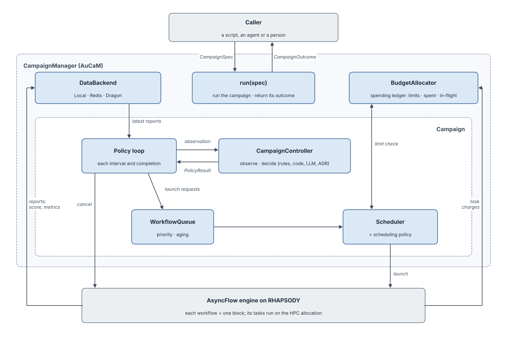

# AuCaM architecture overview

*What AuCaM does, how its parts fit together and why.*

---

## The problem

Adaptive HPC science means stopping poor workflows early, launching more of what
works and staying within the allocation. Today most projects handle this with
their own scripts, and a person still watches the workflows and decides what to do
next. AuCaM takes over that work: a campaign describes what success looks like
and how to react to results, and AuCaM launches the workflows, watches their
progress, cancels the ones that fall behind and ends the campaign when it is
done. It then returns the campaign's outcome to the caller — a person, a
script or an agent — which can plan the next campaign.

---

## Concepts

| Term | Meaning |
|---|---|
| **Campaign** | One coordinated scientific effort toward a goal, e.g. "run folding simulations until 50 high-confidence structures are found". It has workflow types, decision logic and a budget. |
| **Workflow** | One unit of work that AuCaM launches and cancels: a simulation, an analysis, a scoring pass. Many run in parallel, up to the campaign's limit on workflows running at once. |
| **Caller** | Whoever runs the campaign — a person, a script or an agent. It calls `CampaignManager.run(spec)` and gets the campaign's outcome when it ends, then can run the next campaign. |
| **Controller** | A campaign's decision logic: which workflows to launch, which to cancel, when the goal is reached. |
| **Policy cycle** | The controller's periodic step: observe the campaign, decide, act. It runs every `policy_interval_s` and whenever a workflow finishes. |
| **Budget** | Spending limits (CPU-hours, GPU-hours or any other dimension, such as LLM tokens) for the campaign, plus limits on how many workflows run at once. |

A workflow can be a **Python function** or a **command-line program** written
in any language. AuCaM runs either kind as a single AsyncFlow *block*, so both
are launched, cancelled and charged the same way. A Python workflow submits its
compute steps as AsyncFlow tasks, and RHAPSODY places them on the allocation; a
command-line program runs as a single task. Cancelling a workflow cancels all of
its tasks, and what those tasks cost is charged to the workflow.

---

## Components



AuCaM runs one campaign at a time:

```python
cm = CampaignManager()
outcome = await cm.run(spec)  # returns when the campaign ends
```

- **Campaign Manager** — sets up execution, runs the campaign and returns its
  outcome. The caller can then call `run()` again with the next spec.
- **Budget ledger** (`BudgetAllocator`) — the campaign's limits, actual
  spending and the expected cost of its running workflows. Used to stop
  launching at the spending limit.
- **Data backend** — the channel through which workflows report to AuCaM (a
  score and metrics). An in-process store for local runs; Redis or Dragon for
  multi-node runs.
- **Execution** — an AsyncFlow engine on a RHAPSODY backend; AuCaM launches
  and cancels workflows through it.

Each of the following works out of the box; a campaign can replace the
controller or the scheduling policy with its own.

- **Controller** — the campaign's decision logic. Out of the box it keeps
  launching new workflows of the types in its `launch` list (set in the
  campaign spec), up to the campaign's concurrency limits (`LaunchRule`);
  cancels workflows whose latest report meets a condition, such as a score below a
  threshold (`CancelRule`); and ends the campaign after N successful workflows or
  when its goals are met — no code needed. A subclass can extend or replace
  this with any logic, including an LLM or ADR.
- **Queue** — waiting launch requests, ordered by priority (CRITICAL, HIGH,
  NORMAL, LOW) and arrival; NORMAL requests that wait too long become HIGH.
- **Scheduler** — starts queued requests whenever a slot is free. CRITICAL
  requests go first; a scheduling policy picks among the rest. Out of the box
  this is a UCB1 (Upper Confidence Bound) bandit over workflow types: it
  balances *exploring* (trying types it knows little about) with *exploiting*
  (launching the types that complete most often), and explores less as the
  budget runs down. FIFO is also built in, and a campaign can plug
  in its own policy.

**What a campaign gets without writing any code**, compared with launching
workflows by hand:

- poor workflows are cancelled early (`CancelRule`), and so are workflows
  that stop reporting or overrun their wall time;
- the bandit shifts launches toward workflow types that complete;
- AuCaM records what each workflow costs (CPU-hours, GPU-hours or another unit
  such as LLM tokens), based on the resources its tasks requested and how long
  they ran, or on what the workflow reports, and stops launching new workflows once
  the campaign reaches its spending limit;
- a workflow type can wait for another to succeed (dependencies);
- state is checkpointed, and a restarted campaign continues;
- the outcome — counts, spending, the controller's summary — goes back to the
  caller, which can analyse it and plan the next campaign (for example, drop
  workflow types that never succeeded, or adjust parameters and limits).

The [capability demo](cm-advantages.md) shows cancellation, the bandit and
accounting on one run.

---

## Example: one policy cycle with the out-of-the-box controller (no code needed)

1. Three of the campaign's simulations are running. A policy cycle starts,
   either because the policy interval has passed since the last cycle, or
   because one of the campaign's workflows has just finished (a finished
   workflow triggers a cycle right away).
2. AuCaM collects each running simulation's latest report, telemetry (including
   how many of the campaign's tasks are still waiting to start and how many are
   running), the queue and the campaign's budget state.
3. The controller's built-in rules decide. `CancelRule` sees one simulation
   scoring 0.1, below the campaign's 0.4 threshold, and cancels it.
   `LaunchRule` sees no simulation request waiting in the queue and adds one.
4. AuCaM cancels the simulation and queues the request.
5. When the cancelled simulation ends, its slot is freed, its spending is
   recorded and the controller is told its result.
6. The scheduler starts the queued request in the freed slot, within the
   campaign's workflow-count and spending limits.

A custom controller could decide anything else in step 3, such as launching
several workflows at once or changing goals.

---

## How a campaign ends

| Exit reason | When |
|---|---|
| `goals_satisfied` | Ended by AuCaM: the controller declares goals (target values for metrics, e.g. "best energy ≤ −8"), AuCaM checks them every cycle, and all are met. The goal is reached. |
| `controller_terminate` | Ended by the controller, which decides to stop for its own reason: its goal is reached (the built-in "N successful runs" goal ends this way), or it gives up (e.g. the goal looks unreachable). The goal may or may not be reached. |
| `spending_limit` | The spending limit is reached and no workflows are running |
| `campaign_idle` | Nothing queued or running for a while (`idle_exit_s`, configurable or off) |
| `signal` | AuCaM receives SIGTERM or SIGINT, e.g. before a SLURM job's time limit, or the caller calls `cm.stop()` |

In each case the queue is cleared, running workflows are cancelled with a
grace period, a final checkpoint is written (if enabled), and `run()` returns
a `CampaignOutcome`: the exit reason, workflow counts per type, time,
spending, whether the goal was reached, and the controller's summary (e.g. the
best score). The caller can use it to plan the next campaign.

---

## Budgets

A campaign limits how many workflows run at once (`max_concurrent_workflows`
in total and `max_concurrency_per_workflow` for each workflow type) and can
set a spending limit. AuCaM adds what has been spent to the expected cost of
the workflows still running, and stops starting new workflows once that total
reaches the limit. Workflows already running are not cancelled: the campaign
ends after they finish.

See [budgets and spending](budget.md) for how spending is measured.

---

## Design decisions

*Choices that may look like missing features, and why AuCaM makes them.*

- **One campaign at a time.** `run()` runs one campaign and returns its
  outcome; a second `run()` while one is running raises an error. *Why:* the
  caller decides what to run next from each outcome. A scheduling policy
  instance passed to several specs keeps what it learned across campaigns.
- **Resources are given per workflow, not per campaign.** The campaign limits what
  it spends and how many workflows run; it has no limit on CPUs or GPUs busy at
  once. Each workflow, though, is given an allocation when it starts — a spending
  limit and the CPUs and GPUs it may use at once — sized by the scheduler from
  the controller's request, the type's learned cost and the remaining budget.
  The workflow must size its own tasks to it; AuCaM cancels a workflow that spends
  past its limit or uses more than it was given. *Why:* AuCaM cannot know which
  nodes a workflow's tasks hold, so the workflow, which does know, is told its
  share and held to it.
- **The controller makes the scientific decisions.** AuCaM itself cancels a
  workflow only when it stops reporting, runs past its wall-time limit, or
  spends past its own spending limit; every
  other launch and cancel comes from the controller. *Why:* what counts as a
  poor result depends on the science. AuCaM ships default rules, and a campaign
  can replace them.
- **Idle campaigns end by default.** *Why:* a campaign without goals would
  otherwise wait forever and hold the allocation. Set `idle_exit_s=None`
  for a controller that waits on purpose.

---

## Further reading

- [Demo campaign guide](demo-campaign-guide.md) — run a campaign in minutes.
- [Capability demo](cm-advantages.md) — cancellation, learning and accounting
  on one run.
- [Campaign developer guide](campaign-developer-guide.md) — write workflows,
  controllers and the code that runs campaigns.
- [Budgets and spending](budget.md) — how spending is measured, limited and
  reported.
- [Code walkthrough](code-walkthrough.md) — module map for contributors.
- [Known gaps](known-gaps.md) — what is planned but not built yet.
