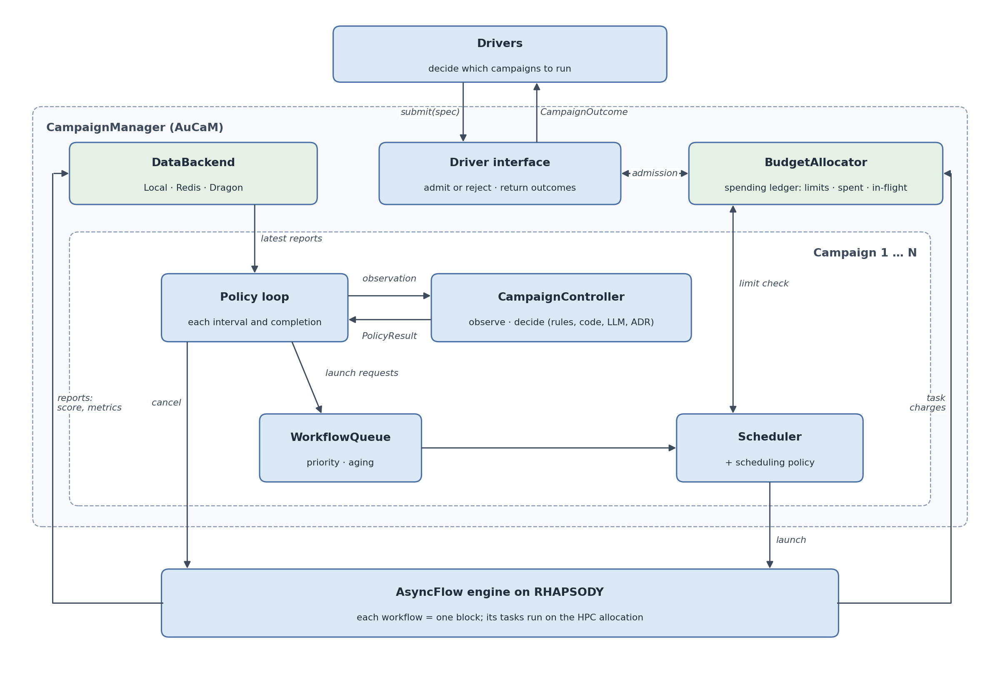
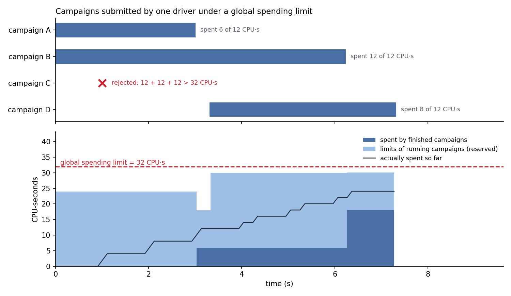

# AuCaM architecture overview

*What AuCaM does, how its parts fit together and why, without code. What is
planned but not built yet is listed in [known gaps](known-gaps.md).*

---

## The problem

Adaptive HPC science means stopping poor runs early, launching more of what
works and staying within an allocation. Usually every project writes its own
scripts for that. AuCaM is a reusable manager for it: a campaign says what
success looks like and how to react to results; AuCaM launches, watches,
cancels and stops.

---

## Concepts

| Term | Meaning |
|---|---|
| **Campaign** | One coordinated scientific effort toward a goal, e.g. "run folding simulations until 50 high-confidence structures are found". It has workflow types, decision logic and limits. |
| **Workflow** | One unit of work that AuCaM launches and cancels: a simulation, an analysis, a scoring pass. Many run in parallel, up to the campaign's limits. |
| **Driver** | The code that decides which campaigns to run. It submits campaigns and receives each campaign's outcome when it ends. |
| **Controller** | A campaign's decision logic: which workflows to launch, which to cancel, when the goal is reached. |
| **Policy cycle** | The controller's periodic step: observe the campaign, decide, act. It runs every `policy_interval_s` and whenever a workflow finishes. |
| **Budget** | Spending limits (CPU-hours, GPU-hours or any other dimension, such as LLM tokens) per campaign and across all campaigns, plus limits on how many workflows run at once. |

A workflow is either a **Python function** or a **command-line program** in
any language. Either way AuCaM runs it as one AsyncFlow *block*, so launching,
cancelling and charging work the same for both: cancelling the block cancels
all its tasks, and its tasks' resources are charged to the workflow. A Python
workflow submits its compute steps as AsyncFlow tasks, which RHAPSODY places on
the allocation; a command-line program runs as one task.

---

## Components

**Shared by all campaigns**

- **Campaign Manager** — admits campaigns submitted by drivers, runs them,
  and returns each one's outcome to its driver.
- **Budget ledger** (`BudgetAllocator`) — one record of every campaign's
  limits, actual spending and the expected cost of its running workflows.
  Used to admit campaigns and to stop launching at a campaign's limit.
- **Data backend** — the channel through which workflows report to AuCaM (a
  score and metrics). An in-process store for local runs; Redis or Dragon for
  multi-node runs.
- **Execution** — a shared AsyncFlow engine on a RHAPSODY backend; AuCaM
  launches and cancels workflows through it.

**One set per campaign** — each part works out of the box; a campaign can
replace the controller or the scheduling policy with its own.

- **Controller** — the campaign's decision logic. Out of the box it keeps
  launching new runs of the workflow types you list, up to the campaign's
  concurrency limits (`LaunchRule`); cancels runs whose latest report meets a
  condition, such as a score below a threshold (`CancelRule`); and ends the
  campaign after N successful runs or when its goals are met — no code needed.
  A subclass can extend or replace this with any logic, including an LLM or
  ADR.
- **Queue** — waiting launch requests, ordered by priority (CRITICAL, HIGH,
  NORMAL, LOW) and arrival; NORMAL requests that wait too long become HIGH.
- **Scheduler** — starts queued requests whenever a slot is free. CRITICAL
  requests go first; a scheduling policy picks among the rest. Out of the box
  this is a UCB1 (Upper Confidence Bound) bandit over workflow types: it
  balances *exploring* (trying types it knows little about) with *exploiting*
  (launching the types that complete most often), and explores less as the
  budget runs down. FIFO is also built in, and a campaign can plug
  in its own policy. Each campaign has its own policy, so learning stays within
  the campaign.

**What a campaign gets without writing any code**, compared with launching
workflows by hand:

- poor runs are cancelled early (`CancelRule`), and so are runs that stop
  reporting or overrun their wall time;
- the bandit shifts launches toward workflow types that complete;
- AuCaM records what each run costs (CPU-hours, GPU-hours or another unit
  such as LLM tokens), based on the resources its tasks requested and how long
  they ran, or on what the workflow reports, and stops launching new runs once
  the campaign reaches its spending limit;
- a workflow type can wait for another to succeed (dependencies);
- state is checkpointed, and a restarted campaign continues;
- the outcome — counts, spending, the controller's summary — goes back to the
  driver, which can analyse it and propose the next campaign (for example, drop
  workflow types that never succeeded, or adjust parameters and limits).

The [capability demo](cm-advantages.md) shows cancellation, the bandit,
accounting and driver feedback on one run.

---

## Example: one policy cycle with the out-of-the-box controller (no code needed)

1. Three of the campaign's simulations are running. A policy cycle starts,
   either because the policy interval has passed since the last cycle, or
   because one of the campaign's workflows has just finished (a finished
   workflow triggers a cycle right away).
2. AuCaM collects each running simulation's latest report, telemetry, the queue
   and the campaign's budget state.
3. The controller's built-in rules decide. `CancelRule` sees one simulation
   scoring 0.1, below the campaign's 0.4 threshold, and cancels it.
   `LaunchRule` sees no simulation request waiting in the queue and adds one.
4. AuCaM cancels the simulation and queues the request.
5. When the cancelled simulation ends, its slot is freed, its spending is
   recorded and the controller is told its result.
6. The scheduler starts the queued request in the freed slot, within the
   campaign's workflow-count and spending limits.

A custom controller could decide anything else in step 3, such as launching
several runs or changing goals.

---

## How a campaign ends

| Exit reason | When |
|---|---|
| `goals_satisfied` | Ended by AuCaM: the controller declares goals (target values for metrics, e.g. "best energy ≤ −8"), AuCaM checks them every cycle, and all are met. The goal is reached. |
| `controller_terminate` | Ended by the controller, which decides to stop for its own reason: its goal is reached (the built-in "N successful runs" goal ends this way), or it gives up (e.g. the goal looks unreachable). The goal may or may not be reached. |
| `spending_limit` | The spending limit is reached and no workflows are running |
| `campaign_idle` | Nothing queued or running for a while (`idle_exit_s`, configurable or off) |
| `signal` | AuCaM receives SIGTERM or SIGINT, e.g. before a SLURM job's time limit |

In each case the queue is cleared, running workflows are cancelled with a
grace period, a final checkpoint is written (if enabled), and the driver
receives a `CampaignOutcome`: workflow counts per type, time, spending,
whether the goal was reached, and the controller's summary (e.g. the best
score). The driver can use it to plan its next campaign.

---

## Budgets

- **Per campaign:** at most `max_concurrent_workflows` running (and
  `max_concurrency_per_workflow` per type), and a spending limit. AuCaM adds
  what has been spent to the expected cost of the workflows still running, and
  stops starting new workflows once that total reaches the limit. Workflows
  already running are not cancelled: the campaign ends after they finish.
- **Across campaigns:** a new campaign is admitted only if it fits: the
  number of running campaigns stays within its limit, and what finished
  campaigns spent plus the limits of running ones plus its own limit stays
  under the global spending limit. Otherwise it is rejected with the reason,
  and the driver can react.

See [budgets and spending](budget.md) for how spending is measured.

---

## Drivers

One or more drivers can submit campaigns, one after another or several at
once; campaigns run side by side. Each driver registers with
`expect_driver()` and calls `driver_done()` after its last submission. AuCaM
stops accepting campaigns when all drivers are done (or after
`GlobalBudget.n_campaigns` campaigns, or more than `max_rejections` budget
rejections, or when the global spending budget is used up) and exits once the
running campaigns have finished.

---

## Design decisions

*Choices that may look like missing features, and why AuCaM makes them.*

- **No limit on resources in use at once.** AuCaM limits what campaigns spend
  and how many workflows run, not how many CPUs or GPUs are busy. *Why:* AuCaM
  cannot know which nodes or GPUs a workflow's tasks hold at a given moment,
  and the HPC allocation itself already bounds what can run at the same time.
- **Campaigns don't learn from each other.** Each campaign has its own
  controller and scheduling policy, and neither sees other campaigns. *Why:*
  campaigns pursue different hypotheses, so what works in one can mislead
  another. Knowledge passes between campaigns through the driver, which reads
  each outcome and plans the next campaign.
- **The controller makes the scientific decisions.** AuCaM itself cancels a
  workflow only when it stops reporting or runs past its wall-time limit; every
  other launch and cancel comes from the controller. *Why:* what counts as a
  poor result depends on the science. AuCaM ships default rules, and a campaign
  can replace them.
- **Admission reserves a campaign's whole spending limit.** *Why:* an admitted
  campaign can always spend up to its limit, without being cut short because
  another campaign spent first. *Cost:* a new campaign can be refused while
  reserved budget is still unspent.
- **Idle campaigns end by default.** *Why:* a campaign without goals would
  otherwise wait forever and keep its budget reserved. Set `idle_exit_s=None`
  for a controller that waits on purpose.

---

## Further reading

- [Demo campaign guide](demo-campaign-guide.md) — run a campaign in minutes.
- [Capability demo](cm-advantages.md) — cancellation, learning, accounting and
  driver feedback on one run.
- [Campaign developer guide](campaign-developer-guide.md) — write workflows,
  controllers and drivers.
- [Code walkthrough](code-walkthrough.md) — module map for contributors.
