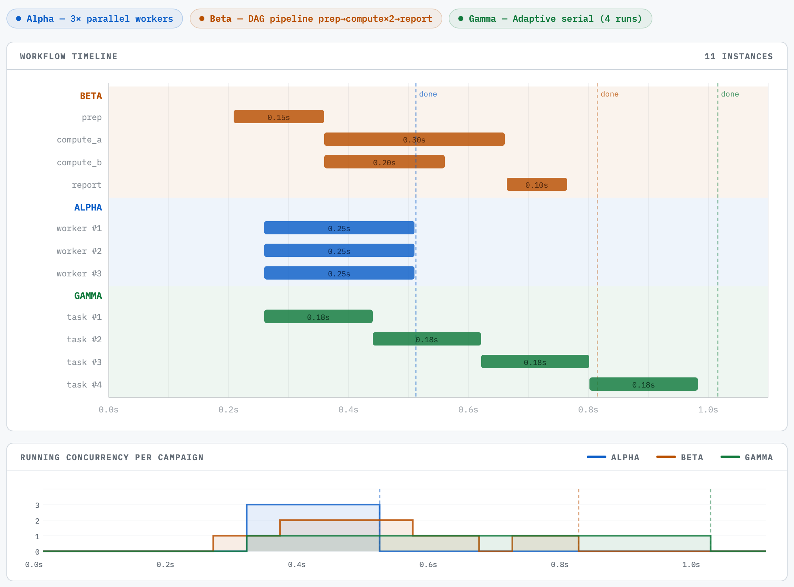

# AuCaM Architecture — Conceptual Overview

*For scientists and researchers who want to understand what AuCaM does without needing to read code.*

---

## The problem AuCaM solves

Running HPC simulations adaptively — stopping poor performers early, launching more of what's working, staying within resource budgets — normally requires writing custom orchestration scripts for every new project.  AuCaM replaces those scripts with a reusable policy engine.  The campaign defines what "success" looks like and what to do with intermediate results; AuCaM handles launching, monitoring, cancelling, and stopping.

---

## Key concepts

### Campaign

A **campaign** is one coordinated scientific run toward a defined goal.  Examples:

- Run protein-folding simulations until 50 high-confidence structures are found.
- Run parameter sweeps until the best energy found stops improving.
- Run MD trajectories, analyse each one immediately, stop after 20 passing analyses.

A campaign has a name, a goal, a budget, and a set of workflow types it can run.

### Workflow

A **workflow** is a single unit of computation — one simulation, one analysis job, one scoring pass.  Workflows are the things that actually run on HPC nodes.  Multiple workflows run in parallel, up to the concurrency limits declared in the campaign budget.

AuCaM recognises two kinds of workflow:

- **Block workflow** (`block=`) — a Python async function dispatched to the Rhapsody backend via asyncflow.  Best for analysis, scoring, and computation written in Python.
- **Subprocess workflow** (`launch_cmd=`) — an external command launched as an executable task.  Best for simulation codes that have their own binary or haven't been adapted to asyncflow.

### Policy cycle

Every few seconds (the *policy interval*) AuCaM asks the **campaign controller**: *"Here is what is running right now and what has finished — what should I do next?"*  The campaign controller returns a decision: launch more workflows, cancel underperforming ones, or declare that the goal is reached.

This loop — **Observe → Decide → Act** — repeats until the campaign controller signals success.

---

## The components and how they relate

Think of AuCaM like a research management system.  Here is each piece in plain terms:

### Campaign Manager

The top-level overseer.  It holds the **global budget** — the total cpu_hours, gpu_hours, or llm_tokens allowed across all campaigns in a session.  When the driver tries to start a new campaign, the Manager checks whether there is room; if the global budget is already exhausted by running and completed campaigns, it rejects the request with a reason.

### Driver

The driver is the experiment planner.  It is an async coroutine that decides *which* campaigns to submit and *when*.  It may submit campaigns sequentially (waiting for each `CampaignOutcome` before deciding what to run next) or concurrently (submitting several campaigns without waiting for earlier ones to finish).  Either way, a `CampaignOutcome` is available for each campaign once it completes; it includes how many workflows succeeded, how much budget was spent, and any scientific aggregates the controller chose to surface (like best score found).

### Campaign Controller

The controller is where the scientific policy lives.  A controller is written by subclassing `CampaignController` and implementing:

- **Decide** — given what is running and what has finished, return: what to launch, what to cancel, and whether the goal is reached.
- **On complete** — called after each workflow finishes; update internal state (e.g., accumulate scores).
- **Is goal reached** — return True when the campaign should stop.
- **Get summary** — return a dict of scientific results for the driver to inspect (best score, score distribution, etc.).

AuCaM ships a base controller with declarative rules (`LaunchRule`, `CancelRule`) so simple policies need no code at all.

### Queue

The queue is the waiting list of work requests.  Each policy cycle the CM calls `controller.decide()`, which returns what to launch; the CM translates those decisions into `LaunchRequest` items in the queue.  Items have priorities (CRITICAL, HIGH, NORMAL, LOW) and age — requests that wait too long are automatically upgraded to HIGH priority so they don't get stuck.

When the goal is reached, the queue is cleared immediately — no queued work starts after the goal is met.

### Scheduler

The scheduler decides *which* queued item to run next, subject to concurrency limits.  The default is a **UCB1 bandit** (Upper Confidence Bound — balances exploiting high-performing workflow types with exploring under-sampled ones) that learns, over time, which workflow types give better outcomes and gives them preferential slots.  Plain FIFO and an LLM-guided ranker are also available.

### Budget

> Full reference: `docs/budget.md`.

Two levels of budget accounting run simultaneously:

**Per-campaign budget** — limits how many workflows run at once (concurrency) and how much total resource a single campaign is allowed to consume (spending).  If a campaign hits its spending limit, it terminates gracefully.

**Global budget** — limits total spending across *all* campaigns in a session.  Checked at admission time: before a campaign is allowed to start, the Manager verifies that its declared spending, combined with already-consumed and currently-running spending, does not exceed the cap.

### Data backend

Workflows communicate back to the controller through a **data backend** — a shared key-value store.  The choice depends on how the workflows are deployed:

- **`LocalDictBackend`** — in-process Python dict; zero setup, used for local testing and CI.
- **`RadexDragonBackend`** — communicates via [radex](https://github.com/…/radex) `DragonClient` over Dragon's distributed dictionary (DDict); used for multi-node HPC runs under Dragon/SLURM.
- **`RhapsodyRedisBackend`** — communicates via `redis-py` over a Redis instance launched by Rhapsody's `RedisDataBackend`; used when Dragon is unavailable or for cross-cluster deployments.

The backend is selected via the `data_backend` field in `GlobalConfig` (see [Config quick reference](#config-quick-reference)).  Workflow code is identical in all cases — it only calls `reporter.emit()`; the CM constructs and injects the correct reporter implementation.

### Concurrent campaigns in practice

The Campaign Manager interleaves structurally different campaigns without any special coordination.
Each campaign declares its own workflow types, concurrency limits, and budget; the CM schedules
them against the shared resource pool independently.

The timeline shows three campaigns running simultaneously:
- **Alpha** — 3 parallel workers, all launched at once (flat fan-out)
- **Beta** — a DAG pipeline (prep → compute_a ∥ compute_b → report), where each step depends on the previous
- **Gamma** — adaptive serial (4 tasks, each triggered after the previous completes)

The CM accounts for each campaign's pool usage independently while enforcing the global budget across all three.

---

## A complete story: one policy cycle

1. Campaign A has been running for 30 seconds.  Three `sim_worker` simulations are currently active.
2. AuCaM wakes up (policy interval fires or a completion event arrives).
3. It collects the latest score reports from all three running simulations via the data backend.
4. It calls `controller.decide()` with a snapshot of everything: what is running, what has finished, current queue depth, resource usage.
5. The controller sees that one simulation has a very low score (0.1) — below the 0.4 threshold.  It returns: cancel that simulation, launch two new ones, continue.
6. AuCaM cancels the bad simulation, enqueues two new launch requests.
7. The scheduler picks the best candidates from the queue (based on bandit arm scores) and launches them.
8. The cancelled simulation's slot is freed; the budget is updated.
9. Repeat in 0.5 seconds.

---

## What happens at goal

When `controller.is_goal_reached()` returns True:

1. The queue is cleared immediately (no new work starts).
2. All in-flight workflows are cancelled with a graceful shutdown period.
3. The campaign writes its final state to a checkpoint (if configured).
4. A SUMMARY line is logged with final counts and spending.
5. The driver receives a `CampaignOutcome` with all results and `spent` amounts.
6. The global budget ledger is updated with the campaign's actual spending.

---

## What happens at budget exhaustion

If a campaign's cumulative spending hits its declared per-campaign limit, it terminates the same way as goal-reached.

If a *new campaign* is submitted and its declared spending, added to what is already spent and committed, would exceed the global cap, it is **rejected immediately** — before any workflows start.  The driver receives a rejection with the exact arithmetic.  The driver can react (try a cheaper campaign, skip, or stop entirely).

A subtler case: if some budget remains but the driver keeps proposing campaigns whose declared spending exceeds the remainder, every submission is rejected and the CM never terminates.  To guard against this, set `GlobalBudget(max_rejections=N)`: once N consecutive budget rejections occur, the CM auto-closes.  `GlobalBudget.n_campaigns` triggers auto-close once that many campaigns complete.  A driver signals completion by calling `cm.driver_done()` after its last `submit()`.  Multiple drivers can be active simultaneously — each calls `expect_driver()` before `run()` to register itself, and `driver_done()` when finished.  The CM closes the submission queue only when all registered drivers have called `driver_done()`; `run()` then exits once all running campaigns finish.

---

## Further reading

- **[Campaign developer guide](campaign-developer-guide.md)** — how to write a controller, define workflows, and submit campaigns.
- **[Dummy campaign guide](demo-campaign-guide.md)** — a worked example with all the files explained.
- **[Code walkthrough](code-walkthrough.md)** — classes, inheritance, and concurrency model for contributors.
