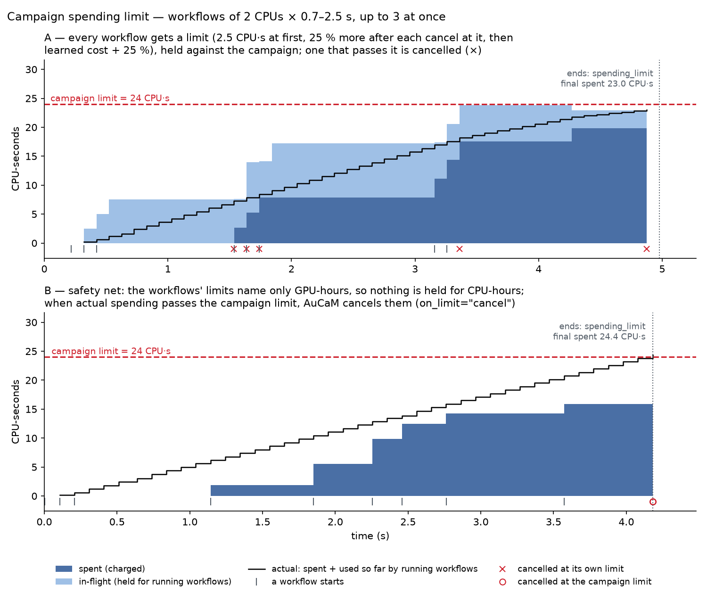
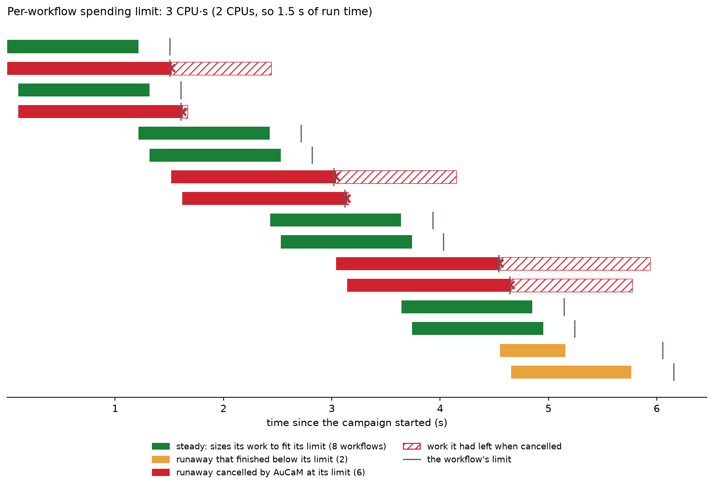
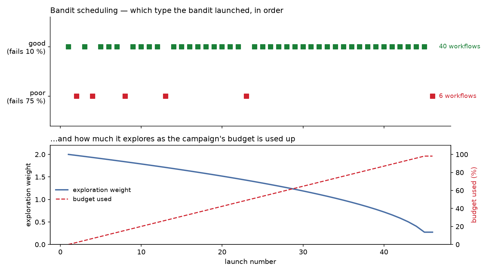

# AuCaM budgets and spending

How AuCaM limits what a campaign spends, how it measures spending, and what it
does with the numbers. Sections 1–7 are for campaign authors; sections 8–9
are implementation notes for developers.

---

## 1. Concepts

- **Campaign** — a set of workflows working toward one goal, steered by a
  controller (its decision logic).
- **Workflow** — one unit of work that AuCaM launches and cancels, such as a
  simulation run. It runs as an AsyncFlow block and may submit many **tasks**
  (individual programs or functions) to the execution backend.
- **Budget dimension** — what is counted, e.g. `cpu_hours` or `gpu_hours`
  (resource-hours: 2 GPUs for 1 hour = 2 GPU-hours), or any other quantity a
  workflow reports, such as `llm_tokens`. Each dimension is limited separately.
- **Spending limit** — the most a campaign may spend over its lifetime, per
  dimension.
- **Estimate** — how much one workflow of a given type is expected to cost. It
  starts as the workflow's `declared_spending` and is replaced by the average
  actual cost once a few workflows of that type have finished (§6).
- **Workflow limit** — the most one workflow may spend. Every workflow gets one
  when it starts, from its type's starting value or estimate + 25 %, then from
  the learned cost (§4); AuCaM cancels a workflow that spends past it.
- **Spent** — what AuCaM has actually charged so far.
- **In-flight** — what running workflows are held at and is not in *spent*
  yet: their limits (a workflow without one: its estimate). Counting it lets
  AuCaM launch only what fits, so running workflows cannot push a campaign
  over its limit.
- **Ledger** — the single place where all of the above is kept
  (`BudgetAllocator`, §8).

The limit is set in `CampaignBudget.spending` and checked before launching
workflows (§4).

---

## 2. Configuration

```python
# Campaign limit (optional; no `spending` = no limit)
CampaignBudget(
    max_concurrent_workflows=4,
    max_concurrency_per_workflow=2,
    capacity={"cpus": 64, "gpus": 4},  # the allocation's resources (required)
    spending={"cpu_hours": 1.0, "gpu_hours": 0.25},
)

# Expected cost of one workflow of this type (optional)
WorkflowConfig(
    name="sim",
    block=my_workflow,
    declared_spending={"wall_hours": 0.5, "cpu_hours": 0.5, "gpu_hours": 0.05},
    spending_limit={"cpu_hours": 1.0},  # starting limit per workflow (optional, §4)
    learn=True,  # False: every workflow keeps this limit (§4)
)

# A different limit for one workflow (optional; overrides the type's)
LaunchRequest.make("sim", spending_limit={"cpu_hours": 2.0})
```

`declared_spending` has two jobs:

- it is the initial **estimate**, which AuCaM holds as in-flight while the
  workflow runs;
- its `wall_hours` (expected run time) lets AuCaM **prorate** the cost when
  nothing better is measured (§3, method C). `wall_hours` itself is never
  charged.

A workflow type with neither `declared_spending` nor `spending_limit` still
runs, but AuCaM reserves nothing for it in advance and may charge it nothing. AuCaM logs a warning at start-up
when a campaign has a spending limit and a workflow type has no
`declared_spending`.

---

## 3. How spending is measured

AuCaM uses the most accurate source available for each workflow:

| Method | Source | When it is charged | `[SPEND] wf_done` shows |
|---|---|---|---|
| **A. Per task** | AsyncFlow telemetry: resources each task requested × how long it ran | As each task finishes | `method=exact source=task_telemetry` |
| **B. Reported** | Values the workflow reports itself | When the workflow ends | `method=exact source=wf_reported` |
| **C. Prorated** | `declared_spending` × actual / declared run time | When the workflow ends | `method=estimated source=wall_proration` |
| **D. None** | — | Never | `method=none source=no_declared_spending` |

### A. Per task

With telemetry on (`CampaignManager(enable_telemetry=True)`), AsyncFlow
publishes a telemetry event each time a task is created, starts and ends. Each
event identifies the workflow the task belongs to, the resources the task
requested, and (when the task ends) how long it ran. AuCaM subscribes to these
events. When a task ends, AuCaM charges the workflow `cpus × hours` and
`gpus × hours`, where `cpus` and `gpus` are what the task **requested** (not
what it actually used) and `hours` is how long it ran.

- A task counts only if its `task_description` states the resources it
  requests. On Dragon, that is `process_template` (one process) or
  `process_templates` (an MPI job: a list of `(ranks, template)`). Each rank
  counts as 1 CPU and no GPUs; add `cores_per_rank` or `gpus_per_rank` to
  charge more (Dragon ignores these two keys; only AuCaM reads them). For
  example:

  ```python
  task_description = {
      "process_templates": [(4, {})],
      "gpus_per_rank": 1,
  }  # 4 CPUs and 4 GPUs × run time
  ```

  A Dragon function task without a template is not charged per task; AuCaM
  uses methods B–D for it.
- The first such task switches the workflow to method A until it ends, and
  AuCaM no longer charges it by methods B–D. Per-task charges are
  more accurate, and adding a workflow-level estimate on top would count those
  tasks twice. Tasks of that workflow without resource keys state no
  resources, so they are not charged; give them resource keys if their cost
  matters.
- Tasks inside nested blocks are charged to the workflow that contains them.
- Only `cpu_hours` and `gpu_hours` are charged this way. Other dimensions that
  a method-A workflow reports (e.g. `llm_tokens`) are charged from its last
  report when it ends, as in method B.
- Method A needs an AsyncFlow version whose telemetry events carry the
  task's requested resources (not yet released). Without it, or with
  telemetry off, AuCaM uses methods B–D.

While the workflow runs: in-flight = estimate − charged so far (never below 0).

### B. Reported

The workflow reports how much it has spent so far, as metrics in its regular
reports. The values are running totals since the workflow started, not amounts
per report:

```python
await reporter.emit(score=s, metrics={"cpu_hours": 1.2, "loss": 0.03, "step": 40})
```

Metrics that count as spending are `cpu_hours`, `gpu_hours`, and any other
name that also appears in the workflow's `declared_spending`, its own
`spending_limit` or the campaign's limit (e.g. `llm_tokens`). Other keys in the same `metrics`, such as `loss` or `step`
above, are not charged; the controller still receives them as usual. When the
workflow ends, AuCaM charges the totals from its last report.

While the workflow runs: in-flight = the larger of the estimate and the latest
reported value. It never drops below the estimate, because nothing is in
*spent* yet.

### C. Prorated

For each dimension in `declared_spending` that the workflow did not report:

```
charge = declared_spending[dim] × actual_wall_hours / declared_spending["wall_hours"]
```

A workflow that finishes early is charged less than declared. One that runs
longer is charged more, unless `WorkflowConfig.max_wall_time_s` cancels it
first.

While the workflow runs: in-flight = estimate × max(1, elapsed / declared
wall time), so it grows once the workflow overruns.

Methods B and C combine per dimension: a reported dimension uses B, the others
use C.

### D. None

A dimension that is neither reported nor declared (with `wall_hours`) is not
charged.

---

## 4. How limits are enforced

AuCaM keeps a campaign within its spending limit at three points: before a
workflow starts, while it runs, and as a safety net for the whole campaign.

**1. Every workflow gets a limit, and only what fits starts.** When a request
is about to start, the scheduler gives the workflow its own spending limit
("Sizing each workflow", below): the controller's amount for this workflow if
it gave one, else what AuCaM has learned about the type, else the type's
starting value — `WorkflowConfig.spending_limit` as given, or its
`declared_spending` + 25 %. Then AuCaM checks every limited dimension:

```
spent + in_flight + the workflow's limit <= campaign limit   →   launch it
```

In-flight is what running workflows are held at: their limits. A request that
does not fit stays queued, and a cheaper one may start instead, even one of
lower priority; CRITICAL requests are checked too. The log shows
`[SCHEDULER-<campaign>] WAIT <type>: … stays queued` once per request.

**2. Each workflow stays within its own limit.** While a workflow runs, its
limit is held against the campaign, so the running workflows together are
never held at more than what is left; AuCaM cancels a workflow that spends
past its limit (below). A workflow cancelled at its limit makes the next ones
of its type get 25 % more, until the type has learned costs. So the campaign
goes over its limit only by what a workflow spends past its own limit before
the next check — at most about one policy cycle (panel A).

**3. The campaign limit cancels running work.** A workflow with no estimate at
all — no starting value, no `declared_spending`, and nothing learned yet — has
no limit of its own, so steps 1 and 2 cannot account for it. Every policy
cycle AuCaM therefore also adds up actual spending: what has been charged plus
what each running workflow has used so far. Once that goes past the limit, it
cancels the running workflows (gracefully, if their type has a
`cancel_grace_s`), charges what they used, and ends the campaign with
`spending_limit` (panel B). The log shows `[SCHEDULER-<campaign>] campaign
spending limit exceeded by actual spending: <dim>=… > … — cancelling N running
workflow(s)`. This is `CampaignBudget.on_limit="cancel"` (the default); with
`"finish"`, running workflows finish and the campaign can end above its limit.

So a campaign ends at most about one policy cycle's spending (plus any grace
period) above its limit; workflows that check their own limit and stop before
passing it, as the example campaigns do, keep it within.

The campaign also ends with `spending_limit` when nothing is running and
either spent + in-flight has reached the limit (`[SCHEDULER-<campaign>]
spending limit reached: …`) or no queued request fits what is left.



*Workflows of 2 CPUs that want 0.7–2.5 s of work, up to 3 at once, against a
24 CPU·s limit. A: declared at 1 s, each workflow gets a limit — 2.5 CPU·s at
first, 25 % more after each cancel at it, then its type's learned cost + 25 %
— held against the campaign; it ends at 23.0 CPU·s. B: with no estimate the
workflows have no limit of their own and nothing is held for them; when actual
spending passes 24 CPU·s, AuCaM cancels the running ones (○); it ends at 24.2.
Generated by `campaigns/hpc_campaign/figures/doc_figures.py --only budget`.*

The check covers the whole campaign, not each workflow type: one expensive
type can still use up the budget before others run, as long as each of its
workflows fits.

A campaign that is idle below its limit ends separately, after
`CampaignSpec.idle_exit_s` (see the developer guide, "How a campaign ends").

### Per-workflow limit

Every workflow with an estimate gets its own spending limit when it starts
("Sizing each workflow", below). `wall_hours` is not a spending dimension here;
use `max_wall_time_s` to limit run time. The limit is:

- **Held against the campaign.** While the workflow is running, its in-flight
  amount is its limit, not its estimate, in every dimension the limit names:
  the campaign reserves what the workflow may spend.
- **Passed to the workflow.** A Python workflow with a `context` parameter
  finds it in `context["spending_limit"]`; a command-line workflow gets one
  environment variable per dimension, e.g. `CM_SPENDING_LIMIT_CPU_HOURS=1.0`.
  The workflow can use it to size its own work.
- **Enforced.** Every policy cycle, AuCaM measures each workflow's spending so
  far, with the best source available, in the same order it charges (§3):
  per-task charges (finished tasks plus the elapsed share of running ones),
  else the running totals the workflow reports, else `declared_spending`
  prorated by elapsed time. A dimension with none of these is not checked.
  When spending so far exceeds the limit in any dimension, AuCaM cancels the
  workflow — gracefully if its type has a `cancel_grace_s` (developer guide,
  "How a campaign ends") — and logs `[WORKFLOW-…] spending limit exceeded
  <dim>=… > … — auto-cancel`. The workflow is charged what it used; its `WorkflowResult` has
  `over_budget=True` and the limit in `spending_limit`;
  `CampaignOutcome.budget_cancels` counts such workflows.

The check runs once per policy cycle, so a workflow can overshoot its limit by
what it spends in one `policy_interval_s` (more if it reports rarely, plus its
grace period if it has one). AuCaM's check is the safety net: a workflow that
must stay within its limit should check it itself — it receives the limit —
and stop before a step that would pass it, as all the example campaigns do.

### Sizing each workflow

How much a workflow gets is decided when it starts, by the scheduling policy's
`size()`. Per spending dimension, the first that applies:

1. the controller's amount for this workflow (`LaunchRequest.spending_limit`);
2. the type's learned cost (§6) + 25 % (`size_margin`), once it has 3
   successful workflows (`min_cost_samples`);
3. after a workflow of the type was cancelled at its own limit: that limit
   + 25 %, until learned costs take over;
4. the type's starting value, `WorkflowConfig.spending_limit`, as given;
5. the type's `declared_spending` + 25 % (the margin covers ordinary variation,
   so most early workflows finish and learning can start).

If the amount does not fit what is left in the campaign budget, the request
waits while other workflows run, and is dropped once nothing else runs.
AuCaM never gives a workflow less than this amount to make it fit. A type
with `WorkflowConfig(..., learn=False)` keeps a fixed amount: steps 2 and 3
are skipped. Resources (`cpus`,
`gpus`) follow the same order, with the type's learned peak use instead of
learned cost and no declared step; AuCaM enforces them like the spending
limit. A campaign can replace this rule with its own (developer guide, "How
much each workflow gets").



*Two workflow types, each with a 3 CPU·s limit per workflow. `steady` reads
its limit and sizes its work to fit; `runaway` ignores it, and AuCaM cancels
every `runaway` workflow as it passes the limit (the tick on each bar). Generated by
`campaigns/hpc_campaign/figures/doc_figures.py --only runlimit`.*

Each example campaign shows this with a ready-made configuration:
`campaigns/demo_campaign/run_campaign.py --overspend`,
`campaigns/hpc_campaign/campaign_configs/campaign_overuse.yaml` and
`campaigns/ddsim_aucam/campaign_configs/campaign_overuse.yaml`. The same for
resources (a workflow that uses more CPUs than it was given):
`campaigns/demo_campaign/run_campaign.py --overcpu` and
`campaigns/hpc_campaign/campaign_configs/campaign_overuse_cpus.yaml`.

---

## 5. What decision logic sees

### Controller

Every policy cycle (the controller's periodic decision step), the
controller's observation includes `obs["budget"]`:

```python
{
    "limits": {"cpu_hours": 1.0, "gpu_hours": 0.25},
    "spent": {"cpu_hours": 0.34, "gpu_hours": 0.028},
    "in_flight": {"cpu_hours": 0.10},
    "capacity": {"cpus": {"total": 64, "in_use": 16, "free": 48}},
    "burn": {
        "cpu_hours": {
            "remaining": 0.56,
            "fraction_left": 0.56,
            "rate_per_hour": 0.9,
            "projected": 0.62,
            "hours_to_limit": 0.62,
        },
        "gpu_hours": {...},
    },
    "by_type": {
        "sim": {
            "completed": 5,
            "cancelled": 2,
            "failed": 0,
            "spent": {"cpu_hours": 0.30},
            "avg_cost": {"cpu_hours": 0.043},
            "cost_per_completed": {"cpu_hours": 0.06},
            "mean_score": 0.81,
        },
    },
}
```

Per limited dimension in `burn`:

| Key | Meaning |
|---|---|
| `remaining` | `max(0, limit − spent − in_flight)` |
| `fraction_left` | `remaining / limit` |
| `rate_per_hour` | Spending charged per hour over the last (up to 20) policy cycles; 0 in the first cycle |
| `projected` | spent + in-flight + the estimated cost of the queued requests (each at its own limit, else the learned or declared cost) |
| `hours_to_limit` | `remaining / rate_per_hour`; `None` while the rate is 0 |

`by_type` covers every finished workflow of each type: `completed` /
`cancelled` / `failed` counts, total `spent`, `avg_cost` (spent ÷ finished
workflows), `cost_per_completed` (spent, cancelled and failed workflows
included, ÷ completed workflows; empty until one completes) and `mean_score`
(mean final score of completed workflows).

A controller can use these, for example, to stop launching a type whose cost
per completed workflow is too high, to stop when `projected` exceeds the
limit, or to end the campaign early. `obs["learned_cost"]` and
`obs["allocations"]` show what AuCaM has learned per type and what each
finished workflow got and achieved (developer guide §8).

`obs["wf_spend"]` gives each running workflow's spending so far. The built-in
`CostCancelRule` uses it to cancel a workflow that has spent a set amount since
its score last improved (developer guide, "Built-in rules").

### Scheduler (bandit)

The default scheduling policy (a UCB1 bandit, which balances trying workflow
types it knows little about against favoring types that complete) explores
less as the budget is used up:

```
used        = max over limited dimensions of (spent + in_flight) / limit   (0–1)
exploration = default_exploration × √(1 − used)
```

With no budget used it explores normally; with the budget used up it only
picks the types that have done best so far.

With `BanditSchedulingPolicy(cost_aware=True)` the reward also accounts for
cost: reward × 1 / (1 + `cost_weight` × relative cost), where relative cost is
the workflow's spending ÷ the average spending of the campaign's finished
workflows (averaged over dimensions). A type that completes as often as another
but costs twice the average earns a third of the reward instead of a half.



---

## 6. Learned cost estimates

After 3 workflows of a type have completed (`CampaignSpec.min_cost_samples`),
AuCaM uses their average actual cost as the estimate for new workflows of that
type, instead of `declared_spending`, and their average peak CPUs / GPUs in use
for its resources. Only completed workflows count, since cancelled and
failed ones are partial. A type with `learn=False` keeps its starting
amount; its averages are still shown.

The averages, and the per-type totals in `obs["budget"]["by_type"]`, are saved
in the checkpoint: a restarted campaign keeps using what it learned.

---

## 7. Results, logs and status

### Per-workflow spending

`WorkflowResult.spent` holds what the workflow was charged, e.g.
`{"cpu_hours": 0.035, "gpu_hours": 0.003}`; `spending_limit` the workflow's own
limit, if any; `over_budget` whether AuCaM cancelled it for exceeding that
limit. The controller's `on_complete()`
and on-completion hooks receive it. (For method A, task charges that arrive
after the workflow has ended go into the ledger but not into `spent`.)

### Log lines

| Line | Level | When |
|---|---|---|
| `[SPEND] wf_done  wf=… method=… source=… cpu_h=… gpu_h=… wall_s=… rc=…` | INFO | A workflow ends (method: §3) |
| `[SPEND] campaign=…  spent_cpu_h=… spent_gpu_h=… in_flight_cpu_h=… in_flight_gpu_h=… budget_used=…%` | INFO | Each policy cycle, once anything is spent or in flight |
| `[SPEND] task_started  wf=… task=… cpus=… gpus=…` | INFO | A method-A task starts |
| `[SPEND] task_charged  wf=… task=… cpu_h=… gpu_h=… wf_cpu_h=… wf_gpu_h=… budget_used=…%` | INFO | A method-A task is charged |
| `[SCHEDULER-…] spending limit reached: …` | INFO | Campaign limit reached (once) |
| `[WORKFLOW-…] spending limit exceeded <dim>=… > … — auto-cancel` | WARNING | A workflow spent past its own limit (§4) |
| `[WORKFLOW-…] resources exceeded <key>=… > … — auto-cancel` | WARNING | A workflow used more CPUs/GPUs at once than it was given |
| `[SCHEDULER-…] campaign spending limit exceeded by actual spending: …` | INFO | `on_limit="cancel"`: running workflows are cancelled (§4) |
| `[WORKFLOW-…] CANCEL signal sent; grace …s` | INFO | A graceful cancel starts |
| `[WORKFLOW-…] did not exit within its grace period — cancelling` | WARNING | A graceful cancel ends in a forced one |
| `[SCHEDULER-…] WAIT <type>: …; stays queued` | INFO | A request does not fit the remaining budget or the free CPUs / GPUs yet (§4); logged once per request |
| `[SCHEDULER-…] DROP <type>: …` | INFO | A request was dropped: it does not fit with nothing else running, or needs more than the capacity |
| `[BANDIT] …  budget_rem=…%  c_eff=…  arms={type: μ=…}` | INFO | The bandit chooses among queued requests |
| `[BANDIT] …  → <type>  ucb=…  c_eff=…` | INFO | The bandit picks a type it has seen before |
| `[CM] Campaign … SUMMARY — exit=… spent={…}` | INFO | A campaign ends |
| `[BLOCK-TAG] …`, `[SPEND-DBG] … filtered` | DEBUG | Method-A event routing (§9) |

---

## 8. Implementation: the ledger (`src/aucam/budget.py`)

`CampaignManager.run()` creates one `BudgetAllocator` per run and passes it
to the campaign; every public method takes one lock.

| Kept | Meaning |
|---|---|
| `limits` | `CampaignBudget.spending`, set when the campaign starts |
| `spent` | Actual charges |
| `in_flight[wf_id]` | Expected remaining cost of each running workflow (§3) |

| Method | Called from | Purpose |
|---|---|---|
| `open()` | `_CampaignInstance` start | Set the limits |
| `set_in_flight()` | `_launch()`; `_on_task_event()` (A); `_collect_telemetry()` (B–D) | Set a workflow's in-flight |
| `record()` | `_on_task_event()` (A); `_on_done()` (B–D) | Add charges to `spent` |
| `clear_in_flight()` | `_on_done()` | Workflow ended |
| `limit_reached()` | `_spending_limit_reached()` | Campaign limit check (§4) |
| `shortfall()` | `_drain_queue()` | Does a request's cost fit what is left (§4) |
| `spending_fraction()` | `_drain_queue()` → `SchedulingContext.budget_remaining_fraction`; `[SPEND]` logs | "used" in §5 |
| `campaign_view()` | Policy cycle | `obs["budget"]` (§5) |
| `close()` | `CampaignManager.run()` | Return `spent` for `CampaignOutcome.spent` |

Per-workflow state in `_CampaignInstance` (`src/aucam/campaign.py`):
`_estimates` (launch estimate), `_task_level` (workflows on method A),
`_task_usage` (their charges), `_type_cost_stats` (learned averages, §6).

## 9. Implementation: routing task events (method A)

AsyncFlow tags each task event with `attributes["asyncflow.workflow_id"]`, the
uid of the enclosing block, and adds `attributes["resources"]` for tasks that
requested resources (`requested_resources()` in asyncflow's
`workflow_manager.py`). AuCaM maps tags to workflows in `_wf_tags`:

- `_launch()` maps the workflow id to itself;
- `_run_as_block()` maps the workflow's block uid (read from the block's own
  future through `_fut_box` when the block body starts);
- `_on_task_event()` maps each nested block (a `TaskCreated` event whose
  `task_id` starts with `block.` and whose parent tag is already mapped), so
  any depth of nesting works.

`_on_task_event()` marks a workflow method A on its first event with
resources, charges `TaskCompleted` / `TaskFailed` / `TaskCanceled` events, and
updates in-flight. `_on_done()` then skips the completion-time charge for that
workflow.
