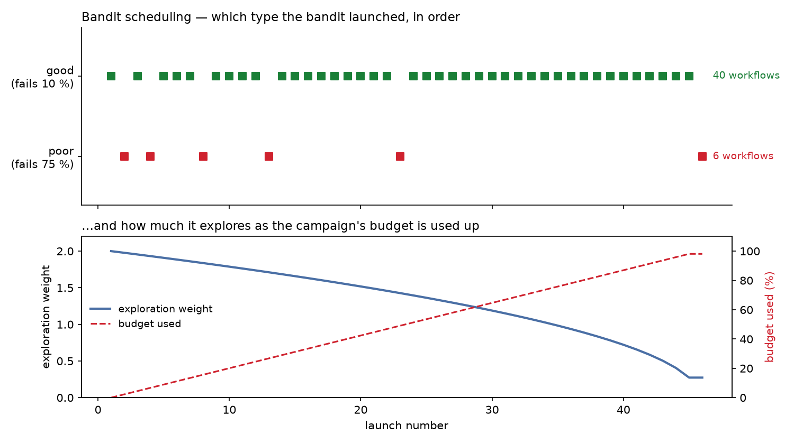
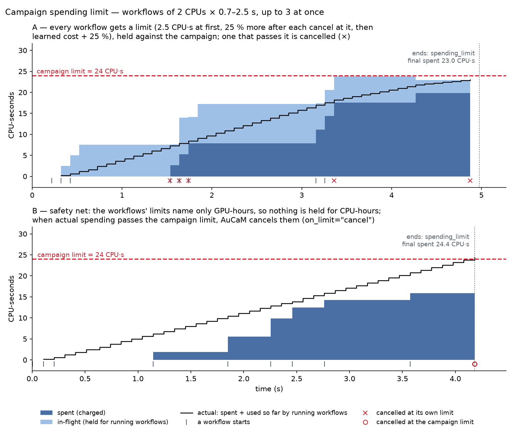

# Campaign developer guide

How to write and run a campaign: workflows, decision logic and limits. For the
ideas behind AuCaM read the [architecture overview](architecture-overview.md)
first; to run something right away, see the [demo campaign](demo-campaign-guide.md).

1. [Concepts](#1-concepts)
2. [Minimal example](#2-minimal-example)
3. [Workflows](#3-workflows)
4. [Reporting from a workflow](#4-reporting-from-a-workflow)
5. [The controller](#5-the-controller)
6. [How a campaign ends](#6-how-a-campaign-ends)
7. [Dependencies between workflow types](#7-dependencies-between-workflow-types)
8. [Scheduling](#8-scheduling)
9. [Budgets and limits](#9-budgets-and-limits)
10. [Running campaigns](#10-running-campaigns)
11. [Troubleshooting](#11-troubleshooting)
12. [Reference](#12-reference)

---

## 1. Concepts

- **Campaign** (`CampaignSpec`) — workflow types, a controller, limits and
  settings. AuCaM runs it until it ends (§6).
- **Workflow type** (`WorkflowConfig`) — a kind of work, e.g. `sim_worker`.
  Each launch of it is one **workflow**; AuCaM runs every workflow as one
  AsyncFlow block, its unit of launch, cancellation and accounting.
- **Controller** (`CampaignController`) — decides what to launch and cancel.
  It is called every **policy cycle**: every `policy_interval_s` and whenever
  a workflow finishes.
- **Queue and scheduler** — the controller's launch requests wait in the
  campaign's queue; the scheduler starts them when a slot is free, choosing
  with the campaign's **scheduling policy**.
- **Ledger** — records what the campaign spends; limits are checked against
  it (§9).
- **Running** — `outcome = await CampaignManager().run(spec)` runs the
  campaign and returns its outcome (§10).

---

## 2. Minimal example

```python
import asyncio
import random

from src.aucam import (
    CampaignBudget,
    CampaignController,
    CampaignManager,
    CampaignSpec,
    WorkflowConfig,
    WorkflowReporter,
)


async def my_sim(reporter: WorkflowReporter) -> None:
    for step in range(5):
        await asyncio.sleep(0.05)
        await reporter.emit(score=random.random(), iteration=step)


spec = CampaignSpec(
    name="my_campaign",
    budget=CampaignBudget(max_concurrent_workflows=4, max_concurrency_per_workflow=4),
    controller=CampaignController(launch=["sim"], goal_type="sim", goal_n=10),
    workflows=[WorkflowConfig(name="sim", block=my_sim)],
    policy_interval_s=0.5,
)


async def main() -> None:
    outcome = await CampaignManager().run(spec)
    print(outcome.exit_reason, outcome.completed, outcome.spent)


asyncio.run(main())
```

The controller keeps one `sim` request queued (`launch=`) and ends the
campaign after 10 successful runs (`goal_type`, `goal_n`). The log ends with a
line like:

```
[CM] Campaign my_campaign SUMMARY — exit=controller_terminate run=13 ok=10 cancelled=3 ...
```

(`cancelled` counts the runs still going when the goal was reached.)

---

## 3. Workflows

```python
WorkflowConfig(
    name="sim_worker",  # unique within the campaign
    block=my_async_fn,  # a Python workflow ── or ──
    launch_cmd=["./sim", "--fast"],  # a command-line program (any language)
    declared_spending={"wall_hours": 0.5, "cpu_hours": 4.0},  # expected cost of one run (§9)
    spending_limit={"cpu_hours": 6.0},  # cancel a run that spends more (§9)
    task_description={"ranks": 4, "cores_per_rank": 8},  # launch_cmd: resource request
    env={"OMP_NUM_THREADS": "8"},  # launch_cmd: extra environment variables
    launch_on_start=True,  # queue one request when the campaign starts
    max_wall_time_s=3600.0,  # cancel a run that takes longer
    stale_timeout_s=120.0,  # cancel a run that stops reporting (after its first report)
    supports_pause=False,  # True only if the workflow handles PAUSE/RESUME
    on_completion=callback,  # called with the WorkflowResult of every run
)
```

Exactly one of `block` and `launch_cmd` must be set.

### Python workflows

An `async def` that runs inside AuCaM's process as the body of an AsyncFlow
block. AuCaM passes these arguments by name, to any function that declares
them (in any order):

- `reporter` — the `WorkflowReporter` (§4);
- `flow` — the AsyncFlow engine; submit compute steps as `@flow` tasks
  so they run on the allocation, are cancelled with the workflow and are
  charged to it;
- `context` — the `LaunchRequest.context` dict of this launch.

```python
async def my_worker(reporter: WorkflowReporter, flow=None, context=None) -> None:
    @flow.function_task
    async def step(i): ...

    for i in range(context.get("n_steps", 10)):
        result = await step(i)
        await reporter.emit(score=result, iteration=i)
```

### Command-line workflows

`launch_cmd` runs as one executable task inside the workflow's block, with
`task_description` as its resource request (RADICAL-Pilot: `ranks`,
`cores_per_rank`, `gpus_per_rank`; Dragon: `process_template(s)`). AuCaM
starts it through `bash -c 'export …; exec <launch_cmd>'`, so no file has to
exist on the compute node. The program's environment has:

| Variable | Value |
|---|---|
| `CM_WORKFLOW_ID` | ID of this workflow |
| `CM_CAMPAIGN_ID` | Campaign name |
| `CM_CTX_<KEY>` | One per `LaunchRequest.context` entry |
| `CM_DATA_ENDPOINT`, `CM_DATA_BACKEND` | How to reach the data backend (Redis or Dragon only) |
| *`WorkflowConfig.env`* | As given |

Its exit code becomes `WorkflowResult.returncode` (§12).

### `on_completion`

A plain function called once per finished run, after
`controller.on_complete()` — for side effects such as saving results. Don't
call `controller.on_complete()` from it, and don't `await` in it. To start
follow-on work, use a dependency (§7) or the controller.

---

## 4. Reporting from a workflow

A report has a **score** (any value: a number, a dict, …) and optional
**metrics** (a dict). Each report replaces the previous one; the controller
sees the latest one every policy cycle, and the last one ends up in
`WorkflowResult.final_score` / `final_metrics`. A workflow that never reports
still runs; AuCaM then only tracks its lifecycle.

### From Python

```python
async def my_worker(reporter: WorkflowReporter) -> None:
    for step in range(n_steps):
        if await reporter.poll() == CampaignDecision.PAUSE:  # only with supports_pause=True
            save_state()
            await reporter.wait_for_resume()

        result = run_step(step)
        await reporter.emit(
            score=result.energy,
            metrics={
                "loss": result.loss,
                "node_id": socket.gethostname(),  # lets AuCaM match node telemetry
                "cpu_hours": cpu_s_so_far / 3600,
            },  # own spending, cumulative (§9)
            iteration=step,
        )
```

Keep the score and all metrics in every report — the last report is the one
that counts. `emit()` raises if the backend fails.

Metric keys AuCaM itself uses: `cpu_hours`, `gpu_hours` and any other budget
dimension (spending, §9); `cpu_seconds` / `gpu_seconds` (live use estimate);
`node_id`; `resource_usage` (from `BlockProfiler` / `TaskProfiler`).

### From a command-line program

Needs the Redis or Dragon data backend (with the default in-process backend
the program runs but cannot report). Three options:

1. **The `aucam-report` command** (installed with AuCaM; also
   `python -m src.aucam_client`):

   ```bash
   aucam-report emit --score 0.82 --metric cpu_hours=1.5 --iteration 3
   sig=$(aucam-report signal)                 # PAUSE, RESUME or nothing
   [ "$sig" = PAUSE ] && aucam-report wait-resume
   ```

   Values are parsed as JSON when possible; `--metrics '{"k": 1}'` passes an
   object. Exit status 2: not running as an AuCaM workflow (or bad value);
   1: backend error.
2. **Redis directly**, from any language: `SET <CM_WORKFLOW_ID>` to a JSON
   object `{"wf_id", "score", "metrics", "iteration", "emitted_at"}`
   (`emitted_at` = Unix time, used for stale detection); read signals with
   `GET` then `DEL` of `<CM_WORKFLOW_ID>:signal`.
3. **Python:** `from src.aucam_client import Reporter` (`emit()`,
   `poll_signal()`, `wait_for_resume()`); it needs only `redis` / `radex`.

### Data backends

Set with `CampaignSpec.data_backend`:

| Backend | Use |
|---|---|
| `LocalDictBackend` (default) | Local runs and tests; in-process |
| `RhapsodyRedisBackend` | Redis server; `pip install -e ".[redis]"` |
| `RadexDragonBackend` | Dragon distributed dictionary, multi-node HPC |

---

## 5. The controller

### Built-in rules — no code

```python
CampaignController(
    launch=["sim_worker", "analysis_worker"],  # keep one request of each queued
    goal_type="analysis_worker",
    goal_n=50,  # end after 50 successful analyses
    rules=[
        CancelRule(
            workflow_type="sim_worker",
            when=lambda r: r.score is not None and r.score < 0.3,  # r: latest WorkflowReport
        )
    ],
)
```

`LaunchRule(type)` (what `launch=` creates) adds a request only when none of
that type is queued. `CancelRule` cancels running workflows of its type whose
latest report matches `when`.

### Your own logic

Subclass `CampaignController` and override what you need:

| Method | Called | Default |
|---|---|---|
| `observe(queue_snapshot, budget, running, **kw)` → `dict` | Each policy cycle | Passes the inputs through |
| `decide(obs)` → `PolicyResult` | Each policy cycle, after `observe` | Applies the rules |
| `on_complete(result)` | Each finished run | Counts `completed` / `cancelled` / `failed` per type — call `super()` |
| `is_goal_reached()` → `bool` | By the default `decide()` | `goal_n` completions of `goal_type` |
| `goals()` → `list[Goal]` | At start | `[]` |
| `get_summary()` → `dict` | When the campaign ends | `{}`; returned in `CampaignOutcome.summary` |

The observation has these keys (plus any your `observe()` adds):

| Key | Content |
|---|---|
| `queue_snapshot` | `QueueSnapshot`: queued counts by priority and type |
| `budget` | This campaign's ledger entry: `limits`, `spent`, `in_flight`, `burn` (§9) |
| `running` | `{workflow_type: number running}` |
| `live_reports` | `{wf_id: WorkflowReport}` — latest report of each running workflow |
| `wf_types` | `{wf_id: workflow_type}` |
| `telemetry` | `TelemetrySnapshot`: run times, node readings, spending, live use estimates |
| `tasks` | AsyncFlow task counts for this campaign: `waiting` (not yet handed to the backend), `submitted` (waiting in the backend), `running`. `None` without telemetry (`enable_telemetry=True`). |

`decide()` returns:

```python
PolicyResult(
    decisions={wf_id: CampaignDecision.CANCEL},  # CANCEL, PAUSE, RESUME, NOOP
    launch_requests=[LaunchRequest.make("sim_worker", context={"seed": 7})],
    cancel_queued={"sim_worker": 2},  # drop up to 2 queued requests of a type
    goals=[Goal("best", metric="best_energy", threshold=-8.0, direction="minimize")],
    remove_goals=["old_goal"],
    terminate=False,  # True ends the campaign
)
```

When scaling a type down, cancel running workflows **and** drop queued
requests (`cancel_queued`), or the freed slots are refilled from the queue.

Example — a controller that tracks the best score and stops on a target:

```python
class BestScore(CampaignController):
    def __init__(self) -> None:
        super().__init__(launch=["sim"])
        self.best = None

    def on_complete(self, result: WorkflowResult) -> None:
        super().on_complete(result)
        if result.returncode == 0 and result.final_score is not None:
            self.best = (
                result.final_score if self.best is None else max(self.best, result.final_score)
            )

    def decide(self, obs: dict) -> PolicyResult:
        result = super().decide(obs)  # keep the launch rule
        result.terminate = self.best is not None and self.best > 0.95
        return result

    def get_summary(self) -> dict:
        return {"best": self.best}
```

---

## 6. How a campaign ends

| Exit reason | When |
|---|---|
| `goals_satisfied` | All `Goal`s are satisfied: each names a key of the observation, a threshold and `"minimize"` / `"maximize"` |
| `controller_terminate` | `decide()` returned `terminate=True` — including the built-in `goal_type` / `goal_n` goal |
| `spending_limit` | The campaign's spending limit is reached and nothing is running |
| `campaign_idle` | Idle for `idle_exit_s`: queue empty, nothing running or paused, no requests held by dependencies |
| `signal` | AuCaM received SIGTERM or SIGINT, or `cm.stop()` was called |

Then AuCaM clears the queue, cancels running workflows (waiting up to
`shutdown_timeout_s`), writes a final checkpoint and `run()` returns the
outcome.

`CampaignSpec.idle_exit_s`:

- `"auto"` (default): `max(5 s, policy_interval_s)` — `decide()` always gets
  at least one policy cycle to add work;
- seconds (≥ 0): a longer window, e.g. for a controller that adds work in bursts;
- `None`: never end an idle campaign, e.g. for a controller that waits for
  external data. It then ends only by the other reasons.

---

## 7. Dependencies between workflow types

```python
CampaignSpec(
    ...,
    workflows=[
        WorkflowConfig(name="sim_worker", block=sim),
        WorkflowConfig(name="analysis_worker", block=analysis, launch_on_start=False),
    ],
    dependencies=[
        WorkflowDependency(
            source="sim_worker",
            target="analysis_worker",
            condition=lambda r: r.returncode == 0,  # the default
        )
    ],
)
```

The target must have `launch_on_start=False`; otherwise it starts right away.
Requests for the target wait outside the queue until a `sim_worker` run
finishes and passes the condition. The first such run releases them (or adds
one request); each later passing run adds one more. For anything more complex
(all of several sources, a count, a score), launch from `decide()`.

---

## 8. Scheduling

When a slot frees up, CRITICAL requests start first; the scheduling policy
chooses among the rest (HIGH, NORMAL, LOW; NORMAL requests that wait longer
than `age_threshold_s` become HIGH).

| Policy | Behaviour |
|---|---|
| `BanditSchedulingPolicy` (default) | UCB1 over workflow types. Reward 1 for a completed run, 0 for cancelled or failed (`reward_fn=` to change). Explores less as the campaign's budget is used up. |
| `FIFOSchedulingPolicy` | Queue order |
| `ADRSchedulingPolicy`, `LLMSchedulingPolicy` | Stubs; behave as FIFO |

Pass a policy instance as `scheduling_policy=`, or `None` for a new bandit.
An instance passed to the specs of several runs keeps what it learned.

### How much each run gets

When a request is about to start, the policy's `size(request, ctx)` decides
its allocation: a spending limit and the resources it may use at once.

- **The controller states the intent** on the `LaunchRequest`: exact amounts
  (`spending_limit=`, `resources=`), or ranges (`bounds={"cpu_hours": (0.5, 4),
  "cpus": (2, 8)}`). Without either, the workflow type's
  `WorkflowConfig.spending_limit` and `resources` apply.
- **The policy decides the amount.** By default: exact amounts are kept; a
  spending range gets the type's learned cost × (1 + `size_margin`, 0.25), or
  the range's maximum before 3 runs have finished; a resource range gets its
  maximum; spending is capped at what is left in the campaign budget
  (`capped=True` in the result), or at remaining ÷ queued requests with
  `fair_share = True`. If even a range's minimum does not fit, the request is
  dropped (`CampaignOutcome.unfit_dropped`).
- **Override `size()`** in your own `SchedulingPolicy` to decide differently;
  `ctx` (`SizingContext`) has the proposal, learned costs, remaining budget
  and queue length.



---

## 9. Budgets and limits

```python
CampaignBudget(
    max_concurrent_workflows=4,  # running at once in this campaign
    max_concurrency_per_workflow=2,  # running at once per workflow type
    spending={"gpu_hours": 10.0},  # lifetime limit per dimension (optional)
)
```

- **Charging.** Each run is charged per task from AsyncFlow telemetry (with
  `CampaignManager(enable_telemetry=True)` and resource keys in the task
  descriptions), or from the spending it reports (cumulative `cpu_hours`,
  `gpu_hours`, …), or by prorating its `declared_spending` by its actual run
  time.
- **Limit.** AuCaM adds the expected cost of running workflows to what is
  already spent and stops launching once that reaches the limit; running
  workflows finish, then the campaign ends (`spending_limit`). Give every
  workflow type a `declared_spending`, or it is not counted in advance.
- **Resources per run.** `WorkflowConfig.resources={"cpus": 8, "gpus": 1}`
  (or `LaunchRequest.resources`) is what one run may use at once. The workflow
  gets it (`context["resources"]`, `CM_RESOURCES_<KEY>`) and must size its tasks
  to it; AuCaM cancels a run that uses more — measured from its running tasks
  with telemetry, or from the `cpus_in_use` / `gpus_in_use` it reports
  (`over_resources=True` in the result).
- **Per-run limit.** `WorkflowConfig.spending_limit` caps what one run of the
  type may spend; `LaunchRequest.make(..., spending_limit={...})` sets a
  different limit for one run. The limit is held against the campaign while
  the run goes, passed to the workflow (`context["spending_limit"]`, or
  `CM_SPENDING_LIMIT_<DIM>` for a command-line program), and enforced: AuCaM
  cancels a run once its spending so far exceeds it (`over_budget=True` in its
  result).
- **In the observation:** `obs["budget"]` has `limits`, `spent`, `in_flight` and
  `burn[dim] = {remaining, fraction_left}`.



Details — measuring methods, learned cost estimates, log lines:
[budgets and spending](budget.md).

---

## 10. Running campaigns

`CampaignManager.run(spec)` runs one campaign and returns its
`CampaignOutcome` when it ends. Your code — a script, an agent, a notebook —
reads the outcome and decides what to run next:

```python
async def main() -> None:
    cm = CampaignManager()
    spec = first_spec()
    while spec is not None:
        outcome = await cm.run(spec)
        print(outcome.exit_reason, outcome.goal_reached, outcome.spent, outcome.summary)
        spec = next_spec(outcome)  # e.g. drop types that never completed
```

- One `run()` at a time; a second call while one is running raises
  `RuntimeError`.
- `cm.stop()` ends the running campaign gracefully, as SIGTERM does
  (`exit_reason="signal"`).
- `CampaignManager(backend=...)` reuses a backend you started (e.g. Dragon on
  HPC) across runs and leaves it running; without one, each run starts and
  stops a local backend.

`CampaignOutcome`: `campaign_name`, `exit_reason`, `completed` / `cancelled` /
`failed` (per type), `elapsed_s`, `goal_reached`, `spent`, `summary`,
`budget_cancels` / `resource_cancels` (runs cancelled for exceeding their own
spending limit or resources), `unfit_dropped` (requests that did not fit the
remaining budget).

### Config-driven runners

`campaigns/hpc_campaign/run_campaign.py` and `campaigns/ddsim_aucam/` build
specs from YAML files (one for the manager, one for the campaign) with
command-line overrides. Their keys are specific to each example; see the
[demo campaign guide](demo-campaign-guide.md) and the files'
`campaign_configs/`.

---

## 11. Troubleshooting

| Symptom | Cause |
|---|---|
| The workflow never gets a reporter | The function must have a parameter named `reporter` |
| A command-line workflow's reports never arrive | It needs `RhapsodyRedisBackend` or `RadexDragonBackend` |
| A dependency target starts immediately | Set `launch_on_start=False` on it |
| The campaign ends with `campaign_idle` too early | Raise `idle_exit_s` or set it to `None` |
| PAUSE has no effect | `supports_pause=True` is needed, and the workflow must `poll()` |
| Spending stays 0 | No `declared_spending` and nothing reported; see [budget.md](budget.md) |

Planned features and known problems: [known gaps](known-gaps.md).

---

## 12. Reference

### `CampaignSpec`

| Field | Default | Meaning |
|---|---|---|
| `name`, `budget`, `controller`, `workflows` | — | Required |
| `dependencies` | `[]` | `WorkflowDependency` list (§7) |
| `policy_interval_s` | 60.0 | Seconds between policy cycles (also runs on every completion) |
| `shutdown_timeout_s` | 120.0 | Grace period for running workflows at shutdown |
| `idle_exit_s` | `"auto"` | §6 |
| `max_queue_depth` | 50 | Above this, a warning is logged (requests are still queued) |
| `age_threshold_s` | 300.0 | NORMAL requests waiting longer become HIGH |
| `data_backend` | `None` → `LocalDictBackend` | §4 |
| `checkpoint_dir` | `None` | Save state after every policy cycle; restore on restart |
| `scheduling_policy` | `None` → new `BanditSchedulingPolicy` | §8 |

### `WorkflowResult`

| Field | Meaning |
|---|---|
| `workflow_id`, `workflow_type` | Which run |
| `returncode` | 0 completed; −1 cancelled; otherwise failed: the program's exit code (128 + N if killed by signal N), or 1 |
| `wall_time_s` | Run time |
| `final_score`, `final_metrics` | From the last report |
| `spent` | What the run was charged |
| `spending_limit`, `over_budget` | The run's own spending limit (empty: none), and whether AuCaM cancelled it for exceeding it |
| `resources`, `over_resources` | What the run could use at once, and whether AuCaM cancelled it for using more |
| `capped` | The scheduler gave it less spending than requested, to fit the remaining budget |
| `resource_profile` | Measured CPU/memory use, when available |

### Imports

Everything is in `src.aucam`: `CampaignManager`, `CampaignSpec`,
`CampaignBudget`, `WorkflowConfig`, `WorkflowDependency`,
`CampaignController`, `CancelRule`, `LaunchRule`, `Goal`, `PolicyResult`,
`CampaignDecision`, `LaunchRequest`, `LaunchPriority`, `WorkflowReporter`,
`WorkflowReport`, `WorkflowResult`, `CampaignOutcome`,
`BanditSchedulingPolicy`, `FIFOSchedulingPolicy`, `SchedulingPolicy`,
`SchedulingContext`, `LocalDictBackend`, `RhapsodyRedisBackend`,
`RadexDragonBackend`, `TelemetrySnapshot`, `QueueSnapshot`, `BlockProfiler`,
`TaskProfiler`, checkpoint helpers. The command-line reporting client is
`src.aucam_client`.
