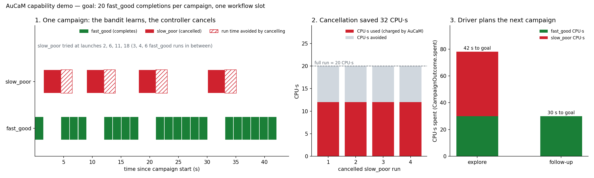

# AuCaM capabilities in one demo

Without AuCaM, each workflow runs to the end whatever its results, and someone has
to decide by hand what to launch next. AuCaM watches results while workflows run
and acts on them. `campaigns/demo_campaign/run_impact.py` shows four of its
capabilities in a run of about 75 seconds:

1. **Steering by the controller** — the campaign's controller watches the
   results of every run and acts on them. In the demo its built-in rules cancel
   runs whose results are poor; a custom controller can also launch work with
   its own parameters, change the campaign's goals as results arrive, or end
   the campaign early.
2. **Learning scheduler** — the campaign's bandit learns which workflow types pay
   off and launches the others less and less.
3. **Spending accounting** — AuCaM records what each run costs, so each
   campaign's cost is known.
4. **Driver feedback** — when a campaign ends, AuCaM returns its outcome to the
   driver, which uses it to plan the next campaign.

---

## Setup

Two workflow types compete for one workflow slot (`max_concurrent_workflows=1`):

| Type | Requests | Run time | Score | What happens |
|---|---|---|---|---|
| `fast_good` | 1 CPU | 1.5 s | 0.75–0.95 | completes |
| `slow_poor` | 4 CPUs | 5 s | 0.30–0.45, falling | cancelled at ~3 s, once its score drops below 0.30 |

One driver runs two campaigns, one after the other. Each campaign ends after 20
`fast_good` completions.

- **Campaign "explore"** offers both types. Its controller keeps one request of
  each type queued and has a `CancelRule` for `slow_poor`. Its scheduling policy
  is a UCB1 bandit that rewards completed runs (1) over cancelled ones (0).
- **Campaign "follow-up"** is planned by the driver from the outcome of
  "explore" (section 4).

Spending is measured in CPU-seconds: each workflow declares its expected cost
(`declared_spending`), and AuCaM charges it for the time it actually ran.

---

## Results



Numbers below are from one run; timings vary slightly from run to run.

### 1. Steering by the controller: cancellation (panel 2)

Each `slow_poor` run's score falls below 0.30 by its third report (about 3 s), and the
`CancelRule` cancels it. A full run would cost 5 s × 4 CPUs = 20 CPU·s; each
cancelled run cost 12 CPU·s. Over the 4 `slow_poor` runs, cancellation saved
**32 CPU·s**, and freed the slot for `fast_good` 2 s earlier each time.

### 2. Learning scheduler (panel 1)

The bandit has to choose between the two queued types each time the slot frees
up. It tries both, sees that `slow_poor` never completes, and tries it less and
less often: at launches 2, 6, 11 and 18, with 3, 4 and then 6 `fast_good` runs in
between. It keeps re-checking `slow_poor` now and then, in case it has improved.
That is how UCB1 balances exploring against exploiting what it has learned.

Each campaign has its own bandit, so it learns within that campaign only. What
carries over to the next campaign is the outcome the driver receives (section 4).

### 3. Spending accounting (panels 2 and 3)

AuCaM charges every finished run in its spending ledger and reports the totals:
per run in `WorkflowResult.spent`, per campaign in `CampaignOutcome.spent`.
Campaign "explore" spent 78 CPU·s: 30 on `fast_good`, 48 on cancelled `slow_poor`
runs. With a spending limit (`CampaignBudget.spending`), AuCaM would also stop
launching once a campaign reached it; see `docs/budget.md`.

### 4. Driver feedback (panel 3)

When a campaign ends, AuCaM returns a `CampaignOutcome` to the driver that
submitted it: completions, cancellations and failures per workflow type, time
taken, spending, whether the goal was reached, and the controller's own summary
(`get_summary()`). The driver can evaluate it and propose the next campaign. In
the demo, the driver keeps only the workflow types that completed at least once:

```python
outcome = await (await cm.submit(explore_spec)).wait()

def plan_next(outcome):
    by_type = outcome.summary["by_type"]          # from the controller's get_summary()
    return [t for t, s in by_type.items() if s["completed"] > 0]

next_types = plan_next(outcome)                   # ["fast_good"]
```

The follow-up campaign reached the same goal in **30 s instead of 42 s** and
spent **30 CPU·s instead of 78**. A real driver can do much more here, such as
changing parameters, raising or lowering limits, or proposing a new hypothesis;
the loop stays the same: submit, wait for the outcome, plan the next campaign.

---

## Not shown in this demo

- **Concurrent campaigns** — several campaigns, from one or more drivers, run at
  the same time; AuCaM admits a campaign only if its limits fit the global budget.
- **Spending limits and burn-down** — per-campaign and global limits, live
  in-flight estimates, learned cost estimates, and a bandit that explores less as
  the budget runs out; [budgets and spending](budget.md) shows each with a
  figure from a real run.
- **Dependencies** — a workflow type can start only after another one finishes
  and passes a condition (`WorkflowDependency`).
- **Command-line workflows** — programs in any language, reporting through the
  `aucam-report` command.
- **Checkpoint and restart** — a campaign's queue, counters and spending survive
  a restart.

See `docs/campaign-developer-guide.md` for how to use each of these.

---

## Running it

```bash
cd $WORK_DIR/campaign_manager

# Run the demo (two campaigns, ~75 s)
python campaigns/demo_campaign/run_impact.py --json-out /tmp/impact_run.json

# Draw the figure from the JSON output (needs matplotlib)
python -I campaigns/demo_campaign/gen_impact_fig.py \
    --json-in /tmp/impact_run.json \
    --out docs/figures/aucam_impact.png
```

Expected output (abridged):

```
── Campaign explore: types=['fast_good', 'slow_poor']
  elapsed=42.1s  goal_reached=True  cpu_spent=78.2 CPU·s
    fast_good  runs=20  completed=20  cancelled= 0  cpu=30.0 CPU·s
    slow_poor  runs= 4  completed= 0  cancelled= 4  cpu=48.1 CPU·s
  driver: dropping ['slow_poor'] for the next campaign

── Campaign follow-up: types=['fast_good']
  elapsed=30.1s  goal_reached=True  cpu_spent=30.1 CPU·s
    fast_good  runs=20  completed=20  cancelled= 0  cpu=30.0 CPU·s
```

---

## Files

| File | Purpose |
|---|---|
| `campaigns/demo_campaign/run_impact.py` | The demo: workflows, controller, driver |
| `campaigns/demo_campaign/gen_impact_fig.py` | Draws the figure from the demo's JSON output |
| `docs/figures/aucam_impact.png` | The figure |
