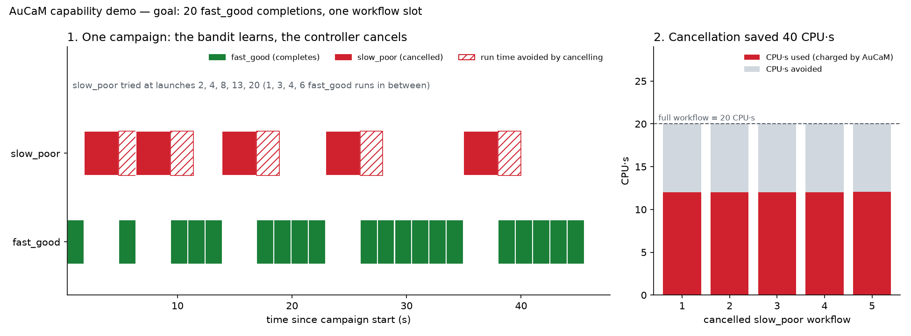

# AuCaM capabilities in one demo

Running a campaign by hand means watching every workflow, stopping the ones
that perform poorly and deciding what to launch next. AuCaM does this on its
own: it follows the results while workflows run, acts on them, and returns the
campaign's outcome to the caller, which can plan the next campaign. The demo in
`campaigns/hpc_campaign/figures/run_impact.py` shows three of these capabilities on a
small example that stands in for the long-running campaigns AuCaM is built for:

1. **Science-driven steering** — the controller makes the scientific decisions
   from each workflow's results. In the demo, its built-in rules cancel
   workflows whose score falls too low; a custom controller can adapt the
   campaign as results arrive: launch workflows with new parameters, change
   goals, or end it early.
2. **Learning scheduler** — the campaign's bandit balances *exploring* (trying
   workflow types it knows little about) with *exploiting* (launching the types
   that complete most often). As evidence accumulates, it shifts launches
   toward the types with the highest observed completion rate, while still
   sampling the others occasionally.
3. **Spending accounting** — AuCaM charges what each workflow spends to the
   campaign and reports it per workflow (`WorkflowResult.spent`) and for the
   campaign (`CampaignOutcome.spent`).

---

## Setup

Two workflow types compete for one workflow slot (`max_concurrent_workflows=1`):

| Type | Requests | Run time | Score | What happens |
|---|---|---|---|---|
| `fast_good` | 1 CPU | 1.5 s | 0.75–0.95 | completes |
| `slow_poor` | 4 CPUs | 5 s | 0.30–0.45, falling | cancelled at ~3 s, once its score drops below 0.30 |

The campaign ends after 20 `fast_good` completions. Its controller keeps one
request of each type queued and has a `CancelRule` for `slow_poor`. Its
scheduling policy is a UCB1 bandit that rewards completed workflows (1) over
cancelled ones (0).

Spending is measured in CPU-seconds. The workflows report none, so AuCaM
charges each the CPUs it was given × the time it actually ran.

---

## Results



Numbers below are from one run; timings vary slightly from run to run.

### 1. Science-driven steering: cancellation (panel 2)

Each `slow_poor` workflow's score falls below 0.30 by its third report (about 3 s), and the
`CancelRule` cancels it. A full workflow would cost 5 s × 4 CPUs = 20 CPU·s; each
cancelled workflow cost 12 CPU·s. Over the 5 `slow_poor` workflows, cancellation saved
**40 CPU·s**, and freed the slot for `fast_good` 2 s earlier each time.

### 2. Learning scheduler (panel 1)

The bandit has to choose between the two queued types each time the slot frees
up. It tries both, sees that `slow_poor` never completes, and tries it less and
less often: at launches 2, 4, 8, 13 and 20, with 1, 3, 4 and then 6 `fast_good`
workflows in between. It keeps re-checking `slow_poor` now and then, in case it has improved.
That is how UCB1 balances exploring against exploiting what it has learned.

### 3. Spending accounting (panel 2)

AuCaM charges every finished workflow in its spending ledger and reports the totals:
per workflow in `WorkflowResult.spent`, per campaign in `CampaignOutcome.spent`.
The campaign spent 90 CPU·s: 30 on `fast_good`, 60 on cancelled `slow_poor`
workflows. With a spending limit (`CampaignBudget.spending`), AuCaM would also stop
launching once the campaign reached it; see [budgets and spending](budget.md).

### The outcome

When the campaign ends, `run()` returns a `CampaignOutcome`: the exit reason,
completions, cancellations and failures per workflow type, time taken,
spending, whether the goal was reached, and the controller's own summary
(`get_summary()`). The caller — a script or an agent — can evaluate it and run
the next campaign, for example without `slow_poor`:

```python
outcome = await CampaignManager().run(explore_spec)
by_type = outcome.summary["by_type"]  # from the controller's get_summary()
next_types = [t for t, s in by_type.items() if s["completed"] > 0]  # ["fast_good"]
```

---

## Not shown in this demo

- **Spending limits and burn-down** — the campaign's spending limit, live
  in-flight estimates, learned cost estimates, and a bandit that explores less as
  the budget runs out; [budgets and spending](budget.md) shows each with a
  figure from a real run.
- **Per-workflow allocations** — each workflow gets its own spending limit and
  CPUs / GPUs, learned from earlier workflows of its type, and is cancelled if
  it goes past them; [budgets and spending](budget.md) §4.
- **Dependencies** — a workflow type can start only after another one finishes
  and passes a condition (`WorkflowDependency`).
- **Command-line workflows** — programs in any language, reporting through the
  `aucam-report` command.
- **Checkpoint and restart** — a campaign's queue, counters and spending survive
  a restart.

See the [campaign developer guide](campaign-developer-guide.md) for how to use
each of these.

---

## Running it

```bash
cd $WORK_DIR/campaign_manager

# Run the demo (~45 s)
python campaigns/hpc_campaign/figures/run_impact.py --json-out /tmp/impact_run.json

# Draw the figure from the JSON output (needs matplotlib)
python -I campaigns/hpc_campaign/figures/gen_impact_fig.py \
    --json-in /tmp/impact_run.json \
    --out docs/figures/aucam_impact.png
```

Expected output (abridged):

```
── Campaign explore: types=['fast_good', 'slow_poor']
  elapsed=45.1s  goal_reached=True  cpu_spent=90.2 CPU·s
    fast_good  runs=20  completed=20  cancelled= 0  cpu=30.0 CPU·s
    slow_poor  runs= 5  completed= 0  cancelled= 5  cpu=60.2 CPU·s
```

---

## Files

| File | Purpose |
|---|---|
| `campaigns/hpc_campaign/figures/run_impact.py` | The demo: workflows, controller, campaign |
| `campaigns/hpc_campaign/figures/gen_impact_fig.py` | Draws the figure from the demo's JSON output |
| `docs/figures/aucam_impact.png` | The figure |
