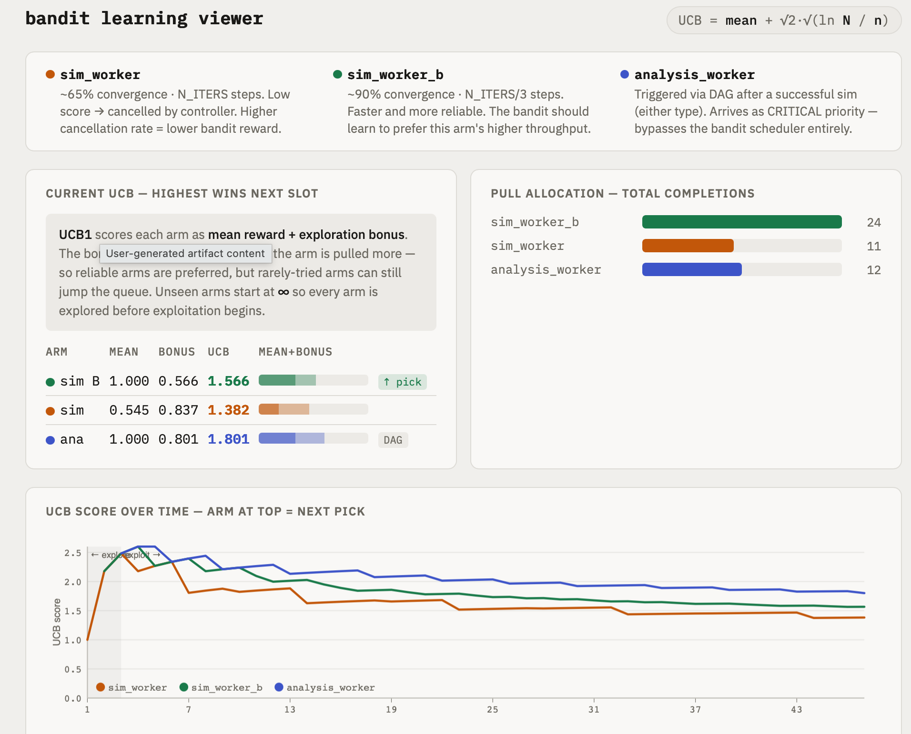
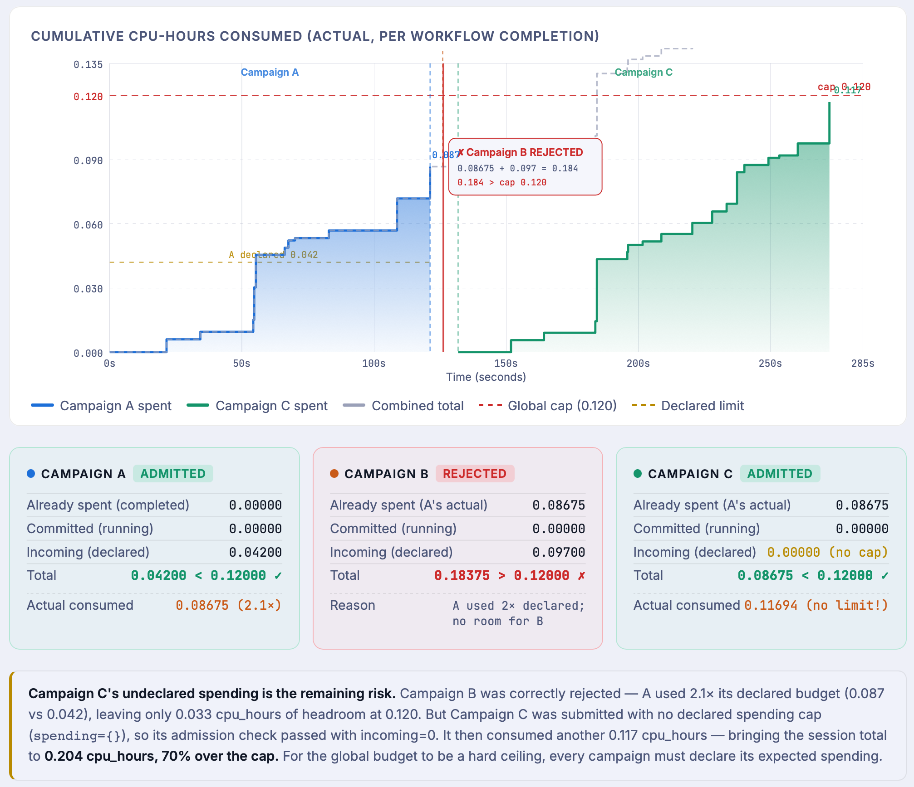

# Dummy Campaign Guide

*A complete walkthrough of `campaigns/demo_campaign/` — the reference implementation for AuCaM.*

---

## What it demonstrates

The demo campaign is the canonical end-to-end example.  It models a realistic sim→analysis pipeline:

- Two competing simulation types (`sim_worker`, `sim_worker_b`) that both feed a downstream analysis step
- Score-based cancellation — low-quality runs are cancelled mid-stream
- A UCB1 (Upper Confidence Bound) bandit scheduler that learns which simulation type is more efficient — it balances exploiting the known-better arm against exploring the other arm, converging toward the faster workflow type over time
- A driver that submits multiple campaigns sequentially and reacts to each outcome
- Global budget enforcement, including a budget rejection when total spending is exceeded
- Full HPC deployment on a two-node allocation using the Dragon backend engine for distributed task execution

---

## File layout

```
campaigns/demo_campaign/
├── run_campaign.py       # entry point: parses config, starts the event loop, drives campaigns
├── controller.py         # ScoreController — campaign policy (cancellation + goal logic)
├── workflows.py          # three async workflow blocks (sim_worker, sim_worker_b, analysis_worker)
├── config.py             # dataclasses and YAML loaders for GlobalConfig + CampaignConfig
├── scheduler.py          # make_policy() — instantiates the scheduling policy from config
│
├── campaign_configs/
│   ├── global.yaml              # CM settings for local dev (engine=concurrent, LocalDictBackend)
│   ├── global_driver_demo.yaml  # driver demo with global spending cap (3 campaigns, 1 rejected)
│   ├── global_hpc.yaml        # CM settings for Dragon/SLURM (engine=dragon, RadexDragonBackend)
│   ├── global_redis.yaml      # CM settings for Redis data backend (engine=concurrent, RhapsodyRedisBackend)
│   ├── campaign.yaml          # campaign template for local dev (short blocks, 3 analyses)
│   └── campaign_hpc.yaml      # campaign template for HPC (longer blocks, 8 analyses)
│
├── delta_sbatch.sh   # complete SLURM batch script for Delta HPC
└── run_dragon_interactive.sh  # helper to launch Dragon interactively
```

---

## The three workflow types

### `sim_worker` — synthetic simulation (65% convergence)

Each instance does `N_ITERS` steps (default: 10 local, 100 HPC).  At startup the run is randomly assigned as converging (~65% probability) or diverging (~35%).  Each step adds Gaussian noise with a positive mean (`+0.05`) for converging runs and a negative mean (`-0.08`) for diverging ones, clipped to `[0, 1]` — this synthesises a score that drifts upward or downward over time.  If the score falls below `score_floor` (default 0.4), `ScoreController` cancels it.

Local timing: 10 × 0.08 s ≈ 0.8 s per run.
HPC timing: 100 × 0.5 s ≈ 50 s per run.

### `sim_worker_b` — fast, reliable simulation (90% convergence)

Same structure as `sim_worker`, but with `N_ITERS_B = N_ITERS // 3` steps and a 90% convergence rate (vs 65%).  It finishes in roughly a third of the time and fails less often.  **The UCB1 bandit should eventually learn to prefer this arm** — UCB1 adds an exploration bonus (`√(2 ln N / nᵢ)`) to each arm's mean reward, so under-tried arms are sampled until the evidence is strong enough to commit; this is the key scheduling demonstration.



The figure above shows a snapshot mid-campaign: `sim_worker_b` has accumulated 24 completions and
sits at UCB 1.566 (mean 1.000, bonus 0.566 from under-sampling relative to `analysis_worker`).
`sim_worker` has 11 completions and UCB 1.382 — lower mean (0.545) due to cancelled runs.  The
bottom chart shows the explore → exploit transition: UCB scores start high for all arms (few
samples, large bonus) and converge downward as evidence accumulates, with `sim_worker_b` settling
above `sim_worker` once the quality difference is statistically clear.

### `analysis_worker` — post-processing step

Triggered only after a successful simulation (either type), via a `WorkflowDependency` DAG edge.  Performs `ANALYSIS_STEPS` iterations of lightweight computation and emits `score=1.0`.  **Goal tracking is done on this type**: the campaign terminates after `goal_analyses` successful `analysis_worker` completions.

When running with asyncflow blocks, all three workflows use `@flow.function_task` to form a DAG inside the block (init → simulate → report for sims; process → summarise for analysis).  On a plain asyncio run (local dev), they fall back to sequential `asyncio.sleep`.

---

## `ScoreController`

Located in `controller.py`.  Subclasses `CampaignController` with:

| Method | What it does |
|--------|-------------|
| `__init__` | Sets `launch=["sim_worker", "sim_worker_b"]`, `goal_type="analysis_worker"`, `goal_n=N` |
| `on_complete` | Increments base counters; collects `score` from `analysis_worker` completions into `_analysis_scores` |
| `is_goal_reached` | Returns `True` when `completed["analysis_worker"] >= goal_n` |
| `get_summary` | Returns `best_score`, `avg_score`, `n_scores`, `scores` list for the driver |

The cancel rule is declarative — passed in the constructor as:

```python
CancelRule(
    workflow_type="sim_worker",     # also covers sim_worker_b implicitly
    when=lambda r: r.score is not None and r.score < score_floor,
)
```

---

## The driver and campaign sequence

`run_campaign.py` contains both a **legacy path** (static `submit_campaign()`) and a **dynamic driver path** (async `_driver()` task).

The driver path:

```python
async def _driver(cm):
    for i in range(num_campaigns):
        spec = _make_spec(name=f"demo-campaign-{chr(ord('a')+i)}", ...)
        result = await cm.submit(spec)
        if result.accepted:
            outcome = await result.wait()
            # log outcome.spent, outcome.summary.best_score, etc.
        else:
            logging.warning("REJECTED: %s", result.reason)

async def main():
    cm = CampaignManager(...)
    cm.expect_driver()                        # declare one driver is coming
    driver_task = asyncio.create_task(_driver(cm))
    await driver_task                         # wait for all submissions to finish
    cm.close()                                # signal no more submissions
    await cm.run()
```

Each call to `_make_spec()` builds a fresh `CampaignSpec` from the loaded `CampaignConfig`, with a unique name (`demo-campaign-a`, `demo-campaign-b`, …).  Spending limits come directly from `budget.spending` in the campaign YAML.

After each campaign finishes (when spending is declared and summary is non-empty), the driver logs:

```
[DRIVER] demo-campaign-a: actual spent: cpu_hours=0.00287
[DRIVER] demo-campaign-a: science summary — n_scores=3  best=1.000  avg=0.867
```

When running with multiple campaigns, the transition log appears before each subsequent submission:

```
[DRIVER] demo-campaign-a → planning demo-campaign-b | prev: goal_reached=True  cancel_rate=25%  analyses=3  elapsed=2.9s
```

---

## Running locally

```bash
cd campaigns/demo_campaign

# Minimal run — single campaign, LocalDictBackend (in-process, no external services)
python run_campaign.py \
    --global-config  campaign_configs/global.yaml \
    --campaign-config campaign_configs/campaign.yaml

# Redis data backend — concurrent execution, RhapsodyRedisBackend for CM↔workflow channel
# Requires redis-server on PATH or set via redis_server_path in global_redis.yaml
python run_campaign.py \
    --global-config  campaign_configs/global_redis.yaml \
    --campaign-config campaign_configs/campaign.yaml

# Driver demo — 3 campaigns, global cap rejects the third
python run_campaign.py \
    --global-config  campaign_configs/global_driver_demo.yaml \
    --campaign-config campaign_configs/campaign.yaml

```

`global_driver_demo.yaml` sets `global_budget.spending.cpu_hours: 0.009`.  `campaign.yaml` declares `0.004` per campaign.  After a and b run (actual spend ≈ 0.0053 cumulative), campaign c's declared `0.004` would push the total to `0.0093 > 0.009`, so it is rejected before any workflows start.

Expected output:

```
[DRIVER] demo-campaign-a: accepted
[CM] Campaign demo-campaign-a SUMMARY — exit=controller_terminate run=17 ok=13 cancelled=4 ...
[DRIVER] demo-campaign-a: actual spent: cpu_hours=0.00271
[DRIVER] demo-campaign-a: science summary — n_scores=3  best=1.000  avg=1.000
[DRIVER] demo-campaign-a → planning demo-campaign-b | prev: goal_reached=True  cancel_rate=23%  analyses=3  elapsed=2.6s
[DRIVER] demo-campaign-b: accepted
[DRIVER] demo-campaign-b: actual spent: cpu_hours=0.00260
[DRIVER] demo-campaign-b: science summary — n_scores=3  best=1.000  avg=1.000
[DRIVER] demo-campaign-b → planning demo-campaign-c | prev: goal_reached=True  cancel_rate=11%  analyses=3  elapsed=2.5s
[DRIVER] demo-campaign-c: rejected — global spending[cpu_hours]=0.009 would be exceeded (spent=0.00531, committed=0.00000, requesting=0.00400, total=0.00931)
```



The figure above shows the same mechanic at HPC scale (global cap 0.120 cpu_hours).  Campaign A
is admitted and runs, consuming 2.1× its declared budget (actual 0.087 vs declared 0.042 —
simulations ran longer than expected).  Campaign B is submitted next: the CM adds A's actual spend
(0.087) to B's declared budget (0.097) and gets 0.184 > 0.120, so B is rejected immediately.
Campaign C is then submitted with no declared spending cap (`spending={}`); its incoming declared
cost is 0 so the admission check passes — but it then consumes another 0.117 cpu_hours, bringing
the session total to 0.204, **70% over the global cap**.  The lesson: `spending={}` bypasses the
admission gate.  For a hard ceiling every campaign must declare its expected spending.

---

## Running on Delta HPC (Dragon)

The SLURM batch script `delta_sbatch.sh` handles everything:

```bash
sbatch delta_sbatch.sh
```

It requests a two-node allocation and supports two execution modes, selected via the `ENGINE` variable at the top of the script:

- **`dragon`** (default) — uses the Dragon backend for distributed execution across both nodes; workflows run as Dragon `function_task`s and communicate via `RadexDragonBackend` over DDict.
- **`concurrent`** — runs the campaign manager as a plain Python process on the head node using the concurrent execution backend; useful for debugging campaign logic without Dragon overhead.

Spending limits and global cap are read from `campaign_hpc.yaml` and `global_hpc.yaml` respectively.

After the job completes, telemetry JSONL is in `aucam-tel-$SLURM_JOB_ID/`.

---

## Config quick reference

### Local dev — `LocalDictBackend` (`global.yaml` + `campaign.yaml`)

```
engine: concurrent | data_backend: auto (→ local) | asyncflow_blocks: false
campaign: 3 analyses goal | 4 max concurrent | no spending limit
sim_worker: 10 iters × 0.08 s (~0.8 s) | analysis: 2 steps
```

### Local dev — `RhapsodyRedisBackend` (`global_redis.yaml` + `campaign.yaml`)

```
engine: concurrent | data_backend: redis | asyncflow_blocks: false
redis_server_path: /path/to/redis-server   # required; redis-server is not pip-installable
campaign: same as local dev
```

### HPC — `RadexDragonBackend` (`global_hpc.yaml` + `campaign_hpc.yaml`)

```
engine: dragon | data_backend: auto (→ dragon) | asyncflow_blocks: true | num_campaigns: 3
campaign: 8 analyses goal | 3 max concurrent | spending set via CLI
global: cpu_hours: 0.120 cap
sim_worker: 100 iters × 0.5 s (~50 s) | analysis: 20 steps (~10 s)
```

### YAML fields that matter most

| File | Field | Effect |
|------|-------|--------|
| `global*.yaml` | `data_backend` | `auto` \| `dragon` \| `redis` \| `local`; `auto` matches the engine |
| `global_redis.yaml` | `redis_server_path` | Path to `redis-server` binary (required for Redis backend) |
| `global_hpc.yaml` | `global_budget.spending.cpu_hours` | Global cap that triggers rejection |
| `global_hpc.yaml` | `num_campaigns` | How many campaigns the driver submits |
| `global_hpc.yaml` | `driver.delay_s` | Pause between submissions |
| `campaign_hpc.yaml` | `controller.goal_analyses` | When each campaign stops |
| `campaign_hpc.yaml` | `controller.score_floor` | Cancellation threshold |
| `campaign_hpc.yaml` | `budget.spending.cpu_hours` | Per-campaign spending limit |

---

## See also

→ **[CM Advantages Over Independent Execution](cm-advantages.md)** — a self-contained experiment
(`run_impact.py`) that runs 8 sequential campaigns sharing one bandit and measures the three-feature
impact (cancellation, bandit learning, backpressure reduction) in a single local run.

---

## Extending the demo campaign

To adapt it for a real science use case:

1. **Replace `workflows.py`** with your actual simulation and analysis blocks.  Keep the `reporter.emit(score=..., metrics={...})` calls so the controller can see intermediate results.
2. **Subclass `ScoreController`** or write a new `CampaignController` subclass.  The `on_complete`/`is_goal_reached`/`get_summary` pattern is the same.
3. **Update `campaign_configs/campaign.yaml`** with realistic timing and budget numbers for your workflow.
4. **Update `delta_sbatch.sh`** with the correct node count and walltime; set spending limits in `campaign_hpc.yaml`.
